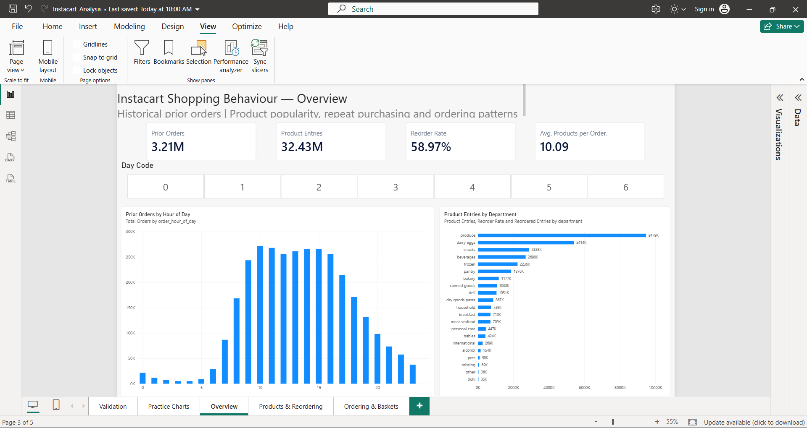
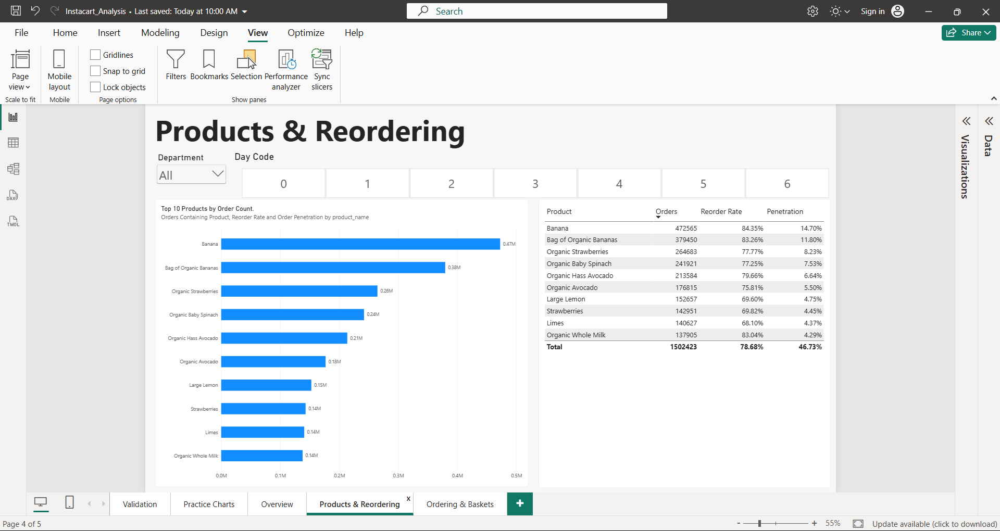
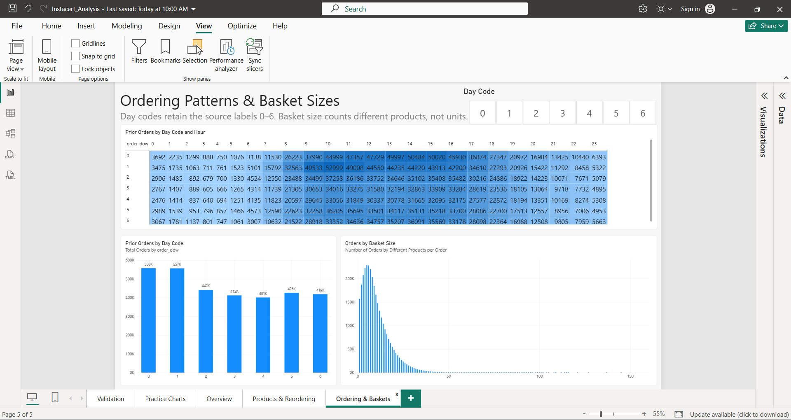
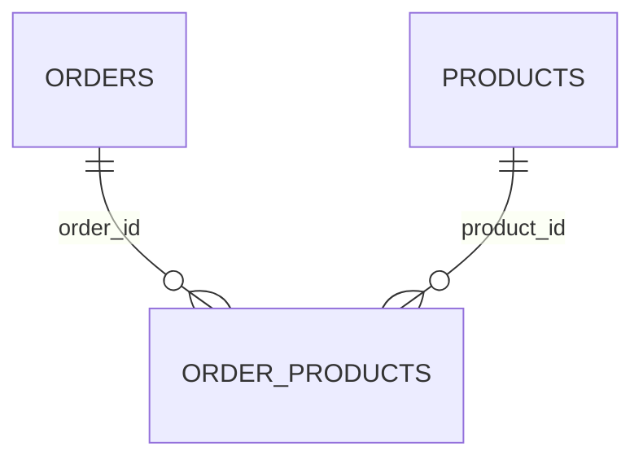

# Instacart Shopping Behaviour — SQL Server & Power BI

I analysed **3.21 million historical orders** and **32.43 million order-product entries** to investigate product popularity, repeat purchasing, ordering patterns and basket sizes. I built a validated SQL reporting layer and a three-page interactive Power BI report.

**Tools:** SQL Server · SSMS · Power Query · Power BI Desktop · DAX · GitHub

A separate [Python reorder prediction milestone](#reorder-prediction-ml-v1) builds on the historical analysis.

## Key findings

| Question | Finding |
|---|---|
| Which product appears in the most orders? | **Banana: 472,565 orders**, or **14.70%** of prior orders |
| How common are repeat purchases? | **58.97%** of product entries are marked as reordered |
| Which department leads volume? | **Produce: 9,479,291 product entries** |
| Which department has the highest reorder rate? | **Dairy eggs: 67.00%** |
| When are orders most frequent? | **Hour 10: 271,885 orders**; the busiest day/hour slot is **day code 1, hour 10: 52,999** |
| How large are baskets? | Mean **10.09** different products; mode **5**; observed range **1–145** |

These are historical descriptive findings. Product entries measure distinct products within orders, not units, sales, revenue or profit. Reorder rate measures repeat-marked entries, not customer retention.

## Report preview

### Overview

Four baseline KPIs, hourly ordering activity and department product-entry volume.

### Products & Reordering

Top-ten product comparisons with orders containing each product, reorder rate and order penetration.

### Ordering & Baskets

Day/hour heatmap, daily ordering totals and the basket-size distribution.

**Interactions:** Day Code is synced across all three pages. Department applies only on Products & Reordering. Product filters flow to OrderProducts; they do not flow back to Orders. Penetration uses all prior orders in the selected day context as its denominator.

## Reorder Prediction (ML v1)

I trained a Python logistic regression model to rank products a customer had already purchased by how likely they were to reorder them. It uses past purchase counts, the share of prior orders containing each product, and how many orders have passed since the last purchase.

Both approaches made 4,646 predictions across 480 held-out orders, with up to 10 recommendations per order. Customers were separated across training, validation and test sets.

| Test metric | Purchase-frequency baseline | Logistic regression |
|---|---:|---:|
| Correct reorders identified (out of 3,012) | 1,352 | **1,390** |
| Mean per-order F1 | 0.3336 | **0.3424** |

See the [evaluation script](scripts/evaluate_ml_test_v1.py) and [held-out test metrics](docs/validation_evidence/ml_reorder_v1_test_metrics.json). These results are from the project's held-out split.

## Data and scope

Source: [Instacart Market Basket Analysis on Kaggle](https://www.kaggle.com/c/instacart-market-basket-analysis/data). Review the source's access terms and documentation before downloading. Raw CSV files are downloaded separately.

| Input | Rows |
|---|---:|
| departments.csv | 21 |
| aisles.csv | 134 |
| products.csv | 49,688 |
| orders.csv | 3,421,083 |
| order_products__prior.csv | 32,434,489 |

The report uses **3,214,874 prior orders**. Train/test order metadata is present in staging, but train/test product entries are outside the analysis. Day codes remain **0–6**; weekday names have not been assigned. The source's previous-order gaps are capped at 30 days, and first-order gaps remain NULL.

## Workflow and validation

1. Import five source files into a `staging` schema.
2. Check row counts, key uniqueness, NULLs, accepted ranges, references and duplicate order/product pairs.
3. Answer product, reorder, department, ordering-time and basket questions with SQL.
4. Create three reporting views and reconcile their coverage and totals.
5. Import the views into Power BI, define relationships and seven measures, build the report and compare its results with SQL.

Reporting checks preserve **32,434,489 entries**, **19,126,536 reordered entries**, and **3,214,874 prior orders**, with **zero unmatched product/order references**. The sum of order-level basket sizes equals the product-entry total.

## Power BI model

| Table | Reporting view | Grain |
|---|---|---|
| Products | reporting.dim_products | One product |
| Orders | reporting.fact_orders | One prior order |
| OrderProducts | reporting.fact_order_products | One product within an order |

Both active relationships filter in one direction, from the one side to OrderProducts. The [technical report](docs/SQL_PROJECT_REPORT.md) contains the seven DAX definitions, filter-context behaviour, validation examples, per-script findings and detailed product/department results.

## Run locally

1. Download the source files and install SQL Server, SSMS and Power BI Desktop.
2. Run `sql/00_environment_check.sql`, then `sql/01_create_database.sql`.
3. Adapt CSV paths in scripts **02–06** to locations the SQL Server service can read.
4. Run scripts **02–07** in numeric order and review their checks. Existing nonempty tables skip import, so validate them before proceeding.
5. Run analyses **08–17**, then reporting views/checks **18–21**.
6. In Power BI Desktop, connect to the local SQL Server database `InstacartAnalytics` using **Import**. Select the three reporting views, create the relationships and measures described in the technical report, then reproduce the pages above.
7. Save the report locally as `powerbi/Instacart_Analysis.pbix`. To refresh an existing report on another computer, update its data-source settings and authenticate against that computer's SQL Server instance.

CSV data, database backups and the Desktop binary are not included in the documentation package. The screenshots show the completed local report. Before adding the `.pbix`, check its size: GitHub blocks normal Git files above **100 MiB**. Use [Git LFS](https://docs.github.com/en/repositories/working-with-files/managing-large-files/about-git-large-file-storage) or a separate download route when required; see [GitHub's file-size guidance](https://docs.github.com/en/repositories/working-with-files/managing-large-files/about-large-files-on-github).

## Repository guide

| Path | Content |
|---|---|
| `sql/00_...` | Environment inspection |
| `sql/01_...` through `sql/07_...` | Setup, ingestion and validation |
| `sql/08_...` through `sql/17_...` | Exploratory and business analysis |
| `sql/18_...` through `sql/21_...` | Reporting views and reconciliation |
| `docs/SQL_PROJECT_REPORT.md` | Technical project report, findings and DAX |
| `docs/images/` | Three final Power BI page screenshots |

## Learning value

This project demonstrates SQL joins, CTEs, aggregation, safe percentage calculations, data-quality checks, reporting grains, Power Query, Power BI relationships, DAX and filter context. Students can extend the practice by explaining the difference between order penetration and reorder rate, reproducing filtered checks, and explaining why distinct-order totals cannot be added across products.

The SQL and Power BI milestone covers local reporting. Power BI Service publication and scheduled refresh are outside its scope. Reorder prediction is documented separately above.

**Author:** [Saurabh Zambare](https://github.com/Saurabhzambare)
