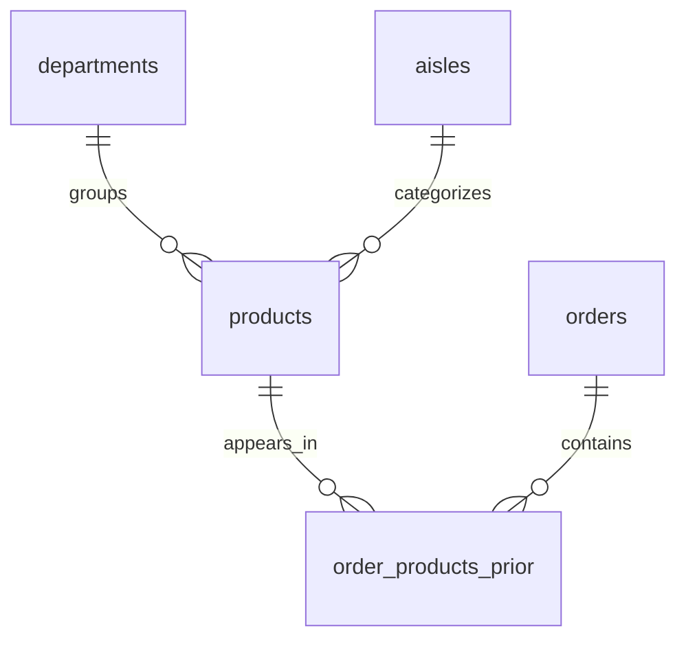

# Instacart BigQuery Loading and Reconciliation Runbook

**Owner:** Saurabh Lalit Zambare  
**Version:** 1.0  
**Verified through:** 1 November 2026  
**Status:** Five-table cloud loading, configured quality checks, and three analytical comparisons passed. Source/evidence publication is the next checkpoint.  
**Committed exporter baseline:** `c90c4f0`  
**Companion:** [Cloud subset exporter](CLOUD_SUBSET_RUNBOOK.md), [scope](PROJECT_SCOPE.md), [roadmap](PROJECT_ROADMAP.md)

## Purpose

This milestone demonstrates that the small, related Instacart subset can be loaded into Google BigQuery, checked, and used to reproduce selected SQL Server results. Reconciliation means comparing the same metrics over the same selected data in both systems.

The local source still contains the full accepted baseline. BigQuery contains the named 5,000-user subset. Always use the selected users and prior-order filter when comparing analytical results. The original full-data Power BI findings describe a different population.

## 1. Dataset and environment

| Item | Accepted configuration |
| --- | --- |
| Google Cloud project name | Instacart Analytics Practice |
| Project ID | `instacart-analytics-practice` |
| BigQuery mode | Sandbox; no billing upgrade performed in this milestone |
| Dataset | `instacart_raw` |
| Dataset location | US multi-region, selected in the guided setup |
| Saved-query code location | `us-central1` (Iowa), selected in the guided setup |
| Export label | `instacart_cloud_5000_users_v1` |
| Accepted export run | `ea95847fec9d4b6b864f0903f7a30a63` |
| Local export directory | `D:\DataProjects\Instacart\exports\cloud_5000_users_v1` |
| SQL Server database | `InstacartAnalytics` |
| Local source schema | `pipeline_staging` |

The data location and saved-code location are separate settings. The successful project/dataset/query screens were reviewed, but no independent cloud schema/location metadata extract or load/query job-ID record was collected.

### Subset selection

Choose the 5,000 lowest user IDs from all-order metadata. Retain all their order metadata, the entries belonging to their prior orders, the referenced products, all 134 aisles, and all 21 departments. The resulting subset is deterministic and reproducible; it is not a random or representative sample.

| Object | Accepted rows |
| --- | ---: |
| departments | 21 |
| aisles | 134 |
| referenced products | 28,854 |
| all selected order metadata | 81,832 |
| selected prior orders | 76,832 |
| selected train orders | 3,200 |
| selected test orders | 1,800 |
| prior order-product entries | 761,750 |
| reordered entries | 448,380 |

The separate `order_products__train.csv` label file is outside this milestone. Train/test order metadata does not provide missing product labels for the official test cohort.

### Relationships used by the checks

This diagram describes the join relationships checked by the queries, not declared or enforced BigQuery foreign keys. Orders include train/test metadata with no product entries in this five-file export.

## 2. Create the project and dataset

1. Open [BigQuery Studio](https://console.cloud.google.com/bigquery), authenticate, and select or create the practice project.
2. Confirm the Sandbox banner.
3. Create dataset `instacart_raw` in the US multi-region. Dataset location cannot be changed after creation.
4. Keep default encryption and sandbox expiration settings. An external dataset is not required.

The project was created and the dataset appeared empty before the first upload. All five tables were then loaded individually through the console's Create Table flow. This was manual batch loading, not a Python-to-BigQuery upload integration.

## 3. File and schema contract

Use the verified files from the export directory, not the original full-data downloads. The original input hashes describe different bytes; the subset manifest describes these exported files.

All fields use mode `NULLABLE` in the guided load contract. The quality queries explicitly count invalid NULLs. These checks establish the observed data state; declaring nullable fields does not enforce required-ID rules on future loads.

| Table | Source filename | Fields in source order |
| --- | --- | --- |
| `departments` | `departments.csv` | `department_id INTEGER`, `department STRING` |
| `aisles` | `aisles.csv` | `aisle_id INTEGER`, `aisle STRING` |
| `products` | `products.csv` | `product_id INTEGER`, `product_name STRING`, `aisle_id INTEGER`, `department_id INTEGER` |
| `orders` | `orders.csv` | `order_id INTEGER`, `user_id INTEGER`, `eval_set STRING`, `order_number INTEGER`, `order_dow INTEGER`, `order_hour_of_day INTEGER`, `days_since_prior_order NUMERIC` |
| `order_products_prior` | `order_products__prior.csv` | `order_id INTEGER`, `product_id INTEGER`, `add_to_cart_order INTEGER`, `reordered INTEGER` |

BigQuery `INTEGER` is an alias for `INT64`. `NUMERIC` preserves decimal order-gap values. A first-order gap is NULL; a later gap of zero is a valid value. The order-product CSV filename has two underscores before `prior`; the BigQuery table name has one.

### Shared CSV options

| Setting | Value |
| --- | --- |
| Create table from | Upload |
| Destination | Selected practice project and `instacart_raw` dataset |
| Format / table type | CSV / native table |
| Auto-detect schema | Unchecked; enter fields explicitly in source order |
| Header rows to skip | 1 |
| Source column matching | Position, or the default with explicit schema |
| Field delimiter | Comma |
| Quote character | Double quote |
| Allow quoted newlines | Checked |
| Number of errors allowed | 0 |
| Allow jagged rows | Unchecked |
| Ignore unknown values | Unchecked |
| Null markers | Default empty-field behavior; no custom marker |
| Encoding | UTF-8 default; the console does not expose an Encoding control in this flow |
| Partitioning / clustering | No custom partitioning or clustering selected |

An empty numeric CSV field loads as NULL with the default marker. Keep quoted-newline support because CSV text can contain embedded newlines. These options are the documented reproduction contract; no independent load-job configuration export was collected.

Create each table once in this order: departments, aisles, products, orders, prior entries. For a repeat load, first inspect existing tables and the selected write action. An append into an existing table can duplicate records. No production replace/append automation was implemented here.

## 4. Quality checks and saved queries

Run each query in BigQuery after its table finishes loading. Save it through Save > Save query, and keep the matching SQL source in `cloud/bigquery` for Git. Saving query text, saving query results, and storing table data are different operations.

| SQL file in `cloud/bigquery` | Verified checks |
| --- | --- |
| `01_validate_departments.sql` | 21 rows, 21 unique IDs, zero missing IDs, zero blank/missing names, zero out-of-range IDs |
| `02_validate_aisles.sql` | 134 rows, 134 unique IDs, zero missing IDs, zero blank/missing names, zero nonpositive IDs |
| `03_validate_products.sql` | 28,854 rows and unique IDs; all five ID/name/value/reference error counts zero |
| `04_validate_orders.sql` | 81,832 rows and unique IDs; 5,000 users; prior/train/test counts 76,832/3,200/1,800; all seven error counts zero |
| `05_validate_order_products_prior.sql` | 761,750 rows; 76,832 orders; 28,854 products; 448,380 reordered entries; all eight error counts zero |

The prior-entry checks include duplicate `(order_id, product_id)` groups, missing/nonpositive IDs, cart position, reordered flag, unmatched order/product references, and entries linked to a non-prior order. Day codes remain 0-6 without assigning weekday names. The gap check requires first-order NULLs, later non-NULL gaps, and a 0-30 range.

The product and prior-entry validation queries use joins to lookup tables whose key uniqueness was already verified. Preserve that dependency order; duplicate parent keys could multiply joined rows.

The observed zero counts establish the configured checks for this load. They are not a claim that every possible data-quality rule has been tested or that BigQuery is enforcing the relationships as foreign keys.

## 5. SQL Server / BigQuery reconciliation

| Comparison | SQL Server file in `sql` | BigQuery file in `cloud/bigquery` | Reviewed result |
| --- | --- | --- | --- |
| Prior orders by hour | `cloud_subset_orders_by_hour.sql` | `06_orders_by_hour.sql` | All 24 rows match |
| Department metrics | `cloud_subset_department_analysis.sql` | `07_department_analysis.sql` | All 21 rows match |
| Top products | `cloud_subset_top_products.sql` | `08_top_products.sql` | All 10 rows match, including order |

Run the SQL Server files in SSMS against `InstacartAnalytics`; run the GoogleSQL files in BigQuery. The local files reproduce `TOP (5000) user_id ... GROUP BY user_id ORDER BY user_id` before filtering prior orders. The cloud files use the already-selected dataset and the same `eval_set = 'prior'` filter.

These three comparisons cover 55 displayed result rows. All IDs, labels, integer metrics, and displayed two-decimal percentages matched in the paired screenshots. This is a manual aggregate reconciliation, not a row-by-row automated database comparison.

### Hourly result

All hours 0-23 matched. Their counts sum to 76,832. Hour 10 has the highest count, 6,559 orders, in this subset. The complete reviewed 24-row result is retained in the evidence JSON.

### Department result

All 21 departments matched on product entries, distinct orders, reordered entries, and reorder percentage. Entries sum to 761,750; reordered entries sum to 448,380. Department order counts overlap because one basket can contain products from multiple departments; do not sum them as a unique total-order count. The literal department name `missing` is a source category, not a failed join.

### Top-product result

Ranking uses `prior_orders_with_product DESC, product_id ASC`, so tied counts have a stable order. The accepted leading product is Banana, product ID 24852: 10,625 orders, 8,879 reordered entries, and 83.57% reorder rate. All ten reviewed products and values are retained in the evidence JSON.

Do not compare these values directly with full-population dashboard findings. No generalization to the full customer population is claimed from this deterministic subset.

## 6. SQL dialect differences

| Concern | SQL Server | BigQuery |
| --- | --- | --- |
| Qualification | `pipeline_staging.orders` after `USE InstacartAnalytics` | Backtick-qualified project.dataset.table |
| Batch separator | SSMS uses `GO` | Do not paste `USE InstacartAnalytics` or `GO` into these GoogleSQL queries |
| Top products | `SELECT TOP (10)` | `LIMIT 10` after ordering |
| Large counts | `COUNT_BIG` | `COUNT`, returning INT64 |
| Conditional counts | SUM/CASE or SUM of the verified 0/1 flag | `COUNTIF` |
| Decimal percentage | `CAST(... AS DECIMAL(10,2))` with `NULLIF` denominator | NUMERIC numerator, `SAFE_DIVIDE`, then `ROUND(...,2)` |
| Display zeros | SQL Server shows `79.90` | BigQuery can display `79.9`; these are numerically equal |

Reorder rate is reordered entry rows divided by all entry rows, multiplied by 100. It is not customer retention or a quantity/revenue measure. A product appears at most once per order in the validated entry grain, so entry count equals orders containing that product for the product-level comparison.

## 7. Evidence provenance

- [Review record and all normalized result rows](cloud_evidence/reconciliation_review.json)
- [Original screenshots](cloud_evidence/screenshots/)
- [Accepted exported-file manifest](validation_evidence/cloud_subset_manifest.json)
- [Successful exporter run](validation_evidence/cloud_export_recovery_pass.json)
- [Original exporter failure](validation_evidence/cloud_export_temp_scope_fail.json)
- [Hosted CI run for the exporter checkpoint: 71 tests passed](https://github.com/Saurabhzambare/instacart-sql-powerbi-analysis/actions/runs/41203173411)

The evidence JSON is a review record transcribed from the owner's screenshots. It includes the five validation summaries, one normalized result set for each paired comparison, attachment provenance, and screenshot byte-size/SHA-256 records. Numeric percentage formatting is normalized to two decimals. Totals and displayed percentages were recalculated from the transcribed integers as a consistency check. It is not an export produced by SQL Server or BigQuery and does not contain fabricated job IDs.

Original screenshots are copied without editing. They provide the audit trail for the transcribed values. No claim is made that the assistant connected directly to the owner's SQL Server or queried the BigQuery project. The subset file integrity checks and earlier hosted CI results have their own separate evidence.

## 8. Completion and limits

| Item | State |
| --- | --- |
| Five-file subset export | Verified and committed at `c90c4f0` |
| Exported file size/hash verification | All five matched the manifest |
| BigQuery project/dataset and five manual table loads | Verified in the guided session |
| Configured table-quality results | Passed for all five tables |
| Hourly / department / top-product comparisons | 24 / 21 / 10 rows matched |
| SQL source files | Eight cloud files and three local reference files visible in GitHub Desktop, pending commit |
| Current runbook/evidence/scope/roadmap package | Prepared for copying, review, commit and push |
| Hosted tests for the next commit | Pending that commit and push |
| Programmatic cloud upload / parity checker | Not implemented |
| dbt build/tests/docs | Next gated learning milestone |
| ML / Airflow / delivery / deployment | Future or conditional work |

Sandbox tables/views expire after 60 days and DML/streaming are unavailable. Preserve source files, contracts, SQL, and selected evidence so the demonstration can be reproduced. Consult current sandbox quotas before another load. The selected file/aggregate checks do not prove every exported row's semantic identity, production availability, enterprise GCP administration, or unattended recovery.

## 9. Commit and next handoff

1. Copy this documentation package into the repository root, preserving relative folders.
2. Keep the eight BigQuery SQL files and three SQL Server reference files already saved locally.
3. Review the new source/docs/evidence files in GitHub Desktop. Commit and push the accepted cloud milestone.
4. Confirm the next GitHub Actions run succeeds. Existing CI checks Python behavior; it does not connect to this BigQuery project or prove these SQL results automatically.
5. Proceed to DBT-01: in a separate compatible environment, prove the intended adapter can create a tiny model and run tests within the available warehouse constraints. Document a local DuckDB fallback accurately if BigQuery/adapter constraints block the intended path.

No additional analytical query is required to close this scoped reconciliation demonstration. Raw CSV exports remain outside Git. Add detailed load/query job metadata or an automated comparison only if a later scope decision requires it.

## References

- [Google Cloud: BigQuery sandbox](https://docs.cloud.google.com/bigquery/docs/sandbox)
- [Google Cloud: Batch loading](https://docs.cloud.google.com/bigquery/docs/batch-loading-data)
- [Google Cloud: CSV load options](https://docs.cloud.google.com/bigquery/docs/loading-data-cloud-storage-csv)
- [Google Cloud: Create saved queries](https://docs.cloud.google.com/bigquery/docs/work-with-saved-queries)
- [Google Cloud: Locations and Studio code asset locations](https://docs.cloud.google.com/bigquery/docs/locations)
- [Google Cloud: Numeric types](https://docs.cloud.google.com/bigquery/docs/reference/standard-sql/data-types)
- [Google Cloud: SAFE_DIVIDE](https://docs.cloud.google.com/bigquery/docs/reference/standard-sql/mathematical_functions#safe_divide)
