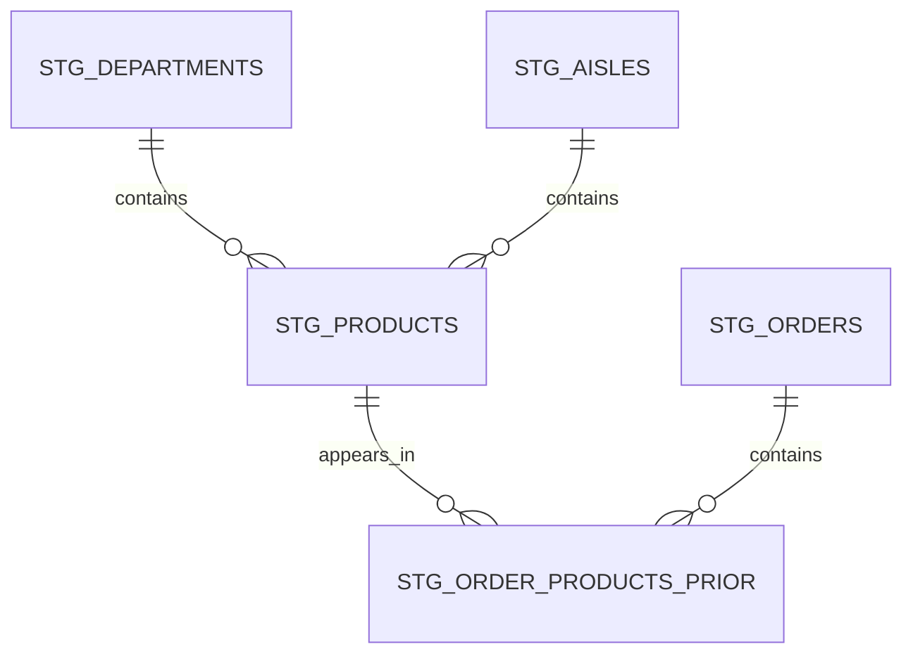

# Instacart dbt Staging Runbook

**Project owner:** Saurabh Lalit Zambare  
**Prepared:** 1 November 2026  
**Scope:** Local dbt Core connected to the verified BigQuery cloud subset  
**Last confirmed Git checkpoint before the staging extension:** `b6d7a5e` — Add verified dbt BigQuery departments model and tests

The complete staging build has been verified from the supplied terminal output: **5 view models, 33 data tests, PASS=38, WARN=0, ERROR=0, exit code 0**. The final BigQuery query confirmed all four prior-entry totals. The complete build report was checked and archived as `dbt_staging_build_pass.json`. Documentation generation completed with exit code 0, and the refreshed catalog contained five model views and five source tables with no reported catalog errors. That catalog was archived as `dbt_staging_catalog.json`. The extension is ready for Git review; its final commit and push were not yet confirmed when this revision was prepared.

## 1. Purpose and boundaries

This milestone introduces dbt to the existing Instacart project. Python previously validated and loaded the full baseline into SQL Server, and exported a deterministic 5,000-user subset. The subset was uploaded to BigQuery and reconciled with SQL Server. dbt now exposes that cloud data through documented staging views and runs repeatable data tests.

The staging models select explicitly named columns from existing source tables. Their SQL does not join, aggregate, filter, or deduplicate the source data. The tests detect violations rather than silently remove problematic rows.

The next transformation layer can use these staging models to build analytical models. Analytical marts, dbt execution in hosted CI, scheduling, and deployment are separate future milestones.

## 2. Verified environment

| Component | Verified value | Purpose |
|---|---|---|
| Main Python project | Python 3.14.3 | Existing Python loading and validation automation |
| dbt Python environment | Python 3.12.12, `.venv-dbt` | Separate runtime for dbt |
| dbt Core | 1.12.6 | Compiles models, creates views, and runs tests |
| BigQuery adapter | 1.12.1 | Connects dbt Core to BigQuery |
| uv | 0.13.1 | Creates environments and manages Python packages |
| Installed dbt environment | 105 packages; compatibility check passed | Includes indirect dependencies |
| Google Cloud CLI | 591.0.0 | Local Google authentication and project configuration |
| Authentication | OAuth through Application Default Credentials (ADC) | Allows Google client libraries to authenticate |
| BigQuery project | `instacart-analytics-practice` | Contains the source and output datasets |
| Source dataset | `instacart_raw` | Previously uploaded CSV subset |
| Output dataset | `instacart_dbt` | dbt staging views |
| Data/query location | `US` | Matches the source dataset |
| Threads | 1 | Runs one dbt task at a time |
| BigQuery environment | Sandbox | Verified for these view builds and SELECT-based tests |

The successful build proves this particular runtime, authentication method, and view/test workload worked together. It does not establish compatibility for every dbt materialization or future workload.

## 3. Dataset contract

The exporter selected the 5,000 lowest user IDs, retained all their orders, and retained product entries for their prior orders. Product lookup rows were restricted to referenced products; departments and aisles remained complete lookups. This is a deterministic engineering subset, not a random or representative sample.

| Source table | Staging view | Rows | Grain |
|---|---|---:|---|
| `departments` | `stg_departments` | 21 | One department |
| `aisles` | `stg_aisles` | 134 | One aisle |
| `products` | `stg_products` | 28,854 | One referenced product |
| `orders` | `stg_orders` | 81,832 | One order |
| `order_products_prior` | `stg_order_products_prior` | 761,750 | One product within one prior order |

| Additional metric | Verified value |
|---|---:|
| Selected users | 5,000 |
| Prior orders | 76,832 |
| Train orders | 3,200 |
| Test orders | 1,800 |
| Distinct orders represented by prior product entries | 76,832 |
| Distinct products represented by prior product entries | 28,854 |
| Reordered prior product entries | 448,380 |

The CSV filename is `order_products__prior.csv` with two underscores before `prior`. Its BigQuery table is `order_products_prior` with one underscore. The dbt source declaration uses the BigQuery table name.

## 4. Relationships and keys

This diagram shows data relationships. It is not a diagram of SQL joins inside the staging models: those models each read one source table.



| Model | Tested key | References |
|---|---|---|
| `stg_departments` | `department_id` | None |
| `stg_aisles` | `aisle_id` | None |
| `stg_products` | `product_id` | `aisle_id`, `department_id` |
| `stg_orders` | `order_id` | No separate user model in this milestone |
| `stg_order_products_prior` | Pair: `order_id`, `product_id` | `order_id`, `product_id` |

An order can contain many products, and a product can appear in many orders. Each ID can repeat in the entry model, so uniqueness is checked on the pair. The tests validate data properties; they do not create enforced database key constraints.

## 5. Folders and files

Paths below are relative to the repository root, `D:\DataProjects\Instacart\instacart-sql-powerbi-analysis`.

| Path | Purpose |
|---|---|
| `.venv-dbt/` | Local Python 3.12 dbt environment; ignored by Git |
| `dbt_instacart/` | Root of the dbt project |
| `dbt_instacart/dbt_project.yml` | Project identity, profile name, resource paths, version requirement, and default view materialization |
| `dbt_instacart/profiles.yml` | OAuth connection settings for project, dataset, location, and threads; contains no credential token in the supplied configuration |
| `dbt_instacart/.gitignore` | Excludes generated output and local dbt user settings |
| `dbt_instacart/requirements-dbt-py312-windows.txt` | Installed dependency-version snapshot for Windows and Python 3.12 |
| `dbt_instacart/models/sources.yml` | Declares the five existing BigQuery source tables |
| `dbt_instacart/models/staging/` | Staging model SQL and associated model properties |
| `dbt_instacart/tests/` | Six custom SQL data tests |
| `dbt_instacart/target/` | Generated manifest, catalog, compiled SQL, and run results; ignored |
| `dbt_instacart/logs/` | dbt execution logs; ignored |
| `dbt_instacart/dbt_packages/` | Installed dbt packages if used later; ignored |
| `dbt_instacart/.user.yml` | Local dbt user settings; ignored |
| `tests/` at the repository root | Existing Python unit tests; separate from dbt SQL tests |
| `cloud/bigquery/` | Saved BigQuery validation and analysis SQL |
| `docs/validation_evidence/` | Deliberately retained reports for selected milestones |
| `docs/DBT_RUNBOOK.md` | This implementation and operation record |

### Model files

Each SQL file defines the SELECT query for a view. Its matching YAML file supplies descriptions and generic data tests.

| SQL file under `models/staging/` | Matching properties file |
|---|---|
| `stg_departments.sql` | `stg_departments.yml` |
| `stg_aisles.sql` | `stg_aisles.yml` |
| `stg_products.sql` | `stg_products.yml` |
| `stg_orders.sql` | `stg_orders.yml` |
| `stg_order_products_prior.sql` | `stg_order_products_prior.yml` |

### Saved BigQuery verification queries

Save both the BigQuery code asset and the local SQL file. A query file preserves the method; a result screenshot or execution report preserves evidence of a particular run.

| Local file under `cloud/bigquery/` | Purpose | Expected result |
|---|---|---|
| `09_validate_dbt_departments.sql` | Department count, uniqueness, missing IDs, blank names | 21 / 21 / 0 / 0 |
| `10_validate_dbt_lookup_counts.sql` | Counts of three lookup views | Aisles 134; departments 21; products 28,854 |
| `11_validate_dbt_orders_counts.sql` | Order and user totals by evaluation set | 81,832 / 5,000 / 76,832 / 3,200 / 1,800 |
| `12_validate_dbt_prior_counts.sql` | Prior-entry, distinct-order, distinct-product, and reordered totals | 761,750 / 76,832 / 28,854 / 448,380 |

## 6. Concepts used by dbt

| Concept | Meaning in this project |
|---|---|
| Source | An existing table that dbt reads, such as `instacart_raw.orders` |
| `source()` | Resolves a declared source's full BigQuery location and records its dependency |
| Model | A SQL SELECT statement whose output dbt materializes |
| View materialization | Creates a saved query rather than a copied physical dataset |
| `ref()` | Resolves another dbt model's location and records a dependency; used by our relationship and custom tests |
| YAML | Structured configuration with indentation that defines project settings, sources, descriptions, and generic tests |
| Generic data test | Reusable check such as `unique`, `not_null`, `accepted_values`, or `relationships` |
| Singular data test | A SQL file returning records that violate a specific assertion |
| Manifest | Generated description of project resources and their dependencies |
| Catalog | Generated warehouse metadata, including relation types and columns |
| Run results | Execution statuses, timing, and adapter responses for a particular command |
| ADC | Credentials Google client libraries discover for local authentication |

For a data test, zero failing rows means PASS. For `dbt build`, the final PASS total includes successful models as well as tests. Therefore PASS=38 here means 5 model successes plus 33 test passes.

## 7. Historical setup sequence

These steps describe setup already completed. Routine operation is in section 10.

1. Confirmed the main project used Python 3.14.3 and Python 3.12.12 was also installed.
2. Installed Google Cloud CLI and confirmed it was available in the terminal.
3. Ran `gcloud init`, signed in, and selected `instacart-analytics-practice`.
4. Observed a disabled Compute Engine API message during optional region/zone discovery. The CLI configuration still completed. Compute Engine was not enabled for this SQL view milestone.
5. Confirmed the configured project with `gcloud config get-value project`.
6. Ran `gcloud auth application-default login`. The first attempt failed because the required cloud-platform permission was not consented. Retried and completed consent successfully.
7. ADC was saved outside the repository, and the quota project was set to `instacart-analytics-practice`.
8. Created `.venv-dbt` using Python 3.12.12 and installed the pinned dbt packages.
9. Verified Python, dbt Core, and BigQuery adapter versions with exit code 0.
10. Created the dbt project, OAuth profile, staging directory, and dbt-specific ignore rules.
11. Ran `dbt debug`: configuration files, Git, and BigQuery connection passed.
12. Built `stg_departments`, ran its two ID tests, and confirmed the BigQuery result 21 / 21 / 0 / 0.
13. Checked all 105 installed packages for compatibility and saved their versions.
14. Generated the initial catalog and inspected its model/source metadata despite nonfatal table_owner warnings.
15. Committed and pushed the departments milestone as `b6d7a5e`.
16. Added aisles and products views with ID, null, and reference tests. Three views plus 12 tests passed; lookup counts matched.
17. Added the orders view and eight generic tests. The first run passed 24 resources, revealing that the two custom SQL tests had not been discovered.
18. Located the custom tests in the repository-root Python test folder. Moved them into `dbt_instacart/tests` and explicitly set `test-paths: ["tests"]`.
19. Confirmed both custom tests appeared in `dbt ls`, rebuilt four views and 22 tests, and verified PASS=26. Saved the corrected orders build evidence.
20. Added prior product entries, seven generic tests, and four custom SQL tests.
21. Confirmed all four new custom test names were discovered. Built all five views and 33 tests: PASS=38, no warnings/errors/skips, exit code 0.
22. Confirmed prior-entry totals in BigQuery and saved query `12_validate_dbt_prior_counts`.
23. Prepared this runbook and the closing evidence/catalog instructions.
24. Validated and archived the full report containing five successful models and 33 passing tests.
25. Regenerated documentation with --no-compile. The table_owner warnings recurred, but catalog generation exited 0; inspection confirmed five view models and five source tables with no reported catalog errors. Saved the catalog evidence.
26. Reviewed the supplied Git status: 26 changed or new files, including the documentation index, staging code, six custom tests, BigQuery queries 10–12, the runbook, and five selected evidence files. Final commit and push remain the next checkpoint.

The final supplied build reported 84.98 seconds. This is a single observed execution, not a performance benchmark.

## 8. Configuration used

`dbt_instacart/dbt_project.yml`:

```yaml
name: instacart_dbt
version: "1.0.0"
config-version: 2

profile: instacart_bigquery

require-dbt-version: [">=1.12.6", "<1.13.0"]

model-paths: ["models"]
test-paths: ["tests"]

clean-targets:
  - target
  - dbt_packages

models:
  instacart_dbt:
    +materialized: view
```

`dbt_instacart/profiles.yml`:

```yaml
instacart_bigquery:
  target: dev

  outputs:
    dev:
      type: bigquery
      method: oauth
      project: instacart-analytics-practice
      dataset: instacart_dbt
      location: US
      threads: 1
      priority: interactive
      job_execution_timeout_seconds: 300
      job_retries: 1
```

The project's `profile` value must match the top-level profile name. The `target` selects the `dev` output. ADC supplies authentication separately; no service-account key was needed for this local setup.

The target schema is simply `instacart_dbt`. No additional model-level schema suffix was configured.

`dbt_instacart/.gitignore`:

```gitignore
target/
logs/
dbt_packages/
.user.yml
```

## 9. Complete test inventory

### Generic tests: 27

| Model | Column | Tests | Count |
|---|---|---|---:|
| Departments | `department_id` | not_null, unique | 2 |
| Aisles | `aisle_id` | not_null, unique | 2 |
| Aisles | `aisle` | not_null | 1 |
| Products | `product_id` | not_null, unique | 2 |
| Products | `product_name` | not_null | 1 |
| Products | `aisle_id` | not_null, relationships to stg_aisles | 2 |
| Products | `department_id` | not_null, relationships to stg_departments | 2 |
| Orders | `order_id` | not_null, unique | 2 |
| Orders | `user_id` | not_null | 1 |
| Orders | `eval_set` | not_null, accepted_values: prior/train/test | 2 |
| Orders | `order_number` | not_null | 1 |
| Orders | `order_dow` | not_null | 1 |
| Orders | `order_hour_of_day` | not_null | 1 |
| Prior entries | `order_id` | not_null, relationships to stg_orders | 2 |
| Prior entries | `product_id` | not_null, relationships to stg_products | 2 |
| Prior entries | `add_to_cart_order` | not_null | 1 |
| Prior entries | `reordered` | not_null, accepted_values: numeric 0/1 | 2 |
| **Total** | | | **27** |

Relationship tests exclude nulls, so required foreign-key columns also receive separate not_null tests. A not_null name test does not check whitespace or empty strings.

### Singular tests: 6

All files below belong in `dbt_instacart/tests/`. Each contains a SELECT query returning failing rows, with no trailing semicolon.

| Filename | Assertion |
|---|---|
| `assert_stg_orders_valid_values.sql` | Positive order/user IDs and order numbers; day 0–6; hour 0–23; null gap on first orders; present gap 0–30 on later orders |
| `assert_stg_orders_subset_counts.sql` | Orders 81,832; users 5,000; prior/train/test counts 76,832 / 3,200 / 1,800 |
| `assert_stg_prior_unique_pairs.sql` | No repeated `(order_id, product_id)` pair |
| `assert_stg_prior_valid_values.sql` | Positive order ID, product ID, and cart position |
| `assert_stg_prior_orders_only.sql` | Matching order exists and belongs to eval_set prior |
| `assert_stg_prior_subset_counts.sql` | Entries 761,750; distinct orders 76,832; distinct products 28,854; reordered entries 448,380 |

The gap rules allow a zero-day interval after the first order. `days_since_prior_order` intentionally has no blanket not_null test because first-order nulls are valid.

### Build milestones

| Stage | Views | Generic tests | Singular tests | Total successful resources |
|---|---:|---:|---:|---:|
| Departments | 1 | 2 | 0 | 3 |
| Three lookups | 3 | 12 | 0 | 15 |
| Orders before discovery fix | 4 | 20 | 0 discovered | 24 |
| Orders after discovery fix | 4 | 20 | 2 | 26 |
| Complete staging | 5 | 27 | 6 | 38 |

## 10. Routine operation

Run these commands in PowerShell from the repository root. Explicit executable paths select the dbt environment without activating it or changing the main Python project.

```powershell
$dbtProjectDirectory = Join-Path (Get-Location).Path "dbt_instacart"

& ".\.venv-dbt\Scripts\dbt.exe" debug `
    --project-dir "$dbtProjectDirectory" `
    --profiles-dir "$dbtProjectDirectory"
```

Build the complete current staging layer:

```powershell
& ".\.venv-dbt\Scripts\dbt.exe" build `
    --project-dir "$dbtProjectDirectory" `
    --profiles-dir "$dbtProjectDirectory" `
    --select stg_departments stg_aisles stg_products stg_orders stg_order_products_prior

$LASTEXITCODE
```

For this milestone, expect 5 views, 33 tests, PASS=38, ERROR=0, SKIP=0, and exit code 0. Reassess the expected count when intentionally adding or removing resources.

List custom tests if discovery is in doubt:

```powershell
& ".\.venv-dbt\Scripts\dbt.exe" ls `
    --project-dir "$dbtProjectDirectory" `
    --profiles-dir "$dbtProjectDirectory" `
    --resource-type test `
    --select assert_stg_orders_valid_values assert_stg_orders_subset_counts assert_stg_prior_unique_pairs assert_stg_prior_valid_values assert_stg_prior_orders_only assert_stg_prior_subset_counts `
    --output name
```

An exit code of 0 alone is insufficient: a command that selects no nodes can finish without running the requested tests. Check discovery, resource counts, and individual results.

## 11. Preserve the successful complete build

`target/run_results.json` is generated output and can be overwritten by later commands. Preserve a selected copy before generating documentation or running further builds.

```powershell
$dbtStagingReport = Get-Content `
    ".\dbt_instacart\target\run_results.json" `
    -Raw | ConvertFrom-Json

$badResults = @(
    $dbtStagingReport.results |
        Where-Object { $_.status -notin @("success", "pass") }
)

$modelResults = @(
    $dbtStagingReport.results |
        Where-Object { $_.unique_id -like "model.*" }
)

$testResults = @(
    $dbtStagingReport.results |
        Where-Object { $_.unique_id -like "test.*" }
)

if (
    $dbtStagingReport.results.Count -ne 38 -or
    $modelResults.Count -ne 5 -or
    $testResults.Count -ne 33 -or
    $badResults.Count -gt 0
) {
    throw "Expected five successful models and 33 passing tests."
}

New-Item -ItemType Directory -Force `
    -Path ".\docs\validation_evidence" | Out-Null

Copy-Item `
    ".\dbt_instacart\target\run_results.json" `
    ".\docs\validation_evidence\dbt_staging_build_pass.json"

Write-Host "Verified and saved five models and 33 tests."
```

This guard verifies result categories, total count, and successful statuses. The selected report records actual execution outcomes; it does not replace the model or test source files.

The previously confirmed selected reports are `dbt_departments_build_pass.json` and `dbt_orders_build_pass.json`. The final Git status also shows `dbt_lookup_views_build_pass.json`, `dbt_orders_generic_build_pass.json`, `dbt_staging_build_pass.json`, and `dbt_staging_catalog.json`. The generic-only orders report is intermediate evidence: inspect its result count and statuses before committing it as a successful run. The intended intermediate run had four successful models and 20 passing generic tests, for 24 results. It must not be described as proof that the two custom orders tests ran.

## 12. Generate and inspect documentation

After preserving the build evidence:

```powershell
& ".\.venv-dbt\Scripts\dbt.exe" docs generate `
    --no-compile `
    --project-dir "$dbtProjectDirectory" `
    --profiles-dir "$dbtProjectDirectory"

$LASTEXITCODE
```

For this dbt Core v1 workflow, --no-compile avoids replacing the preceding build's test outcomes with compilation results. Documentation generation reads warehouse metadata; it is not a substitute for rebuilding and testing data.

Inspect the resulting catalog:

```powershell
$dbtCatalog = Get-Content `
    ".\dbt_instacart\target\catalog.json" `
    -Raw | ConvertFrom-Json

if ($dbtCatalog.errors) {
    $dbtCatalog.errors | ConvertTo-Json -Depth 10
    throw "The dbt catalog contains errors."
}

$catalogModels = @($dbtCatalog.nodes.PSObject.Properties)
$catalogSources = @($dbtCatalog.sources.PSObject.Properties)

if ($catalogModels.Count -ne 5 -or $catalogSources.Count -ne 5) {
    throw "Expected five catalog models and five sources."
}

$catalogResources = @($catalogModels) + @($catalogSources)

$catalogResources | ForEach-Object {
    [pscustomobject]@{
        Resource = $_.Name
        Type     = $_.Value.metadata.type
        Columns  = ($_.Value.columns.PSObject.Properties.Name -join ", ")
    }
} | Format-Table -AutoSize
```

Expect five model entries of type view and five source entries of type table, with the corresponding columns below. Column display order can differ from SELECT order in a catalog inspection.

| Relation | Columns |
|---|---|
| Departments | department_id, department |
| Aisles | aisle_id, aisle |
| Products | product_id, product_name, aisle_id, department_id |
| Orders | order_id, user_id, eval_set, order_number, order_dow, order_hour_of_day, days_since_prior_order |
| Prior entries | order_id, product_id, add_to_cart_order, reordered |

To preview the generated documentation locally:

```powershell
& ".\.venv-dbt\Scripts\dbt.exe" docs serve `
    --project-dir "$dbtProjectDirectory" `
    --profiles-dir "$dbtProjectDirectory" `
    --port 8080
```

Open the local address printed by dbt. The server keeps that terminal occupied until Ctrl+C stops it. This is a local preview, not a deployment.

## 13. Dependency snapshot and environment recreation

The main project's Python requirement remains >=3.14. Its .python-version, pyproject.toml, and uv.lock were not changed to install dbt. The separate environment is selected explicitly.

Historical installation commands:

```powershell
uv venv --python 3.12.12 .venv-dbt

uv pip install --python ".\.venv-dbt\Scripts\python.exe" `
    "dbt-core==1.12.6" "dbt-bigquery==1.12.1"
```

Compatibility check and snapshot capture:

```powershell
uv pip check --python ".\.venv-dbt\Scripts\python.exe"

uv pip freeze --python ".\.venv-dbt\Scripts\python.exe" |
    Set-Content `
        ".\dbt_instacart\requirements-dbt-py312-windows.txt" `
        -Encoding utf8
```

On another Windows/Python 3.12 setup, after creating the separate environment, install the recorded versions using:

```powershell
uv pip install --python ".\.venv-dbt\Scripts\python.exe" `
    -r ".\dbt_instacart\requirements-dbt-py312-windows.txt"

uv pip check --python ".\.venv-dbt\Scripts\python.exe"
```

The snapshot records installed versions. It is not a hash-verified universal lockfile, and reinstalling it on another machine was not yet demonstrated. Python 3.12 and the Windows platform are part of its intended context. That machine also needs its own Google authentication and access to the datasets.

## 14. Issues encountered and resolutions

| Observation | Meaning and action | Verified outcome |
|---|---|---|
| Compute Engine API disabled during gcloud init | Optional compute-region discovery failed; CLI project configuration still completed | Continued without enabling Compute Engine for this milestone |
| ADC cloud-platform scope not consented | Required OAuth permission was not granted in the first browser flow | Retried login, completed consent, ADC saved and later used successfully |
| Python >=3.14 project warning when creating the 3.12 environment | uv found the enclosing main project requirement | Explicit dbt executable used Python 3.12.12 successfully |
| Hardlink failed; full-copy fallback | Package files were copied rather than linked | Installation completed; 105 packages passed compatibility checking |
| dbt v2 announcement | Installed dbt Core v1 printed an upgrade notice | Continued with pinned 1.12.6 / adapter 1.12.1 |
| Saved manifest missing on first build | No prior parse artifact existed | Full parsing completed and the first model passed |
| table_owner warnings during docs generation | Metadata-generation warnings were emitted in both initial and complete-staging catalog runs | Both runs exited 0; initial catalog inspection passed and final catalog contained five model views and five source tables with no reported catalog errors |
| PASS=24 rather than 26 | Two custom orders SQL tests were not discovered | Found files in repository-root tests, moved them into dbt_instacart/tests, then PASS=26 |
| No selected tests but exit code 0 | Selection matched no enabled nodes; no tests ran | Added discovery/count checks rather than relying on exit code alone |
| Incomplete pasted Copy-Item command | The attempted archival command was not reliable evidence of a saved report | Corrected orders report was validated and explicitly copied |

The exact upstream cause of the table_owner warnings was not established. Their nonfatal outcome was verified for both the initial one-model catalog and the complete five-model catalog. Future catalog runs should still be checked for errors and expected resources.

## 15. Git checkpoint workflow

Use GitHub Desktop to review and commit the source, configuration, selected evidence, saved BigQuery SQL, and this runbook. Generated target output, logs, .user.yml, and the environment remain ignored.

```powershell
git check-ignore `
    .venv-dbt/pyvenv.cfg `
    dbt_instacart/logs/dbt.log `
    dbt_instacart/target/manifest.json

git status --short --untracked-files=all
```

Review the actual changed-file list before choosing a commit summary. A suitable complete-staging summary is:

```text
Complete verified dbt staging views and data tests
```

After committing and pushing with GitHub Desktop:

```powershell
git status --short --branch
git log -1 --oneline
```

The existing GitHub Actions workflow runs the separate Python unit-test suite. A green Python workflow alone does not establish that dbt connected to BigQuery or that these 33 cloud data tests ran. That proof comes from the local live build and its selected run-results report. dbt CI execution remains future work.

## 16. Limits and next work

- The current staging views expose source columns directly; analytical joins, metrics, and marts are next.
- Exact subset counts are tied to instacart_cloud_5000_users_v1. Changing the dataset requires deliberate contract review.
- The 33 tests cover the listed assertions. They do not establish full row-by-row equality with SQL Server, all source business rules, or an exact comparison of the selected user-ID set.
- Some lookup row counts and the department blank-name check were manually verified with saved BigQuery queries. They are not all separate automated dbt tests in this milestone.
- Both initial and complete-staging catalogs were generated and inspected. The latest verified catalog contains five view models and five source tables; repeat section 12 after later model changes.
- There is no source-freshness check because this static subset has no configured load timestamp.
- The existing Python test suite and the dbt data tests have different scopes and runtimes.
- No scheduled cloud loader, hosted dbt job, paid service, or continuous deployment was established by these steps.

## 17. References

- [dbt BigQuery setup](https://docs.getdbt.com/docs/local/connect-data-platform/bigquery-setup?version=1.12) — select the v1/1.12 documentation when consulting version-specific instructions.
- [dbt data tests](https://docs.getdbt.com/docs/build/data-tests?version=1.12)
- [dbt generic test properties](https://docs.getdbt.com/reference/resource-properties/data-tests)
- [dbt build command](https://docs.getdbt.com/reference/commands/build)
- [dbt debug command](https://docs.getdbt.com/reference/commands/debug)
- [Google ADC login command](https://docs.cloud.google.com/sdk/gcloud/reference/auth/application-default/login)
- [Google documentation on dbt Core v1 artifacts and --no-compile](https://docs.cloud.google.com/knowledge-catalog/docs/dbt-transfer)
- [uv command reference](https://docs.astral.sh/uv/reference/cli/)

Execution findings in this document come from the supplied project terminal output and BigQuery screenshots. They are distinguished from steps still awaiting user execution and verification.
