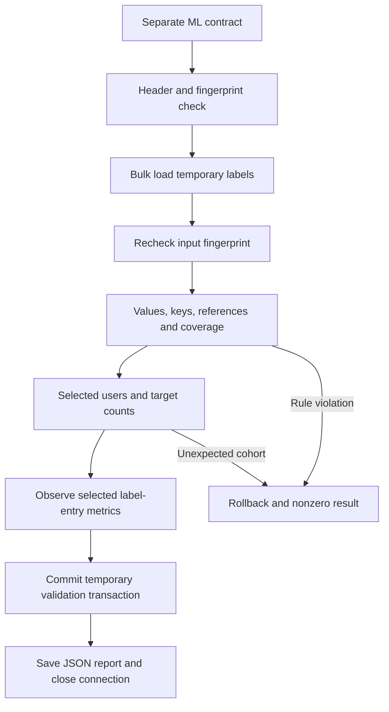

# Instacart ML Training-Label Input Runbook

**Owner:** Saurabh Lalit Zambare  
**Prepared:** 1 November 2026  
**Phase:** ML-01, separate training-label contract and temporary SQL validation  
**Accepted prior milestone:** `f300088` — eight dbt views, 56 passing data tests, and passing hosted Python CI

## 1. Scope and current status

The source-file header, row count, size, and hash below were observed on the owner's machine. This package adds a separate input contract and a validator. The updated 94-test Python suite passed in a local verification copy. Windows execution and live SQL validation must still be demonstrated by the owner.

The validator creates only SQL Server local temporary tables. It checks the complete training-label file against the existing full `pipeline_staging.orders` and `pipeline_staging.products` tables, then measures eligibility and label-entry counts for the same lowest-5,000-user cohort used by the cloud demonstration.

This step validates inputs. It does not publish a permanent label table, create ML candidate examples, split users, build features, train a model, or evaluate predictions. Those steps follow after the live checks pass.

## 2. Observed source contract

| Property | Value |
|---|---|
| Dataset label | `instacart_ml_train_labels_v1` |
| File | `order_products__train.csv` |
| Columns, in order | order_id, product_id, add_to_cart_order, reordered |
| Data rows | 1,384,617 |
| Size | 24,680,147 bytes |
| SHA-256 | `d27c4034883051c85e37c2cb0379fecbbeccad932970e171461aa99f18f75aea` |
| Expected full train-order count | 131,209, from the accepted full order-metadata contract |
| ML subset label | `instacart_ml_5000_users_v1` |
| Selection | The 5,000 lowest distinct user IDs from full order metadata |
| Expected labeled users and target orders | 3,200 of those 5,000 users |

The original five-file manifest and fingerprint baseline remain separate. This package introduces `config/ml_train_labels_spec.json`; it does not add a sixth file to the completed ingestion baseline.

The first inspection expected three columns and stopped with exit code 1. The file correctly contains four columns, including `add_to_cart_order`; the inspection was corrected and rerun successfully. The validator and its regression test now require all four columns.

## 3. Prediction-task boundary

For a customer with earlier purchases, predict which previously purchased products appear in the next labeled order. Candidate examples will be built from the customer's prior history. Presence of a candidate product in the target order gives label 1; absence gives label 0.

| Field or information | Allowed role |
|---|---|
| Prior order metadata and product entries | Earlier-history feature inputs, subject to explicit cutoffs |
| Target order_id | Identifies the labeled outcome and candidate group |
| Target product_id | Used to construct product-presence labels |
| Target add_to_cart_order | Outcome information; excluded from predictors |
| Target reordered flag | Source annotation for validation/description; excluded from predictors |
| Target basket contents | Used for labels, not feature construction |

The training CSV contains both previously purchased products and newly purchased products. The historical `reordered` annotation alone does not construct all positive and negative candidate examples for the chosen task. Candidate generation must join earlier history to target-product presence, and account for previously purchased products that are absent from the target order.

The report deliberately calls the sum of this source flag `historically_reordered_entries`, not a model-positive count.

## 4. New files

| File | Purpose |
|---|---|
| `config/ml_train_labels_spec.json` | Separately versioned file identity, expected header/rows/hash, and cohort counts |
| `scripts/check_ml_train_labels.py` | Command-line validator using existing input fingerprinting and SQL connection helpers |
| `tests/test_check_ml_train_labels.py` | 23 offline unit tests using small files and mocked SQL responses |
| `docs/ML_INPUT_RUNBOOK.md` | This scope, operating procedure, and validation record |

The Python test belongs under repository-root `tests/`. SQL data tests for dbt remain under `dbt_instacart/tests/`; these are different test systems.

Existing helpers reused without modification:

- `scripts.check_inputs.inspect_file`: checks the header, size, SHA-256, and file stability during hashing.
- `scripts.db_connection.get_connection`: uses ODBC Driver 18, Windows integrated authentication, and the existing SQL Server environment variables/defaults.

No new Python dependency is needed. Use the main project's uv environment, which already contains pyodbc.

## 5. Validation flow



Local temporary tables are created in unparameterized session scope, preserving the lesson from the earlier cloud-export `#cloud_users` scope failure. They disappear when the SQL connection closes. The bulk path escapes SQL apostrophes.

The transaction uses SERIALIZABLE reads to retain a consistent validation boundary while examining SQL reference tables. A successful COMMITTED status here refers to completion of the temporary-table validation transaction; it does not mean labels were published to a permanent table. The report records `permanent_table_writes: false`.

## 6. Exact SQL checks

| Report check | Expected |
|---|---:|
| rows | 1,384,617 |
| invalid_rows | 0 |
| distinct_train_orders | 131,209 |
| duplicate_order_product_groups | 0 |
| duplicate_order_cart_groups | 0 |
| missing_train_orders | 0 |
| missing_products | 0 |
| train_orders_without_labels | 0 |
| selected_users | 5,000 |
| selected_train_orders | 3,200 |
| selected_train_users | 3,200 |

Invalid rows have a missing required field, a nonpositive order ID/product ID/cart position, or a reordered flag outside 0/1. Invalid integers that SQL Server cannot load cause an execution error rather than a successful validation.

`missing_train_orders` counts label entries without a matching order classified as train. `missing_products` checks the full SQL Server product lookup, which can include target products outside the prior-only cloud product subset. `train_orders_without_labels` verifies coverage of every full train order.

Both `(order_id, product_id)` and `(order_id, add_to_cart_order)` must be unique. The script does not yet assert contiguous cart positions or compare target flags with reconstructed user-product history.

## 7. Observations to obtain from the live run

| Observation | Meaning |
|---|---|
| label_entries | Number of target-basket product rows for the selected labeled users |
| target_orders | Distinct selected labeled orders; expected 3,200 |
| distinct_products | Products appearing in those target orders |
| historically_reordered_entries | Sum of the source reordered annotation within those selected target rows |

The selected label-entry, product, and reordered-entry totals have not yet been observed. The script reports them rather than inventing fixed expected values. It checks basic consistency, including a positive row count, product count no greater than row count, and a reordered count between zero and the row count.

## 8. Run on Windows

From the repository root:

```powershell
uv run python -m unittest discover -s tests -v
$LASTEXITCODE
```

Expected current suite: **94 tests**, all passing, exit code 0. This comprises the original 71 tests plus 23 ML-input tests. These offline tests do not establish that the SQL statements execute successfully against the live SQL Server.

After the suite passes:

```powershell
uv run python -m scripts.check_ml_train_labels `
    --data-dir "D:\DataProjects\data-download"

$LASTEXITCODE
```

The contract path defaults to repository-relative `config/ml_train_labels_spec.json`. A reviewed alternative can be supplied with `--spec`; the report records the actual specification path.

Expected successful output includes:

```text
Result: PASS
Training-label rows: 1,384,617
Selected labeled users: 3,200
label_entries: <observed value>
target_orders: 3,200
distinct_products: <observed value>
historically_reordered_entries: <observed value>
Permanent table writes: NONE
Transaction: COMMITTED
Report saved: ...\logs\ml_inputs\<run_id>.json
```

The source file must be readable by SQL Server at its resolved absolute path, as with the existing BULK INSERT loaders. The script uses the existing `pipeline_staging` tables as prerequisites and does not recreate them.

## 9. Results and failure handling

| Result | Meaning | Exit code |
|---|---|---:|
| PASS | File identity and all configured SQL checks passed; report saved | 0 |
| FAIL | Contract, fingerprint, values, keys, references, or cohort rule failed | 1 |
| ERROR | Unexpected execution issue, including an ODBC/SQL error | 1 |

Failure before connection leaves transaction outcome NOT_STARTED. A failure before the commit attempt is reported as ROLLED_BACK when rollback succeeds. A commit error or failed rollback leaves outcome UNKNOWN; errors are preserved in the report. Failure to save the final report also returns 1.

Routine reports are under ignored `logs/ml_inputs/`. After the live result is accepted, retain a selected report under `docs/validation_evidence/`. Do not label a mocked test run as a live input validation.

## 10. Offline tests included

The 23 tests cover contract validation, unsafe/inconsistent subset settings, matching input bytes, same-size content changes, missing files, BOM handling, the four-column header, path quote escaping, missing/changed check results, and stopping before database connection on a fingerprint failure.

SQL-flow tests cover successful temporary capture, invalid values, wrong row counts, duplicate pairs/cart positions, order/product references, missing label coverage, global train-order counts, selected-user eligibility, observation bounds, post-bulk file changes, commit/rollback errors, and temporary-table scope/permanent-source write boundaries. SQL responses are mocked; live SQL validation remains the next acceptance step.

## 11. Next implementation after live validation

1. Preserve the successful live report and its observed selected-label totals.
2. Define and load the selected labels into a separate ML target with transaction, rerun, and failure behavior.
3. Define candidate products, per-target history cutoffs, and reproducible user partitions.
4. Build earlier-history features and a simple frequency baseline before fitting a model.

This input-validation package starts ML-01; it does not mark the full ML phase complete. The accepted five-file loader, BigQuery tables, dbt models, and dependency lockfile are unchanged by these additions.

## Verified live results — 2 November 2026

All 94 Python unit tests passed on the local Windows machine.

The live SQL Server input validation also passed, with exit code 0.

| Measurement | Verified result |
|---|---:|
| Full training-label rows | 1,384,617 |
| Selected labeled customers | 3,200 |
| Selected target orders | 3,200 |
| Selected target product entries | 33,782 |
| Distinct target products | 9,850 |
| Entries marked as previously purchased | 20,229 |

The validation used temporary tables only. No permanent ML
tables were created.

The earlier file-access error was resolved, and the successful
validation transaction completed with status COMMITTED.

Evidence: [Successful live validation report](validation_evidence/ml_train_labels_validation_pass.json)

Candidate generation, feature creation, train/validation/test
splitting, and model training are still pending.

## Verified live results — 2 November 2026

All 118 Python tests passed on the local Windows machine.

The permanent table pipeline_ml.train_labels_5000_users_v1
was loaded and checked successfully.

| Check | Verified result |
|---|---|
| Initial load | PASS, REPLACED, 33,782 rows written, COMMITTED |
| Unchanged rerun | PASS, UNCHANGED, zero rows written, COMMITTED |
| Deliberate failure | FAIL, SIMULATED_FAILURE, ROLLED_BACK |
| Recovery rerun | PASS, UNCHANGED, zero rows written, COMMITTED |

After rollback, SSMS confirmed 33,782 entries, 3,200 customers,
3,200 target orders, 9,850 distinct products, and 20,229 entries
marked as previously purchased.

All six quality-check counts were zero.

Evidence:

- [Initial load](validation_evidence/ml_labels_initial_load_pass.json)
- [Unchanged rerun](validation_evidence/ml_labels_unchanged_rerun_pass.json)
- [Expected rollback failure](validation_evidence/ml_labels_rollback_expected_failure.json)
- [Recovery](validation_evidence/ml_labels_rollback_recovery_pass.json)

Candidate generation, historical features, customer splits,
and model training remain pending.