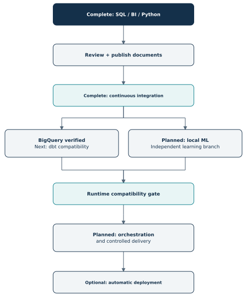
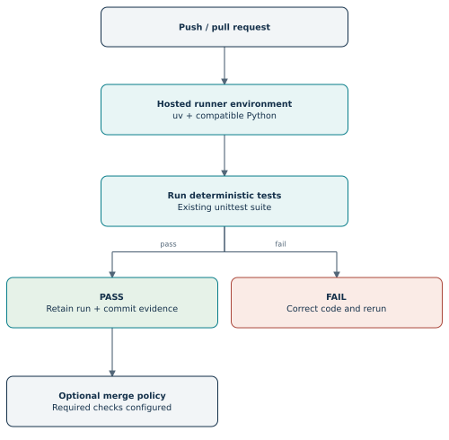
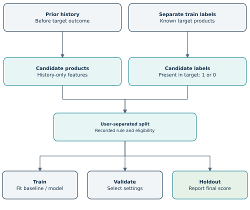
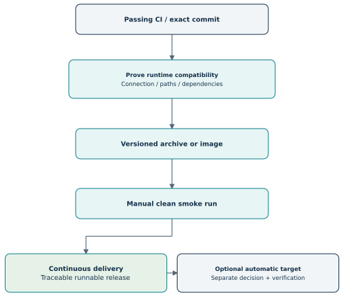

# Instacart Project Roadmap

**Owner:** Saurabh Lalit Zambare  
**Version:** 2.2 - BigQuery loading and reconciliation verified  
**Status date:** 1 November 2026  
**Committed code baseline:** `c90c4f0`  
**Cloud SQL/docs/evidence:** verified in the owner session; current commit pending  
**Loading baseline:** `bfc1763`  
**CI recovery proof:** `647d9c2` on the demonstration branch  
**Companion:** [Project scope](PROJECT_SCOPE.md) and [documentation guide](DOCUMENTATION_INDEX.md)

## What changed from the first roadmap

The earlier draft dated 29 October treated Python automation as future work. The local five-file pipeline is now implemented and verified. This revision records that result, retains the original stage numbers for continuity, and gives the remaining stages practical completion checks.

Core CI runs the unittest suite in uv on hosted Windows; 71 tests passed at c90c4f0. The five-file cloud subset and five BigQuery loads/checks are verified, and selected results match SQL Server. dbt, ML, orchestration, and delivery remain future work. Windows-to-Linux database connectivity is an explicit feasibility gate before a containerized deployment is promised.

## Contents

- [1. Current position and remaining work](#1-current-position-and-remaining-work)
- [2. Starting baseline and completion rules](#2-starting-baseline-and-completion-rules)
- [3. Documentation and delivery checkpoint](#3-documentation-and-delivery-checkpoint)
- [4. Stage 4 - Continuous integration](#4-stage-4---continuous-integration)
- [5. Stage 5 - Small BigQuery and dbt demonstration](#5-stage-5---small-bigquery-and-dbt-demonstration)
- [6. Stage 6 - Machine-learning task and data preparation](#6-stage-6---machine-learning-task-and-data-preparation)
- [7. Stage 6 - Features, models, evaluation, and batch prediction](#7-stage-6---features-models-evaluation-and-batch-prediction)
- [8. Stage 7 - Orchestration and recovery](#8-stage-7---orchestration-and-recovery)
- [9. Stages 8-9 - Delivery and optional deployment](#9-stages-8-9---delivery-and-optional-deployment)
- [10. Operational tracking and prioritized backlog](#10-operational-tracking-and-prioritized-backlog)
- [11. Decision register and compatibility gates](#11-decision-register-and-compatibility-gates)
- [12. Risks, maintenance, and next handoff](#12-risks-maintenance-and-next-handoff)

# 1. Current position and remaining work

| Original stage | Milestone | State on 1 November | Evidence or next action |
| --- | --- | --- | --- |
| 1 | SQL and local Power BI analysis | Complete | Scripts 00-21, three views, seven measures, three pages |
| 2 | GitHub project delivery | Core files pushed; smoke check open | Verify a clean download/open of the LFS-tracked PBIX |
| 3 | Python loading, checks, and run reporting | Core local milestone complete | `bfc1763`, 53 tests, safe replay and recovery evidence |
| Documentation | Python report, scope, roadmap, milestone runbooks | Earlier documents published; current cloud update ready | Preserve current evidence and commit the update |
| 4 | Continuous integration | Core complete | Original red/green exercise plus 71-test hosted PASS at c90c4f0 |
| 5 | BigQuery and dbt | Subset and BigQuery verified; dbt pending | CLD-01/02 verified in session; close Git checkpoint, then DBT-01 |
| 6 | Reorder prediction | Planned | Labels, history-only features, baseline/model evaluation |
| 7 | Airflow orchestration | Planned with environment gate | Compatible tasks, dependency graph, recovery proof |
| 8 | Continuous delivery | Planned with runtime gate | Traceable runnable release artifact and smoke test |
| 9 | Automatic deployment | Optional; target undecided | Separate target, cost/authentication, and recovery decision |
| 10 | Portfolio / LinkedIn | Separate discussion | Draft only when Saurabh initiates that conversation |

No calendar deadline is attached. Effort depends on tool compatibility and access. The stages represent evidence to produce, not an obligation to add every technology before the project is useful.



The cloud/dbt branch and local ML branch share the validated data foundation but do not require each other to run. Core CI and the scoped BigQuery demonstration are verified. After the current cloud Git checkpoint, the intended order is dbt compatibility/models, then ML. Airflow coordinates suitable tasks after they work individually; release packaging follows runtime feasibility.

# 2. Starting baseline and completion rules

## 2.1 Results to preserve

The descriptive baseline includes 3,214,874 prior orders, 32,434,489 entries, 19,126,536 reordered entries, and 49,688 products. The new Python tables include all 3,421,083 order metadata rows. Keep the order-cohort distinction visible in every comparison.

The completed local command is:

```powershell
uv run python -m scripts.run_pipeline --data-dir "D:\DataProjects\data-download"
```

It verifies baseline bytes, runs five table loaders in dependency order, and checks committed automation tables. Each loader has its own transaction. The original reporting-view runner remains separate:

```powershell
uv run python -m scripts.run_validations
```

## 2.2 Status meanings

| Label | Meaning |
| --- | --- |
| Complete | Implementation plus stated acceptance evidence exists |
| Planned | Agreed learning direction; implementation has not been established |
| Conditional | Start only after access, compatibility, resource, or target feasibility is resolved |
| Open check | Narrow verification still missing from the record |
| Created for review | Document prepared; review/commit/publication are separate actions |

For every future phase: implement, run relevant checks, deliberately exercise a meaningful failure where appropriate, preserve evidence, document limits, then update the status. Do not keep adding tools to avoid closing a milestone.

# 3. Documentation and delivery checkpoint

The original Python report and planning files were published at dcb145d; CI documentation followed at aa46eeb and the exporter checkpoint at c90c4f0. This revision brings the published planning statuses forward through verified CI and the owner-session BigQuery results. Preserve relative diagram/evidence folders and commit the current SQL/docs/evidence checkpoint before the dbt compatibility phase.

The older input runbook still describes the loader as its next step, and the README primarily introduces the SQL/Power BI stage. A small documentation follow-up should add navigation and current status without rewriting the already validated analytical definitions.

| Check | Completion evidence |
| --- | --- |
| Python report saved | Markdown/PDF and eight diagram assets available in local `docs` |
| Scope and roadmap accepted | Current statuses, exclusions, and phase gates reviewed |
| Documentation publication | Current cloud SQL, runbook, review evidence and planning update need the next commit/push check |
| PBIX delivery | Fresh LFS-enabled clone/download obtains the actual binary, opens in Desktop, and can reconnect to the local SQL source |

Downloading an LFS pointer alone is insufficient for the PBIX check. The smoke test is a delivery verification, not a reason to rebuild every chart or repeat the full analytical study.

# 4. Stage 4 - Continuous integration

**Core status: complete.** The exporter checkpoint [run #6](https://github.com/Saurabhzambare/instacart-sql-powerbi-analysis/actions/runs/41203173411) passed all 71 tests on Windows/Python 3.14.3. The original 53-test exercise remains valid historical evidence. [Baseline run](https://github.com/Saurabhzambare/instacart-sql-powerbi-analysis/actions/runs/41181217619): 53 tests passed. [Regression run](https://github.com/Saurabhzambare/instacart-sql-powerbi-analysis/actions/runs/41181802743): exactly one expected failure. [Corrected run](https://github.com/Saurabhzambare/instacart-sql-powerbi-analysis/actions/runs/41181974673): 53 passed. See the [CI runbook](CI_RUNBOOK.md) and [evidence summary](validation_evidence/ci_pass_fail_recovery.json). The following design is now implemented for push-triggered tests. Required merge policy and separate PR/manual-trigger proof remain optional checks.

## 4.1 Explain it simply

Continuous integration means code changes trigger automatic checks in a clean runner environment. The code has already been tested manually on the laptop. CI repeats the relevant code checks on pushes/pull requests so later changes are less likely to break accepted behavior [R1].

Continuous delivery means a tested release artifact can be prepared and used. Continuous deployment goes further and updates a running target automatically. Core CI is now verified; delivery and deployment remain separate later milestones.



## 4.2 Technology and scope

Use GitHub Actions, uv, Python 3.14, and `unittest`. Begin with a hosted Windows runner to match the development environment. Validate the runner label and action versions at implementation time; pin reviewed action versions/commits rather than copying an old example blindly. Add a Linux matrix only if it serves a tested portability goal.

The first job uses deterministic small fixtures, mocks, and the small subprocess test. It does not connect to Saurabh's laptop SQL Server or load the original 32-million-row table. Hosted runners are their own environments [R2]. A database integration job can later create its own isolated test database and fixtures.

## 4.3 Implemented workflow behavior

| Workflow step | Purpose |
| --- | --- |
| Checkout code | Test the exact commit under review |
| Prepare uv and compatible Python | Recreate the declared environment |
| `uv sync --locked` | Require dependency metadata and lockfile agreement |
| `uv run --locked python -m unittest discover -s tests -v` | Run the current suite with visible failures |
| Retain useful test output | Link future failures to a run/commit |
| Finish nonzero on test failure | Make the workflow status meaningful |

Implemented file: `.github/workflows/python-tests.yml`, added at c863046. It configures push, pull-request, and manual triggers; the collected exercise verifies push-triggered execution. Use the permission needed to read/test code; credentials, real raw files, and the PBIX binary are unnecessary inputs to this first job.

## 4.4 Acceptance and failure exercise

1. A valid push/pull request starts the workflow and passes the relevant suite.
2. A controlled change on a temporary branch makes one test fail and the workflow becomes red.
3. Correcting that change makes the next run green.
4. Save workflow run links, source commits, and the failure/correction explanation.
5. If merge blocking is desired, verify the repository's available branch/ruleset support and configure required checks separately. A workflow alone does not enforce that policy.

**Done when:** the checks run automatically and the controlled fail/correct/pass sequence is inspectable. Reusing the 53 tests is the starting point; retain the correct evolving suite, not an arbitrary permanent count.

# 5. Stage 5 - Small BigQuery and dbt demonstration

## 5.1 Why add this branch

The local project demonstrates SQL Server work. A cloud branch can show that the same data questions and quality rules can be expressed in another analytical warehouse. dbt adds named SQL models, dependencies, tests, and documentation rather than a collection of disconnected query tabs.

## 5.2 Accepted subset and cloud result proof

**CLD-01 and CLD-02 implementation checks passed.** Select the 5,000 lowest user IDs; keep complete prior histories and all order metadata for those users. The accepted export has 81,832 orders, 761,750 prior entries, 28,854 referenced products, 134 aisles, and 21 departments. All five file sizes/hashes matched the manifest. The subset exporter and selected evidence were committed at c90c4f0.

All five tables loaded into `instacart-analytics-practice.instacart_raw` and passed the configured quality queries. SQL Server and BigQuery matched on 24 hourly rows, 21 department rows, and 10 top-product rows, including displayed two-decimal reorder rates. See the [BigQuery runbook](BIGQUERY_RUNBOOK.md) and [manual screenshot review](cloud_evidence/reconciliation_review.json). This proof concerns selected aggregates, not full-row byte identity or an automated parity job. The current SQL/evidence documentation still needs its Git checkpoint.

**DBT-01 is next after that checkpoint.** Prove a tiny adapter/model build and tests in a compatible separate environment before expanding dbt. The remainder of Stage 5 below describes the still-planned dbt outcome.

Do not use the first N rows of each CSV independently: that can discard related records and make local/cloud comparisons meaningless. Reconcile exactly the same selected subset in both systems. Reuse SQL Server aggregation to keep Python memory use small.

## 5.3 Tools and checks

| Component | Proposed use |
| --- | --- |
| BigQuery sandbox | Batch-load the small subset and run analytical SQL |
| dbt with compatible BigQuery adapter | Build staging/reporting models and declare dependencies |
| dbt generic tests | Unique keys, required IDs, accepted values, relationships |
| Custom SQL test | Composite order-product uniqueness and project-specific gap/total checks |
| Local SQL Server | Produce matching reference results on that same subset |

The sandbox currently limits capabilities, including DML and streaming, and expires stored tables/views after 60 days [R3]. Keep this branch small and reproducible; recheck quota/authentication details at setup. Use suitable batch, view, or full-rebuild models instead of assuming incremental MERGE models will work. First prove a tiny end-to-end adapter model before promising the full dbt setup.

dbt's generic tests include `unique`, `not_null`, `accepted_values`, and `relationships`; custom queries can test project-specific assumptions [R4]. Version and adapter compatibility are implementation gates. A local DuckDB/dbt fallback demonstrates local dbt work, not BigQuery deployment experience.

## 5.4 Planned outputs and completion

Proposed folders: `cloud/bigquery/`, `dbt_instacart/`, and `docs/cloud_evidence/`. Keep secrets and machine-specific connection profiles outside committed source.

**Done when:** the subset can be recreated; selected product/order/reorder results reconcile across SQL Server and BigQuery; dbt builds/tests pass; one deliberately broken test condition is detected; generated model documentation and a short SQL-dialect note are preserved. No paid expansion is assumed.

# 6. Stage 6 - Machine-learning task and data preparation

## 6.1 The first prediction question

For a customer with earlier shopping history, which products they purchased before will appear in their next order? Each candidate example represents a customer, target order, and previously purchased product. Its label is 1 if that product appears in the known target order; otherwise 0.

This is an initial reordered-product task. New-product discovery, quantities, revenue, live APIs, and real-time recommendations require separate scope. The historical `reordered` flag describes a past entry; it is not automatically the correct label for a future prediction example.



## 6.2 Inputs and label boundary

| Input | Role | Work remaining |
| --- | --- | --- |
| Prior metadata and entries | Features from earlier purchases | Define exact per-target history cutoff |
| Train metadata and `order_products__train.csv` | Known next-order outcomes | Add a separate label manifest/contract and loader; validate references |
| Official test cohort | Unlabeled target orders | Optional batch prediction output after evaluation; no direct local ground-truth score |

Keep the train-label file outside the accepted five-file baseline until its separately versioned contract is agreed. Adding it should not silently alter the completed baseline recorder or target counts.

## 6.3 Proposed split and leakage rules

Start with an explicit reproducible customer assignment, initially proposed as 70% train, 15% validation, and 15% final holdout among eligible labeled users. Record IDs, seed/rule, sizes, exclusions, and candidate coverage. Keep all candidate rows for one customer in one partition.

Every feature must use information available before that customer's target outcome. Build each customer's own features from permitted earlier history. Fit learned preprocessing and shared training statistics on the allowed training partition, then apply them to validation/holdout; do not tune on final holdout outcomes [R5].

The user-grouped split measures generalization across held-out users with their observed histories. It is not a claim of performance over future calendar dates; this dataset does not provide full transaction dates in the current scope. If later using multiple targets from one user, preserve group separation and cutoff rules explicitly.

# 7. Stage 6 - Features, models, evaluation, and batch prediction

## 7.1 Manageable feature design

| Feature family | Initial examples | Computation boundary |
| --- | --- | --- |
| User-product | Historical purchase count, fraction of prior orders, orders since last purchase, previous-basket presence | Earlier history only |
| User | Prior order count and average historical basket size | Before target order |
| Product | Popularity/repeat statistics | Training-side reference history under the split policy |
| Target context | Known ordering context, if justified and available at prediction time | Exclude target outcome and target basket contents |

Use SQL Server to aggregate the large history into a smaller feature table. Load only the selected feature set into Python. Keep candidate generation, preprocessing, and labels traceable. Measure memory/runtime on the reproducible subset before scaling.

## 7.2 Modeling order

1. Implement a simple documented customer-frequency recommendation baseline.
2. Fit a scikit-learn logistic-regression model with suitable preprocessing.
3. Consider histogram gradient boosting only after the baseline/first model and evaluation are working.
4. Choose probability thresholds or set-selection rules using validation results.
5. Evaluate the final accepted settings once on the reserved holdout and report errors honestly.

CPU work is sufficient for the intended initial scope. The GTX 1650 is not a requirement or a reason to add a deep-learning model. Pin compatible data/ML packages in a reviewed environment; avoid expanding the ingestion environment without need.

## 7.3 Evaluation contract

| Question | Required answer in the ML report |
| --- | --- |
| Does it beat a simple rule? | Baseline and model evaluated on exactly the same held-out orders |
| Does it over-recommend? | Precision and representative false positives |
| Does it miss expected products? | Recall and representative false negatives |
| What is the set-level quality? | Mean per-order F1 over the declared reordered-product candidate task |
| What happens for empty sets? | Explicit handling of empty truth/prediction sets |
| Is it fair? | Feature cutoffs, customer partitions, and no holdout tuning |
| Can it be repeated? | Dataset/feature version, split manifest, seed, model settings, commit, and run ID |

The local task's F1 definition and candidate truth set must be stated. Previously purchased candidates omit new products by design, so do not automatically equate this restricted score with a full-basket competition leaderboard score. Official test predictions are an optional output, not a substitute for labeled holdout evaluation.

**Done when:** baseline and model results are reproducible, leakage checks pass, errors are explained, and batch predictions can be regenerated from a recorded model. A model is not required to beat the baseline for the learning exercise to be valid; the result must be reported accurately.

Proposed outputs: `ml/`, small versioned feature/split manifests, `docs/ML_REPORT.md`, and managed model/prediction artifacts. Model binaries and large feature exports need a storage decision rather than automatic ordinary-Git inclusion.

# 8. Stage 7 - Orchestration and recovery

## 8.1 What Airflow adds

The local coordinator already establishes task order. Airflow would add scheduler-managed task instances, visible states, and controlled reruns/retries for suitable commands. It should invoke accepted job logic rather than hide duplicated business rules in DAG definitions.

Before setup, decide which tasks are compatible with the runtime. Airflow uses Linux/WSL2 or Linux containers on Windows [R6]. The existing local connection uses Windows integrated authentication and local server-side bulk paths. Those assumptions do not automatically carry into a Linux worker.

| Feasibility decision | Acceptable resolution |
| --- | --- |
| Runtime memory | A measured small learning setup fits the laptop alongside required services |
| Python/tool compatibility | Pin a supported Airflow environment separately from ingestion/ML if needed |
| SQL authentication/networking | Prove a supported explicit connection; do not assume localhost/Windows identity is shared |
| Bulk source path | Confirm SQL Server can read the chosen server-side path |
| Task scope if Windows loading remains external | Orchestrate a compatible cloud/subset/feature demo and document the Windows loader as a separate manual prerequisite |

The Docker quick start calls for at least 4 GB memory and ideally more; on an approximately 12 GB laptop, use a measured small learning configuration and avoid running all heavy tools together [R7]. The quick start is a learning setup, not evidence of production availability.

## 8.2 Failure behavior and acceptance

Transient connection errors can have bounded retries if rerunning the task is safe. Missing files, wrong schemas, and deterministic quality failures should stop and be corrected rather than retried indefinitely. Failed validation must prevent downstream feature publication or scoring.

Keep model training separate from routine batch scoring. Scoring uses a recorded accepted model. Retraining, drift handling, and automated model promotion remain later decisions.

**Done when:** an honestly scoped compatible DAG runs; one controlled failure blocks the appropriate downstream tasks; a corrected rerun succeeds without duplication; task/run states and recovery steps are preserved. Scheduling static input replay proves orchestration behavior, not a live data feed.

# 9. Stages 8-9 - Delivery and optional deployment



## 9.1 Stage 8: continuous delivery

Choose a release artifact that can actually run the accepted job. A versioned code/archive release is a valid first form. A Docker image published to GitHub Container Registry is a useful option after SQL access, filesystem paths, required drivers, and authentication have been proved for that image.

The image option is conditional, not a claim that copying Windows Python files into a Linux container yields a working full SQL pipeline. If only the portable subset/ML task is packaged, the release must name that scope accurately.

Build from an exact commit after passing CI; record dependency and artifact versions; exclude raw CSVs, credentials, `.venv`, routine logs, and the PBIX from the runtime package. Supply runtime configuration separately. A manual smoke run proves the artifact works in its documented environment.

**Done when:** passing checks produce a traceable artifact, a clean environment can execute the documented smoke workflow, and a previous artifact can be selected and checked for recovery. Retaining old artifacts is useful only if their data/model compatibility is also recorded.

## 9.2 Stage 9: automatic deployment, optional

Automatic deployment updates a chosen running target and verifies it. Publishing a ZIP or image is not by itself deployment. Before this stage, choose the target, authentication model, trigger, cost controls, smoke checks, and recovery procedure [R8].

No target or paid resource is selected in this roadmap. If the learning goal is satisfied by CI and a reproducible manually run release, stage 9 can remain outside the accepted scope.

# 10. Operational tracking and prioritized backlog

Use a small board with To do, In progress, Review, and Done, or keep the table below in Git until a Jira board is useful. Jira setup is planned; academic Jira exposure is not being presented as an existing project board. Keep one main implementation milestone active.

| ID | Task | Status | Completion evidence |
| --- | --- | --- | --- |
| DOC-01 | Review/save Python automation report | Published | Documentation checkpoint dcb145d |
| DOC-02 | Review/save scope and roadmap | Current cloud revision ready | Version 1.2 scope / 2.2 roadmap; publication pending |
| DOC-03 | Add navigation and reconcile older README/runbook status wording | Documentation index updated; older README/input runbook follow-up remains | Current index/runbooks plus a later narrow README wording check |
| DEL-01 | Verify clean PBIX LFS download/open | Open check | Binary obtained, opens, reconnect behavior documented |
| OPS-01 | Environment and driver setup | Complete | uv/Python/pyodbc and successful connection |
| OPS-02 | Original reporting validators | Complete | 18 checks and saved mismatch/recovery |
| OPS-03 | Manifest and fingerprint baseline | Complete | `743c62a`, actual baseline pass |
| OPS-04 | Five transactional loaders | Complete | Individual live first-load results |
| OPS-05 | Safe replay and rollback | Complete | Five UNCHANGED actions, department rollback/recovery |
| OPS-06 | Full coordinator and final validation | Complete | `bfc1763`, seven-stage PASS |
| CI-01 | Add hosted test workflow | Complete | Main run #1 initially passed 53; run #6 at c90c4f0 passed 71 |
| CI-02 | Prove failed/corrected CI; record optional policy separately | Core complete; merge policy unverified | Run #3 failed one test; run #4 passed all 53 |
| CLD-01 | Define/export reproducible related subset | Complete; exporter published | c90c4f0, accepted manifest and five matching file fingerprints |
| CLD-02 | BigQuery batch demo and reconciliation | Checks passed; SQL/docs/evidence publication pending | Five loaded/checked tables; 24/21/10 matching result rows |
| DBT-01 | Prove adapter/model compatibility | Next gated implementation | Tiny model build/test succeeds within warehouse limits |
| DBT-02 | Build tested documented models | Planned | Model graph, tests, docs, reconciliation |
| ML-01 | Add train-label contract/load | Planned | Counts/references/label eligibility verified |
| ML-02 | Define candidates, cutoffs, and user partitions | Planned | Split/candidate manifest and leakage checks |
| ML-03 | Build features and rule baseline | Planned | Reproducible feature export and baseline report |
| ML-04 | Train/evaluate first model | Planned | Validation decisions and final holdout report |
| ML-05 | Batch prediction and model record | Planned | Repeatable output tied to model/data versions |
| ORCH-01 | Resolve runtime/authentication/resource feasibility | Conditional | Compatible task proof before DAG build |
| ORCH-02 | Demonstrate scheduled task/recovery graph | Planned | Failure block and successful rerun evidence |
| REL-01 | Release runnable accepted artifact | Conditional | Build, clean smoke run, previous-version recovery |
| DEP-01 | Decide whether an automatic target is needed | Optional | Explicit target/scope/cost decision |
| COM-01 | Portfolio/LinkedIn discussion | Deferred | Started separately by Saurabh |

An issue should state the problem, concrete output, acceptance check, dependency, related commit, and evidence. Move it to Done only after those checks pass. Do not create a board full of tools without a result each tool is supposed to produce.

# 11. Decision register and compatibility gates

| Decision | Resolution at this version | Revisit when |
| --- | --- | --- |
| Retain validated analytics source | Keep original staging/reporting path | Explicit new-source BI integration is chosen |
| First CI test framework | Reuse unittest | A concrete testing need justifies another framework |
| CI host access | Offline checks first; no assumption of laptop access | Isolated SQL integration job is designed |
| BigQuery vs local fallback | BigQuery batch demonstration verified; dbt adapter proof next | Use clearly labeled local DuckDB/dbt only if adapter/warehouse constraints block cloud dbt |
| ML size | Start with measured related customer subset | Memory/runtime supports scaling |
| ML target | Previously purchased next-order products | Scope expands with new candidate/evaluation design |
| Scheduling runtime | Separate compatible Linux/WSL2 environment | Stage 7 begins |
| Linux SQL connection | Must be proved; Windows auth is not assumed portable | Container/worker feasibility step |
| Release format | Choose working archive/image after runtime proof | Stage 8 begins |
| Deployment | Optional; no running target selected | A concrete use case needs automatic updates |

Version pinning is stage-specific. Preserve the accepted ingestion lockfile while testing large tool dependencies in a separate environment when appropriate. Current platform limits and adapter support should be checked again when that phase starts; this roadmap is a plan, not a guarantee of future compatibility.

# 12. Risks, maintenance, and next handoff

| Risk | Practical response |
| --- | --- |
| Tool collection overwhelms the project | Close one measurable milestone before adding another |
| Fixed baseline mistaken for daily production ingestion | Label static replay clearly; version intentional input changes |
| SQL and BI/new pipeline paths drift | Reconcile before changing report sources |
| Cloud comparisons use different data | Use the same subset manifest and reference outputs |
| Model target leaks into features | Record cutoff/partitions; fit only on permitted training data |
| Airflow/container exceeds resources | Measure small compatible setup before expansion |
| Published image cannot reach SQL Server | Require a real runtime connection smoke proof before release claims |
| Documentation becomes stale | Update statuses, evidence, links, and PDF after accepted milestones |

**Immediate handoff:** commit/push the current cloud SQL, local reference queries, runbook, screenshot review and planning update; verify the resulting hosted tests. **Next implementation: DBT-01**, a tiny compatible model build/test. CI-01/02 and CLD-01/02 checks are verified. dbt, ML, orchestration, delivery and deployment remain separate milestones; LinkedIn work remains a separate discussion.

Maintain the Markdown files as editable sources. Regenerate the PDFs after content changes. Keep diagrams and their `.mmd` source files beside the documents. The scope states the boundaries; this roadmap states order and acceptance; detailed reports explain completed execution.

## References

- [R1: GitHub - Continuous integration](https://docs.github.com/en/actions/get-started/continuous-integration)
- [R2: GitHub - Choosing a workflow runner](https://docs.github.com/en/actions/how-tos/write-workflows/choose-where-workflows-run/choose-the-runner-for-a-job)
- [R3: Google Cloud - BigQuery sandbox](https://docs.cloud.google.com/bigquery/docs/sandbox)
- [R4: dbt - Data tests](https://docs.getdbt.com/docs/build/data-tests)
- [R5: scikit-learn - Common pitfalls and data leakage](https://scikit-learn.org/stable/common_pitfalls.html)
- [R6: Apache Airflow - Prerequisites](https://airflow.apache.org/docs/apache-airflow/stable/installation/prerequisites.html)
- [R7: Apache Airflow - Docker learning setup](https://airflow.apache.org/docs/apache-airflow/stable/howto/docker-compose/index.html)
- [R8: GitHub - Continuous deployment](https://docs.github.com/en/actions/get-started/continuous-deployment)
- [Current implementation checkpoint](https://github.com/Saurabhzambare/instacart-sql-powerbi-analysis/commit/bfc176320df799733f9ef448017c181b6cb842fc)
- Version history: the original planning documents were published at dcb145d. This revision records verified CI and BigQuery work through 1 November 2026; its own publication is pending.
