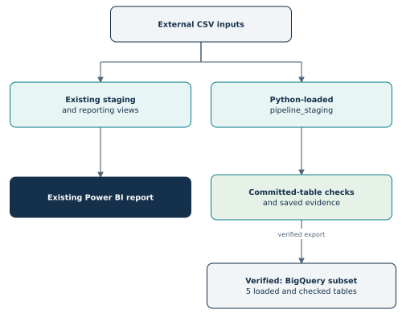

# Instacart Project Scope

**Owner:** Saurabh Lalit Zambare  
**Version:** 1.0  
**Status date:** 31 October 2026  
**Verified implementation:** `bfc176320df799733f9ef448017c181b6cb842fc`  
**Companion documents:** [Project roadmap](PROJECT_ROADMAP.md), [Python automation report](PYTHON_AUTOMATION_REPORT.md), [SQL technical report](SQL_PROJECT_REPORT.md)

## Purpose of this document

This document defines what the project is intended to demonstrate, what has been completed, what remains planned, and what evidence is required before a capability is described as finished. The roadmap explains the implementation order. The detailed reports explain the completed work.

The project began as SQL Server and Power BI analysis of Instacart shopping behavior. It now also includes a verified local Python loading and validation workflow. Later extensions add code checks, cloud SQL, documented transformations, and a carefully evaluated prediction task. Each extension has a separate acceptance decision; a plan does not establish an implemented skill.

## Contents

- [1. Project objective and audience](#1-project-objective-and-audience)
- [2. Dataset boundaries and metric definitions](#2-dataset-boundaries-and-metric-definitions)
- [3. Current architecture and ownership boundaries](#3-current-architecture-and-ownership-boundaries)
- [4. Completed deliverables and acceptance evidence](#4-completed-deliverables-and-acceptance-evidence)
- [5. Approved learning direction and future deliverables](#5-approved-learning-direction-and-future-deliverables)
- [6. Technologies: retain, add, or defer](#6-technologies-retain-add-or-defer)
- [7. Explicit exclusions and constraints](#7-explicit-exclusions-and-constraints)
- [8. Definition of done and evidence policy](#8-definition-of-done-and-evidence-policy)
- [9. Scope-change process](#9-scope-change-process)
- [10. Immediate handoff and maintenance](#10-immediate-handoff-and-maintenance)

# 1. Project objective and audience

**Objective:** build a reproducible portfolio project that explains historical shopping behavior and demonstrates how analytical data can be prepared, checked, recovered, and eventually used for predictive analysis.

| Audience | What the project should make clear |
| --- | --- |
| Technical reviewer | Data grain, SQL logic, contracts, dependency order, failure handling, tests, and implementation limits |
| Hiring professional | What Saurabh implemented, the scale handled, the questions answered, and the evidence available |
| Student or practitioner | How to reproduce the work and understand each stage without needing undocumented steps |
| Project owner | What is complete, what comes next, and which deliverables belong to each milestone |

The portfolio demonstrates project experience. It does not claim years of production data engineering, enterprise GCP administration, or on-call support from a local demonstration.

## 1.1 Business questions already answered

The completed analysis asks which products are most common, how widely they occur across orders, how often entries are marked reordered, which departments lead volume or reorder rate, when ordering peaks, and how basket sizes vary.

| Verified finding | Interpretation |
| --- | --- |
| Banana appears in 472,565 prior orders; 14.70% penetration | Reach across historical orders |
| 19,126,536 reordered entries; 58.97% reorder rate | Share of entries marked as previously purchased |
| Produce contributes 9,479,291 entries | Department entry volume |
| Dairy eggs has a 67.00% reorder rate | Department repeat-marked entry share |
| Hour 10 has 271,885 orders | Peak order hour in the analyzed baseline |
| Mean basket 10.09; mode 5; range 1-145 | Distinct products per prior order |

These are descriptive historical results. Product entries are not item quantities or revenue. Reorder rate is not customer retention. There is no price, profit, transaction date, or external economic data in the declared analytical scope.

# 2. Dataset boundaries and metric definitions

## 2.1 Source inputs

The source directory on the development machine is `D:\DataProjects\data-download`. Files remain outside the Git repository. Download/access conditions follow the source dataset's terms.

| Input | Rows or role | Current use |
| --- | --- | --- |
| `departments.csv` | 21 rows | SQL baseline and Python automation |
| `aisles.csv` | 134 rows | SQL baseline and Python automation |
| `products.csv` | 49,688 rows | SQL baseline and Python automation |
| `orders.csv` | 3,421,083 rows | Metadata for prior, train, and test cohorts |
| `order_products__prior.csv` | 32,434,489 rows | Historical order-product entries |
| `order_products__train.csv` | Available locally; product outcomes for train orders | Future ML labels; outside current five-file baseline |

The five automated inputs have a manifest and recorded byte sizes/headers/SHA-256 values. This is a fixed reference dataset, not a live daily feed. Changing source bytes requires an explicit version/contract decision.

## 2.2 Cohorts and grain

| Object or cohort | Definition |
| --- | --- |
| Prior orders | 3,214,874 historical orders used by the descriptive reporting views |
| Train orders | 131,209 order metadata rows; associated product-label CSV is separate |
| Test orders | 75,000 order metadata rows; final product answers are not available in the shown inputs |
| Users | 206,209 distinct users in all-order metadata |
| Product grain | One row per product ID |
| Order grain | One row per order ID |
| Entry grain | One row per `(order_id, product_id)` pair |

The prior/train/test labels describe dataset roles. They are not an automatically valid modeling split. A future model must define its prediction target, history cutoff, and evaluation partitions explicitly.

## 2.3 Agreed metric meanings

| Metric | Definition and boundary |
| --- | --- |
| Order penetration | Orders containing a product divided by all prior orders in the intended order/day context |
| Reorder rate | Reordered entry rows divided by all entry rows in the selected context |
| Basket size | Distinct product count in an order, not summed quantities |
| Order gap | Days-since-prior-order field; first-order NULL is meaningful; 0 is valid; values are capped at 30 |
| Day code | Dataset values 0-6; no assumed weekday names |
| Product-filter behavior | Products filter OrderProducts; they do not filter back into Orders in the established single-direction model |

# 3. Current architecture and ownership boundaries

| Component | Responsibility | Status |
| --- | --- | --- |
| Original `staging` | Imported baseline for established SQL work | Implemented |
| Existing `reporting` views | Product dimension, prior orders, prior entries | Implemented |
| Power BI Desktop | Three-page local descriptive report | Implemented locally |
| `pipeline_staging` | Five permanent tables populated by Python loaders | Implemented and verified |
| Temporary SQL tables | Validate input before target replacement | Implemented |
| Local JSON reports | File, loader, check, and coordinator execution history | Implemented |
| Future cloud/dbt/ML outputs | Separately named demonstration outputs | Planned |

The new Python workflow does not rebuild reporting views from `pipeline_staging` or refresh the Power BI report. Connecting those paths is a future integration decision with its own reconciliation checks. Current analysis remains reproducible through the established SQL/reporting path.

# 4. Completed deliverables and acceptance evidence

## 4.1 SQL and Power BI

Completed assets include numbered SQL scripts 01-21 plus auxiliary script 00, five original imports, quality checks, business analyses, three reporting views, seven DAX measures, and three final local report pages: Overview, Products & Reordering, and Ordering & Baskets.

Day Code is synced across all three pages. Department filtering stays local to Products & Reordering. SQL and report metric definitions were reconciled at the analytical milestone. The technical SQL report contains the per-script findings and DAX details.

The PBIX is LFS-tracked. An earlier pointer recorded 208,487,698 bytes. A fresh clone/download-and-open test on the delivered binary remains unverified in this record. Local completion and clean delivery verification are separate acceptance checks.

## 4.2 Python loading and validation

| Capability | Verified result |
| --- | --- |
| Reporting quality checks | 18 checks across five groups; saved failure/recovery evidence |
| File identity enforcement | All five real inputs matched the recorded baseline |
| Initial database loading | Five real table loads, including 32,434,489 prior entries |
| Safe replay | All five loaders reported UNCHANGED in the complete coordinator run |
| Transaction recovery | Department failure after clearing the target rolled back; SSMS verified 21 unique IDs afterward |
| Final accepted-table checks | Five tables passed 27 named metric checks |
| Coordinator behavior | Missing inputs stopped execution before any loader; corrected input run passed all seven stages |
| Automated code checks | 53 local tests passed, exit code 0 |
| Preserved evidence | Nine selected JSON reports committed |

The successful combined replay took 163.175 seconds in its saved local run. That is one observed replay duration, not an initial-load benchmark or runtime guarantee. Mocks cover controlled code behavior; live SQL execution supplies the separate loading/rollback evidence.

## 4.3 Evidence checkpoints

| Checkpoint | What it establishes |
| --- | --- |
| `76f0b23` | Earlier analytical documentation and GitHub delivery checkpoint |
| `4e6536a` | Reporting validators, combined reports, and saved evidence |
| `743c62a` | Input manifest, fingerprint baseline, and 15 input tests |
| `bfc1763` | Completed local loading/validation workflow and 53-test suite |

The connected repository confirmed the final three commits during this documentation pass. The detailed Python report was created for local review in the previous step; its addition to GitHub has not been verified. The earlier roadmap was also a prepared document rather than a verified file at `docs/PROJECT_ROADMAP.md` on the current remote. This package supplies the current scope and roadmap files for review and saving.

# 5. Approved learning direction and future deliverables

These are the agreed directions to plan toward, not completed implementations or permission to create paid resources. The companion roadmap defines dependencies and checks.

| Extension | Intended outcome | Evidence required |
| --- | --- | --- |
| Continuous integration | Existing tests run automatically for code changes | Workflow, passing run, deliberate failed run, corrected pass |
| Cloud SQL | Small related subset analyzed in BigQuery | Selection manifest, load results, reconciled local/cloud outputs |
| dbt | Reusable documented SQL models and quality tests | Model dependency graph, test results, generated documentation |
| Machine learning | Predict previously purchased products in a next order | Leakage-controlled splits, baseline/model metrics, error analysis, reproducible batch predictions |
| Operational tracking | Record tasks, defects, and resolution evidence | Small board or backlog with acceptance/evidence links |
| Airflow | Schedule/coordinate already-working compatible tasks | DAG, controlled failure, correct downstream blocking, successful rerun |
| Continuous delivery | Produce a traceable tested release artifact | Release version, dependency record, smoke check, previous-version recovery |
| Automatic deployment | Update and verify a chosen running target | Optional; requires an actual target and operating/cost decision |
| Portfolio communication | Explain implemented work and connect with others | Separate LinkedIn drafting/review discussion when initiated |

The first ML task is a reordered-product recommendation/classification task over previously purchased candidates. Forecasting revenue, predicting exact quantities, discovering all brand-new products, and real-time serving are separate questions. Model improvement over the baseline will be measured rather than promised.

# 6. Technologies: retain, add, or defer

| Technology | Scope choice | Why |
| --- | --- | --- |
| SQL Server, SSMS, Power BI | Retain established analytics | Preserve validated logic, grains, and report behavior |
| Python 3.14 + uv + pyodbc | Retain local workflow | Existing reproducible environment and successful loading evidence |
| `unittest` | Retain for initial CI | Reuse all 53 existing tests; no test-framework migration needed |
| GitHub Actions | Next planned addition | Run deterministic code checks away from the laptop |
| BigQuery sandbox | Small cloud branch | Demonstrate analytical SQL with a reproducible related subset |
| dbt + compatible adapter | After cloud/subset proof | Model dependencies, SQL tests, and documentation |
| SQL aggregates + scikit-learn | First ML path | Reduce large history to manageable features; begin with interpretable baselines |
| DuckDB | Conditional fallback | Local dbt practice if cloud constraints block the intended branch; label the outcome accurately |
| Airflow via WSL2/Linux environment | Later, gated by compatibility | Orchestrate working jobs rather than fix their logic inside a scheduler |
| Docker / image registry | Conditional delivery format | Useful only after proving a runnable environment and database connection path |
| Jira | Lightweight tracking option | Demonstrate clear task/defect ownership without making a board the project bottleneck |

Future libraries should be pinned only after compatibility is checked. Airflow/dbt may use a separate environment. The successful Windows integrated-authentication connection is not automatically portable into a Linux container or hosted runner.

# 7. Explicit exclusions and constraints

| Boundary | Scope rule |
| --- | --- |
| Production experience | Local project runs do not establish enterprise availability or on-call operations |
| Unattended operation | Current pipeline is manually started; scheduling/retries/alerts remain planned |
| Full-pipeline atomicity | Each loader commits separately; later failure can leave earlier successful commits |
| Concurrency | Run one local pipeline at a time; there is no global run lock |
| Snapshot consistency | Final table checks are separate queries; avoid concurrent edits/loads |
| Data changes | Baseline and fixed counts target selected static data; changed data needs a reviewed contract |
| Schema evolution | Targets are created if missing; schema migrations are not implemented |
| Source authenticity | Local fingerprints identify selected bytes; they are not independently published authenticity proofs |
| BI delivery | Power BI Service publication and scheduled refresh are outside current completion |
| Resource use | Approximately 12 GB RAM; shared SQL/Power BI/container workloads require capacity checks |
| Costs | No paid cloud resource, billing upgrade, or automatic deployment is established by this plan |
| Advanced platforms | Kubernetes, streaming, Spark clusters, broad enterprise GCP administration, and deep learning are outside the initial roadmap |

For BigQuery, the sandbox restricts capabilities including DML and streaming and expires stored tables/views after 60 days. Keep a reproducible small batch demonstration and recheck the current quotas before loading [R1]. For Airflow's Docker quick start, the documentation calls for at least 4 GB of container memory and recommends more; the laptop needs a feasibility check before that stage [R2].

# 8. Definition of done and evidence policy

A milestone is done when its implementation exists, its stated acceptance checks pass, representative evidence is saved, the operating instructions explain how to reproduce it, and its limitations are recorded. Documentation creation, local review, Git commit, and remote publication should be marked separately when they occur at different times.

| Evidence kind | Storage policy |
| --- | --- |
| Source code/configuration/tests | Commit to Git with a meaningful milestone message |
| Raw CSV data and local environment | Keep external/recreated; follow dataset terms and the existing ignore policy |
| Routine JSON run history | Keep under ignored `logs` folders |
| Selected pass/failure/recovery reports | Copy into `docs/validation_evidence` with descriptive names |
| Cloud and ML demonstrations | Store small manifests, metric summaries, reproducible scripts, and permitted sample outputs |
| Models/images/releases | Choose appropriate artifact/release storage; do not add large generated binaries blindly to ordinary Git |
| Documentation diagrams | Keep local relative links and editable diagram sources with the documents |

No accuracy threshold, test-count growth target, deadline, or job outcome is promised. Future test counts can change; passing the relevant suite matters more than retaining the number 53 forever.

# 9. Scope-change process

Before adding a substantial extension, record its question, proposed output, affected data path, technology, resource/cost impact, and acceptance evidence. Mark it Planned or Conditional. Start it after its prerequisites are accepted. Update the scope/roadmap after completion rather than presenting planned work as already implemented.

| Decision | Current resolution |
| --- | --- |
| Move established Power BI source to new automation tables? | Open; preserve current views until a separately reconciled integration is chosen |
| Replace unittest with pytest? | No current need; reuse existing suite for first CI |
| Use a different Python version for a new tool? | Allowed in an isolated environment after compatibility review |
| Run full database imports on each hosted CI push? | Outside the first CI scope; use deterministic offline tests |
| Choose a paid cloud deployment now? | Deferred; no target selected |
| Draft another LinkedIn post now? | Deferred to the separate discussion requested by Saurabh |

# 10. Immediate handoff and maintenance

1. Review the Python automation report and these scope/roadmap documents.
2. Save the agreed files under `docs`, including diagram assets.
3. Commit/push the documentation through the established GitHub Desktop workflow.
4. Resolve the small outstanding PBIX delivery smoke check when the asset is available.
5. Begin the CI milestone using the current tests and uv configuration.

Update this scope when accepted deliverables or exclusions change. Update the roadmap after every accepted milestone. Link new evidence to an exact commit or saved report. These documents record planning and current status; they do not start new jobs or schedule future actions.

## References

- [R1: Google Cloud - BigQuery sandbox](https://docs.cloud.google.com/bigquery/docs/sandbox)
- [R2: Apache Airflow - Docker learning setup](https://airflow.apache.org/docs/apache-airflow/stable/howto/docker-compose/index.html)
- [Verified implementation commit](https://github.com/Saurabhzambare/instacart-sql-powerbi-analysis/commit/bfc176320df799733f9ef448017c181b6cb842fc)
- [SQL technical report at the implementation checkpoint](https://github.com/Saurabhzambare/instacart-sql-powerbi-analysis/blob/bfc176320df799733f9ef448017c181b6cb842fc/docs/SQL_PROJECT_REPORT.md)
