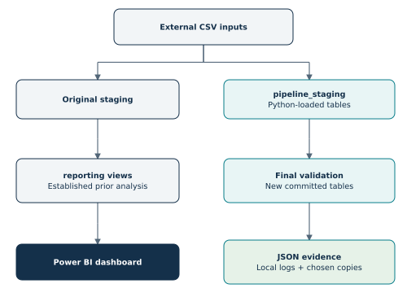
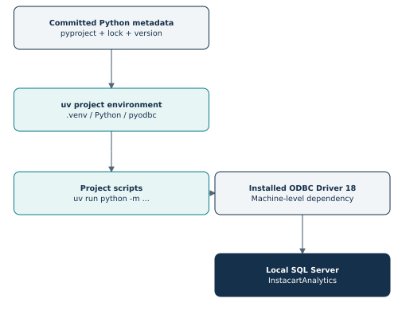
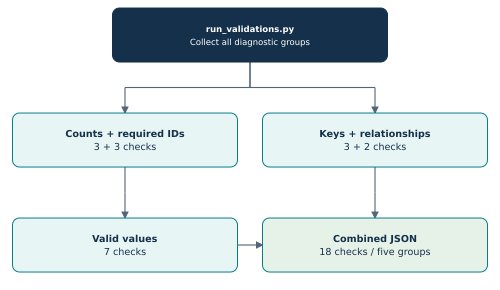
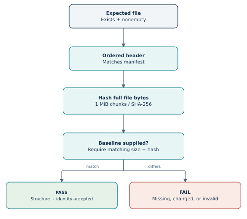
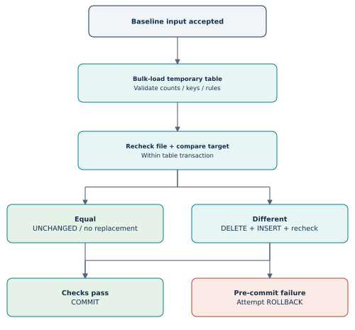
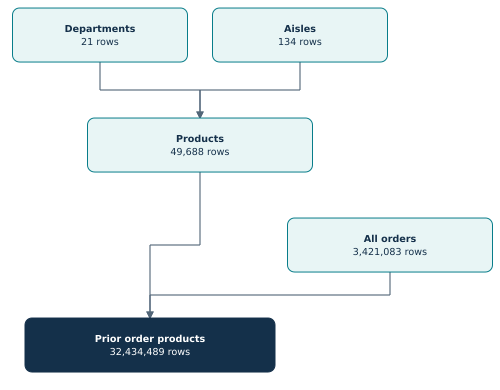
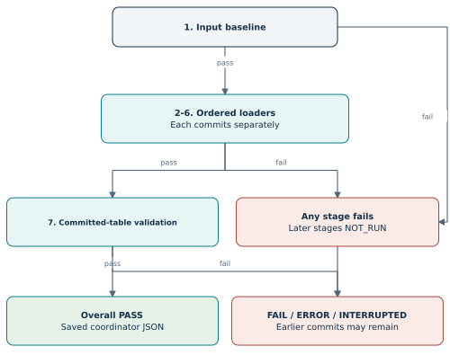
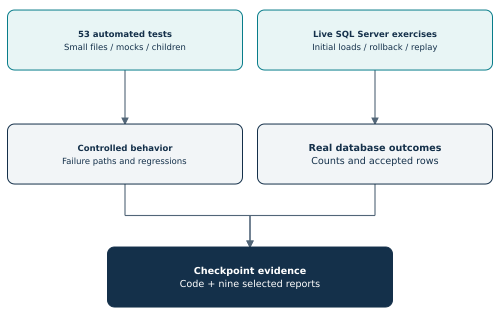

# Instacart: Python Automation Report

**A complete learning and implementation record**  
**Project owner:** Saurabh Lalit Zambare  
**Verified through:** 31 October 2026  
**Code checkpoint:** `bfc176320df799733f9ef448017c181b6cb842fc`  
**Repository:** [instacart-sql-powerbi-analysis](https://github.com/Saurabhzambare/instacart-sql-powerbi-analysis)

## How to read this report

This report covers the Python automation milestone from the first environment check to the committed, tested loading pipeline. It explains the final code as well as the development steps, mistakes, fixes, and evidence that led to that code. The existing SQL analysis and Power BI dashboard provide context; their full analytical findings belong in the earlier SQL report.

Read sections 1-3 for the purpose and history, sections 4-20 for the implementation, sections 21-25 for testing and evidence, and sections 26-29 for operation, limitations, and concepts. The appendices provide a complete file inventory, every automated test, and every Python function defined in the automation scripts.

Explanations come before commands. Commands marked **historical** document work already performed. They are not a request to repeat initialization, change a reference count, or recreate the existing baseline. Commands marked **routine** are the current operating commands. SQL examples are explanatory unless explicitly labeled as a verification query.

The final code and nine selected JSON evidence files were read directly from the named GitHub commit. Earlier setup output and intermediate run IDs come from the recorded project session. This distinction matters: a result shown in a terminal is useful evidence, while a committed JSON report can also be inspected later. The source index links to the exact code checkpoint rather than a moving branch.

## Contents

- [1. What Python automation means in this project](#1-what-python-automation-means-in-this-project)
- [2. Where automation fits into the existing project](#2-where-automation-fits-into-the-existing-project)
- [3. Complete development sequence](#3-complete-development-sequence)
- [4. Tools, environment, and first setup](#4-tools-environment-and-first-setup)
- [5. Root files and reproducibility](#5-root-files-and-reproducibility)
- [Python environment and cache](#python-environment-and-cache)
- [Generated local run reports](#generated-local-run-reports)
- [6. Python package layout and database connection](#6-python-package-layout-and-database-connection)
- [7. First automation: validating the original reporting views](#7-first-automation-validating-the-original-reporting-views)
- [8. Reporting runner, logging, and first recovery evidence](#8-reporting-runner-logging-and-first-recovery-evidence)
- [9. Finding and inspecting the real CSV inputs](#9-finding-and-inspecting-the-real-csv-inputs)
- [10. Manifest and first input checker](#10-manifest-and-first-input-checker)
- [11. Recording and enforcing the reference baseline](#11-recording-and-enforcing-the-reference-baseline)
- [12. Transactional loading: concepts before implementation](#12-transactional-loading-concepts-before-implementation)
- [13. First loader: `scripts/load_departments.py`](#13-first-loader-scriptsload_departmentspy)
- [14. Departments live loading, repeat run, and rollback exercise](#14-departments-live-loading-repeat-run-and-rollback-exercise)
- [15. Reusable loading contracts: `scripts/table_specs.py`](#15-reusable-loading-contracts-scriptstable_specspy)
- [16. Generic transactional loader: `scripts/load_table.py`](#16-generic-transactional-loader-scriptsload_tablepy)
- [17. Cross-platform path-test failure and correction](#17-cross-platform-path-test-failure-and-correction)
- [18. Loading the remaining four real tables](#18-loading-the-remaining-four-real-tables)
- [19. Final committed-table validation: `scripts/validate_pipeline.py`](#19-final-committed-table-validation-scriptsvalidate_pipelinepy)
- [20. One-command coordination: `scripts/run_pipeline.py`](#20-one-command-coordination-scriptsrun_pipelinepy)
- [21. All automated tests and what they prove](#21-all-automated-tests-and-what-they-prove)
- [22. Live coordinator failure and recovery](#22-live-coordinator-failure-and-recovery)
- [23. JSON reports: folders, fields, and interpretation](#23-json-reports-folders-fields-and-interpretation)
- [24. Every selected evidence file](#24-every-selected-evidence-file)
- [25. Git checkpoint and delivery workflow](#25-git-checkpoint-and-delivery-workflow)
- [26. Routine operating guide](#26-routine-operating-guide)
- [27. Completion boundaries and later work](#27-completion-boundaries-and-later-work)
- [28. Skills and concepts demonstrated](#28-skills-and-concepts-demonstrated)
- [29. Glossary within this project's technical boundaries](#29-glossary-within-this-projects-technical-boundaries)
- [Appendix A. Complete folder and file inventory](#appendix-a-complete-folder-and-file-inventory)
- [Appendix B. Every automated test](#appendix-b-every-automated-test)
- [Appendix C. Every automation-script definition](#appendix-c-every-automation-script-definition)
- [Appendix D. Exact input fingerprints](#appendix-d-exact-input-fingerprints)
- [Appendix E. Sources and reading references](#appendix-e-sources-and-reading-references)
- [Appendix F. Additional command record](#appendix-f-additional-command-record)

# 1. What Python automation means in this project

Python automation means writing a repeatable program that performs the project steps and checks their results. Instead of opening each SQL file, running it, reading the output, and manually deciding what to run next, a Python command carries out a defined workflow.

In this project, Python checks the input CSV files, connects to SQL Server, starts database loading operations, checks the loaded data, decides whether existing tables need replacement, handles failures, and saves a report. SQL Server still performs the large database operations. Python coordinates the work and records what happened.

**In very simple technical terms:** the original workflow relied on the person running the project to remember each step. The automated workflow stores those steps, their order, and their pass conditions in code.

## 1.1 Why it was added

The existing SQL analysis was already useful. Automation addressed a different question: can the underlying data workflow be repeated, checked, and explained after something goes wrong?

| Need in this project | What the automation adds |
| --- | --- |
| Confirm the correct source files were selected | Required filenames, ordered headers, byte sizes, and SHA-256 comparisons |
| Avoid loading incomplete or unexpected data | Checks before loading and SQL checks on temporary input tables |
| Repeat a load without accumulating duplicates | Compare source and target; report `UNCHANGED` when equal |
| Protect existing automation data during replacement | Explicit transaction, validation, commit, and rollback handling |
| Notice missing IDs or broken relationships | Required-field, uniqueness, value, and reference checks |
| Run dependencies in the correct order | One coordinator command with seven ordered stages |
| Explain failures afterward | Run IDs, timestamps, exit codes, captured output, and JSON evidence |
| Check the program itself | 53 automated tests covering successful and failing behavior |

## 1.2 What could happen without it

Manual execution can still produce correct results; the original analysis demonstrated that. The difficulty is maintaining consistency across repeated runs. A person could select a different CSV, miss a failed query, overlook an unmatched product, or forget to run a final check. Another person may struggle to reproduce the same result if paths and dependencies are not documented.

The old import scripts loaded only when their staging table was empty. That prevents an ordinary second import into a populated table. However, a nonempty table is not proof of a complete load. If it contains only part of the intended data, the empty-table condition can skip it. The new loaders validate the incoming data, compare it with the automation target, and validate publication inside a transaction.

Without saved reports, closing the terminal can also remove the easiest explanation of what happened. The JSON reports preserve enough information to distinguish input failure, rule failure, successful reuse, and transaction outcomes.

# 2. Where automation fits into the existing project



The project has two established database paths. The original SQL scripts populate `staging`; the existing `reporting` views serve the analysis and Power BI model. The Python loaders populate a separate schema, `pipeline_staging`. This made it possible to develop and test loading behavior while keeping the established analytical baseline available.

| Layer | Contents | Role at this milestone |
| --- | --- | --- |
| External CSV folder | Five baseline inputs, plus a separate train-label CSV | Source files on the local D: drive |
| `staging` schema | Original imported data | Supports the original SQL work |
| `reporting` schema | Product, prior-order, and prior-entry views | Existing Power BI analytical source |
| `pipeline_staging` schema | Five Python-loaded permanent tables | Validated output of the new loading pipeline |
| SQL temporary tables | `#departments_input` or `#pipeline_input` | Validate one incoming file before publication |
| `logs` folder | Automatically generated JSON run reports | Local operational history |
| `docs/validation_evidence` | Selected copied JSON reports | Version-controlled proof of milestone behavior |

The Python milestone automates loading and validation. Rebuilding reporting views from `pipeline_staging`, refreshing Power BI, scheduling runs, and cloud deployment require their own implementation decisions. The full pipeline command does not invoke the earlier reporting-view validation runner; it has a final validator for the newly loaded tables.

## 2.1 The counts that must not be confused

| Data object | Expected rows | Meaning |
| --- | ---: | --- |
| Departments input/automation table | 21 | One row per department |
| Aisles input/automation table | 134 | One row per aisle |
| Products input/automation table | 49,688 | One row per product |
| All orders input/automation table | 3,421,083 | Prior, train, and test order metadata |
| Prior orders in the reporting view | 3,214,874 | Historical orders used in the analysis |
| Train orders within all-order metadata | 131,209 | Orders assigned to the train cohort |
| Test orders within all-order metadata | 75,000 | Orders assigned to the test cohort |
| Prior order-product entries | 32,434,489 | One row per order-product pair |
| Distinct users in all-order metadata | 206,209 | Customers represented in `orders.csv` |
| Reordered prior entries | 19,126,536 | Prior entry rows whose `reordered` flag is 1 |

The three order cohorts add up to 3,421,083. Therefore, the larger all-orders count in `pipeline_staging.orders` is expected. The reporting view deliberately contains only prior orders. Also, 32,434,489 entries do not mean that many different products or orders; the same product can occur in many different orders.

# 3. Complete development sequence

This sequence records every material step visible in the Python automation work. It includes exploratory commands and failed attempts because they explain the final structure. Later sections explain each implementation in detail.

| Step | Action and observation | Decision or outcome |
| ---: | --- | --- |
| 1 | Checked the repository location, Python version, Git status, and existing directories | Confirmed the SQL/Power BI repository and Python 3.14.3 |
| 2 | Chose `uv` for Python project management; verified uv 0.13.1 | Kept Python work inside the existing repository |
| 3 | Tried entering `.venv/`, `__pycache__/`, and `*.py[cod]` in PowerShell | Learned these are ignore-file contents, not commands |
| 4 | Ran bare project initialization, pinned Python, and added pyodbc 5.3.0 | Created the environment, dependency metadata, and lockfile |
| 5 | Observed the hardlink fallback warning | Package installation succeeded using copies |
| 6 | Tried importing a missing, then empty, `requirements.txt`; tried invoking the filename | Removed the unnecessary empty file from the final dependency approach |
| 7 | Put Python ignore patterns into `.gitattributes` by mistake, then moved them to `.gitignore` | Restored the original attributes file; corrected ignore handling |
| 8 | Verified the selected interpreter, pyodbc version, and installed ODBC drivers | Confirmed project `.venv` and ODBC Driver 18 |
| 9 | Created and ran `test_connection.py` | Connected successfully to `InstacartAnalytics` on server `Saurabh` |
| 10 | Extracted reusable connection creation into `db_connection.py` | Shared connection settings for later modules |
| 11 | Added row-count checks and deliberately changed the expected product count | Verified exit 1 on mismatch and exit 0 after restoring 49,688 |
| 12 | Resolved the editor import warning with package imports and `scripts/__init__.py` | Standardized execution with `python -m scripts...` |
| 13 | Added required-ID, unique-key, relationship, and valid-value validators | Completed 18 checks on the original reporting views |
| 14 | Added the reporting validation runner and JSON run reports | One command ran all five diagnostic groups |
| 15 | Saved failed and recovered validation evidence and a runbook | Committed checkpoint `4e6536a` |
| 16 | Searched under the project parent for CSVs; search returned none | Located inputs instead in `D:\DataProjects\data-download` |
| 17 | Read source paths from SQL import files and inspected actual filenames, sizes, and headers | Confirmed five baseline inputs and a separate train-label file |
| 18 | Built the manifest and input checker; inspected real files | Recorded SHA-256 fingerprints; seven initial tests passed |
| 19 | Added strict baseline loading and one-time recording | Fifteen input/baseline tests passed; real files matched the saved baseline |
| 20 | Preserved baseline-pass evidence and the input runbook | Established an inspectable input identity checkpoint |
| 21 | Implemented the departments loader in an isolated schema | First real transactional load committed 21 rows |
| 22 | Repeated the departments load, injected a failure after deletion, then recovered | Confirmed `UNCHANGED`, rollback, and preserved 21 unique department IDs |
| 23 | Added registry-based loaders for the remaining four inputs | Reused one loading process with table-specific contracts |
| 24 | Ran 34 tests; one Windows path assertion failed | Fixed the test to distinguish Windows and POSIX path representations |
| 25 | Reran all 34 tests successfully | Verified corrected quoting tests and loading behavior tests |
| 26 | Loaded aisles and products, then repeated both | 134 and 49,688 rows; reruns were `UNCHANGED` |
| 27 | Loaded all orders; checked free disk space | 3,421,083 rows; C: 46.45 GB and D: 30.56 GB free at that checkpoint |
| 28 | Loaded the largest prior-entry file | 32,434,489 rows committed with exit 0 |
| 29 | Added committed-table validation and the seven-stage coordinator | Connected input checks, all loaders, and final validation |
| 30 | Ran the expanded test suite | All 53 tests passed on the user's Windows environment |
| 31 | Ran the coordinator against a newly created empty temporary folder | Failed at input checking; all subsequent stages stayed `NOT_RUN` |
| 32 | Ran the coordinator against the real input directory | All seven stages passed; all five targets were `UNCHANGED` |
| 33 | Copied six additional evidence reports into documentation | Preserved loading, rollback, final validation, and coordinator proof |
| 34 | Committed and pushed the milestone | `bfc1763`; clean `main`, matching `origin/main` |
| 35 | Reviewed completion, then approved this report | Documentation records the completed scope before the broader roadmap update |

The initial inventory showed `docs`, `New folder`, `powerbi`, and `sql`. `New folder` was an existing placeholder, not an automation component. No Python responsibility was assigned to it. Later folders were created deliberately for scripts, configuration, tests, and local reports.

# 4. Tools, environment, and first setup

## 4.1 Technology choices

| Technology | Version or setting observed | Why it is used |
| --- | --- | --- |
| Windows PowerShell | Local command shell | Runs uv, Python, file operations, and Git inspection |
| Python | 3.14.3 | Implements checks, control flow, reporting, and coordination |
| uv | 0.13.1 | Manages the project environment and resolved dependencies |
| pyodbc | 5.3.0 | Lets Python open an ODBC connection and execute SQL |
| ODBC Driver 18 for SQL Server | Installed locally | Database driver used by the connection string |
| SQL Server / SSMS | SQL Server 17.x observed | Stores data and performs bulk loading and analytical checks |
| Git / GitHub Desktop / GitHub | Existing repository workflow | Records and shares code, configuration, and selected evidence |
| Antigravity IDE / Pyrefly | Local editor and diagnostics | Edits files and identifies import issues |
| Python standard library | Built in | Supplies CSV, JSON, hashing, paths, tests, subprocesses, and timing |

Only pyodbc is a third-party Python dependency in this milestone. pandas, SQLAlchemy, pytest, Airflow, and machine-learning libraries were not required for the implemented workflow. The large CSV is loaded by SQL Server rather than copied into a Python DataFrame.

## 4.2 Initial checks and initialization

**Purpose and hints:** confirm the folder first, then confirm the installed interpreter and a clean Git starting point. A bare uv project fits an existing SQL repository because it adds dependency files without generating an unrelated application layout.

**Historical PowerShell commands:**

```powershell
Get-Location
py --version
git status --short
Get-ChildItem -Directory | Select-Object Name
uv --version
uv init --bare --python 3.14
uv python pin 3.14
uv add "pyodbc==5.3.0"
```

`uv init` established project metadata. `uv python pin` wrote the preferred Python version. `uv add` declared and installed the dependency and updated the lockfile. The installation selected the existing Python 3.14.3 interpreter and created a project environment under `.venv`.

## 4.3 Environment verification

**Purpose and hints:** importing pyodbc proves the Python package is available. Listing drivers separately checks the machine-level component. Printing `sys.executable` identifies which Python is actually running.

```powershell
uv run python -c "import sys, pyodbc; print('Python executable:', sys.executable); print('pyodbc version:', pyodbc.version); print('ODBC drivers:', pyodbc.drivers())"
```

The executable was inside the repository's `.venv\Scripts\python.exe`; pyodbc reported 5.3.0; the driver list included `ODBC Driver 18 for SQL Server`. Other installed drivers were visible, but this connection explicitly selects Driver 18.

## 4.4 Setup mistakes and their fixes

| Observation | What it means | Resolution |
| --- | --- | --- |
| `.venv/` entered at the prompt caused command-not-found | PowerShell tried to execute a folder-pattern string | Put the pattern into `.gitignore` |
| Ignore patterns placed in `.gitattributes` | Attributes and ignore rules have different purposes | Move patterns to `.gitignore`; restore attributes |
| `uv add -r requirements.txt` said file not found | The referenced file did not yet exist | No import was needed after direct `uv add` |
| Later import said the requirements file had no dependencies | An empty file supplied no package requirements | Use `pyproject.toml` and `uv.lock` as the dependency records |
| Typing `requirements.txt` caused command-not-found | A text file is not a PowerShell command | Open it in the editor or read with `Get-Content` when needed |
| uv could not hardlink cached files | Cache and target could be on different filesystems | uv copied files and completed installation |
| Git showed a newline-only `.gitattributes` change | Removing a final newline changed file content | Inspect with `git diff`; restore this accidental edit |
| Git warned about LF/CRLF conversion | Git was explaining text line-ending handling | Distinguish that warning from an installation or test failure |

The hardlink warning was about installation efficiency, not an unsuccessful dependency install. An optional future invocation can use uv's copy link mode when copies are intentional. No such setting is required to explain the successful environment shown in this project.

# 5. Root files and reproducibility



## 5.1 `pyproject.toml`

This is the Python project's metadata and direct dependency declaration. The committed file is small:

```toml
[project]
name = "instacart-sql-powerbi-analysis"
version = "0.1.0"
requires-python = ">=3.14"
dependencies = [
    "pyodbc==5.3.0",
]
```

The project name identifies the environment. Version 0.1.0 is project metadata, not evidence of a deployed service. `requires-python` sets the supported lower bound. `==5.3.0` fixes the direct pyodbc version rather than accepting any future release automatically.

## 5.2 `.python-version`

The file contains `3.14`. It records the interpreter preference used by uv for this repository. This selects a minor version line; it does not itself pin the exact patch release 3.14.3. The installed interpreter observed in the session was 3.14.3.

## 5.3 `uv.lock`

The lockfile records uv's resolved package selection and distribution metadata, including download hashes. It is generated by uv and belongs in Git. It helps another compatible environment recreate the resolved dependencies. It does not install the operating-system ODBC driver or SQL Server, and it does not contain the CSV input baseline.

For routine environment recreation, use `uv sync --locked`. The locked option checks that the lockfile agrees with the project metadata rather than silently accepting a lock update. `uv run` runs a command in the project environment. These are different from activating a virtual environment manually.

## 5.4 `.venv` and generated caches

`.venv` contains the local interpreter environment and installed Python packages. It is recreated from metadata rather than committed. `scripts/__pycache__` and `tests/__pycache__` contain compiled Python bytecode created during imports and tests. A filename such as `load_table.cpython-314.pyc` identifies generated interpreter cache data, not another source implementation.

## 5.5 `.gitignore`

The committed patterns are:

```text
# Python environment and cache
.venv/
__pycache__/
*.py[cod]
# Generated local run reports
logs/
```

The first three patterns exclude recreated environment/cache artifacts. `logs/` excludes routine reports, which can accumulate on every run. The selected copies under `docs/validation_evidence` remain eligible for version control because they are outside `logs`.

Ignoring a path does not delete it, and it does not automatically untrack a file already committed. Here, `git status` showed the intended source/configuration files rather than thousands of environment files.

## 5.6 `.gitattributes`, Power BI attributes, and README

The root `.gitattributes` retained its original text-normalization rule, `* text=auto`. The accidental Python patterns were removed. The existing `powerbi/.gitattributes` contains `*.pbix filter=lfs diff=lfs merge=lfs -text`, which assigns Power BI files to Git LFS handling. These are existing repository concerns, not Python ignore rules.

`README.md` introduces the overall analytical project. It predates much of this milestone, so the automation report provides the detailed, checkpoint-specific explanation. The Power BI binary appeared modified before the final commit; its analytical contents were not inspected as part of this Python report. Git checkpoint verification confirms a clean final working tree, not an independent dashboard visual review.

# 6. Python package layout and database connection

## 6.1 `scripts/__init__.py` and module execution

This deliberately empty file marks `scripts` as a regular Python package. Empty is its intended content. It does not run the pipeline, create tables, or load configuration.

The first row-count script used an import such as `from db_connection import get_connection`. The editor reported a missing import. The project standardized on `from scripts.db_connection import get_connection` and execution from the repository root with `python -m scripts.validate_row_counts`.

`-m` asks Python to locate and execute a module through its package import system. Running a nested file directly can change which directory Python searches first, which explains why a direct-file command and an editor can disagree about imports. The package/module approach made the intended root clear. Suppressing the diagnostic with an ignore comment was unnecessary.

## 6.2 `scripts/test_connection.py`

This was the first practical Python-to-database check. It reads environment overrides, constructs a connection string, opens a connection, creates a cursor, runs a small metadata query, and prints the server and database. It returns 0 on success and 1 on a pyodbc error.

The connection check returned server `Saurabh`, database `InstacartAnalytics`, and a closed connection. `localhost` is the address used to connect; `Saurabh` is the server name SQL Server reported. Those names serving different purposes is expected.

The final committed connection-test file still contains its own connection-string construction. Later validation and loading modules use the shared helper. This report documents that actual state rather than claiming the connection test was fully refactored.

## 6.3 `scripts/db_connection.py`

`get_connection()` centralizes database connection creation. It reads `INSTACART_SQL_SERVER`, defaulting to `localhost`, and `INSTACART_SQL_DATABASE`, defaulting to `InstacartAnalytics`. It then calls `pyodbc.connect` with a 10-second connection timeout.

| Connection setting | Meaning in this project |
| --- | --- |
| `DRIVER={ODBC Driver 18 for SQL Server}` | Select the installed SQL Server driver |
| `SERVER` | SQL Server address or instance supplied by the environment/default |
| `DATABASE` | Database to open |
| `Trusted_Connection=yes` | Use Windows integrated authentication |
| `Encrypt=yes` | Request an encrypted connection |
| `TrustServerCertificate=yes` | Accept the server certificate without normal trust-chain validation in this local setup |
| `timeout=10` | Connection/login timeout; not a limit on the complete 32-million-row load |

The helper returns an open connection. The caller owns its lifetime and transaction behavior. Environment variables allow a machine-specific server/database choice without editing every script. No SQL username/password was added to these Python files. There is no `.env` loader in the committed implementation.

The certificate setting reflects local learning configuration. A production connection would need an appropriate certificate/trust configuration. That is a deployment concern rather than evidence of production hardening in this milestone.

## 6.4 Connections, cursors, and cleanup

A connection is the database session. A cursor submits SQL and retrieves results. `cursor.execute(query)` runs a statement, and `fetchone()[0]` obtains the first value from a single returned row. Large data processing stays in SQL Server; Python receives small summaries.

`with closing(...)` ensures an object's `close()` method is called when leaving the block, including on ordinary exceptions. Closing and committing are different actions. The loaders explicitly commit successful transactions and explicitly attempt rollback after errors; cleanup alone is not used as a success decision.

Each runnable module ends with `if __name__ == "__main__": raise SystemExit(main())`. Importing the module exposes helpers without starting a load. Executing it runs `main`, and its return value becomes the process exit code.

# 7. First automation: validating the original reporting views

The first implementation automated checks on the existing reporting views. It did not yet load CSVs. Each script stores a fixed set of checks, obtains a connection, loops through its checks, prints a result, and returns a process status.



## 7.1 `scripts/validate_row_counts.py`

`EXPECTED_COUNTS` contains the three reporting view names and their expected counts: 49,688 products, 3,214,874 prior orders, and 32,434,489 prior entries. The script uses `COUNT_BIG(*)` and compares each result with the corresponding reference value.

**Purpose and hints:** count rows independently for each view. Keep the expected values separate from the returned values. Increase a failure counter whenever actual differs from expected, so printing a warning does not accidentally result in overall success.

```sql
SELECT COUNT_BIG(*)
FROM reporting.dim_products;
```

`COUNT_BIG` returns SQL Server's BIGINT count. The current counts would fit an INT, but the wider return type is suitable for large-data checks. Python's underscores in `49_688` improve readability; they do not change the integer.

The fixed view names are selected by the code, not directly taken from arbitrary user input. `f"...{view_name}..."` constructs SQL identifiers from that fixed list. SQL value parameters and SQL object identifiers are different problems; a `?` value placeholder cannot simply stand in for a table name.

## 7.2 Deliberate row-count mismatch

The expected product count was temporarily changed from 49,688 to 49,689. The actual database still returned 49,688. The validator printed `FAIL` and returned exit code 1. Restoring the expected value produced `PASS` and exit code 0.

This tested the program's failure signal. It did not demonstrate a missing product in the database, and it did not change the source CSV. A saved report later captured the same mismatch exercise within the combined reporting runner.

## 7.3 `scripts/validate_required_ids.py`

This contains three required-ID checks: product ID in the product dimension; order ID or user ID in prior orders; and order ID or product ID in prior entries. SQL counts rows where any required identifier is NULL. Zero affected rows means the check passes.

When a row has both IDs missing, `WHERE order_id IS NULL OR product_id IS NULL` counts the row once. Therefore, the output is the number of affected rows, not the total number of empty cells. SQL requires `IS NULL`; `= NULL` does not express this check correctly.

## 7.4 `scripts/validate_unique_keys.py`

This checks uniqueness of product ID, order ID, and the combined order-product pair. It groups by the intended key, keeps groups with `COUNT_BIG(*) > 1`, then counts those groups.

If an order-product pair appears three times, it contributes one duplicate key group. It is not reported as three groups or as the two excess rows. Distinguishing those definitions keeps the printed result interpretable.

`order_id` alone is expected to repeat in an order-product table because one order contains multiple products. The pair `(order_id, product_id)` is the relevant composite key for this dataset.

## 7.5 `scripts/validate_relationships.py`

The two checks detect prior entry rows without a matching reporting product or matching prior order. A LEFT JOIN keeps every entry; filtering for a NULL identifier on the joined side finds unmatched rows.

| Entry value | Product exists? | Interpretation |
| --- | --- | --- |
| `product_id` is NULL | No usable ID supplied | Required-field problem |
| `product_id = 999999`, but no product has that ID | No | Relationship problem |
| A non-NULL ID matches a product | Yes | Relationship check passes for that row |

The code counts unmatched entry rows. If many entries refer to the same absent product, each affected entry contributes to the count. The required-ID and relationship checks answer related but different questions.

## 7.6 `scripts/validate_values.py`

This adds seven business-domain checks. Each query returns the number of invalid rows; expected result is zero.

| Check | Accepted condition | Reason |
| --- | --- | --- |
| Order hour | Non-NULL integer 0-23 | Valid hour code |
| Order day code | Non-NULL integer 0-6 | Valid dataset day code |
| Order number | Non-NULL integer at least 1 | Valid position in a user's order sequence |
| Reordered flag | Non-NULL 0 or 1 | Defined binary flag |
| Cart position | Non-NULL integer at least 1 | Valid item placement |
| Order gap / first-order rule | First order has NULL gap; later order has non-NULL gap; present gaps are 0-30 | Dataset's gap conventions |
| Basket size | Non-NULL value at least 1 | Prior reporting order has product entries |

A zero-day gap is valid. A first-order NULL gap is meaningful because no earlier order exists. A gap of 30 is within the dataset's capped representation; it should not automatically be read as an exact 30-day delay. The automation retains day codes 0-6; it does not invent a weekday-name mapping.

All 18 checks passed in the live reporting run: 3 row counts + 3 required-ID checks + 3 uniqueness checks + 2 relationship checks + 7 value checks.

# 8. Reporting runner, logging, and first recovery evidence

## 8.1 `scripts/run_validations.py`

This runner executes the five reporting validators as separate Python modules. `VALIDATORS` defines the display names and module names. `sys.executable` keeps the child process on the same interpreter as the parent. `cwd=PROJECT_ROOT` sets a predictable working directory, and UTF-8 output settings make captured text consistent.

It uses `subprocess.run` to capture stdout and stderr, records each child's exit code, and prints the captured text after that group completes. Unlike the later loading coordinator, this diagnostic runner continues to all five groups after a failure. That provides a wider picture of reporting quality in one run.

| Runner detail | Why it exists |
| --- | --- |
| UUID run ID | Distinguishes one run from another |
| UTC start/end timestamps | Records when it ran |
| `time.perf_counter` duration | Measures elapsed time |
| Per-group stdout/stderr | Retains the check messages and errors |
| Per-group exit code | Gives a machine-readable success/failure signal |
| Overall status | Summarizes all groups |
| JSON report | Makes the result inspectable after the terminal closes |

Any failed child yields overall FAIL unless a launch error gives overall ERROR. A child's SQL exception normally returns 1, so its runner group is FAIL even if the child's text says ERROR. Status granularity follows the interface actually implemented.

## 8.2 Report saving and process exit

Reports are written under `logs/validation/<run-id>.json`. A successful run returns 0 only after its report is saved. If saving fails, the runner returns 1, even if the SQL checks passed. A printed PASS and a saved, successful process result are related but not identical outcomes.

PowerShell's `$LASTEXITCODE` shows the most recent native program's exit code. Read it immediately after the Python command, before running another native program that might overwrite it.

**Historical and still available command:**

```powershell
uv run python -m scripts.run_validations
$LASTEXITCODE
```

## 8.3 Verified failure and recovery

The first combined pass used run ID `7a0d0a2d2b5947d1b8486eeceb58bdef`. The deliberate expected-count mismatch used `cfe1db95585e41cf95014893047b0a3e`, overall FAIL and exit 1. Required IDs, unique keys, relationships, and valid values still passed. Restoring the expected count produced `c38059380fd64134ba2037ba8bb4c10b`, overall PASS and exit 0.

The terminal paste of the failed run appeared to stop partway through the valid-values text, but the saved group summary showed that group passed. This is one reason to preserve structured reports rather than infer every result from a partial console paste.

`docs/validation_evidence/failure_count_mismatch.json` and `recovery_pass.json` preserve those two results. `docs/VALIDATION_RUNBOOK.md` explains the reporting checks, commands, exit behavior, and recovery exercise. Checkpoint `4e6536a` recorded this completed validation layer.

# 9. Finding and inspecting the real CSV inputs

## 9.1 Directory discovery

The first recursive search under `D:\DataProjects\Instacart` returned no CSV files. The source files were outside that tree, under `D:\DataProjects\data-download`. The import SQL files confirmed the paths through their `BULK INSERT ... FROM` statements.

**Historical discovery commands:**

```powershell
Get-ChildItem -Path 'D:\DataProjects\Instacart' -Filter '*.csv' -File -Recurse |
    Select-Object FullName

Select-String -Path .\sql\0[2-6]*.sql `
    -Pattern '\.csv', 'BULK INSERT' -Context 2,2
```

The old source scripts are `02_import_departments.sql`, `03_import_products.sql`, `04_import_aisles.sql`, `05_import_orders.sql`, and `06_import_order_products_prior.sql`. They already establish CSV parsing options and the original `staging` tables. Reading them reduced the chance of inventing a new filename or incompatible data type.

## 9.2 Exact baseline files and headers

| CSV | Bytes verified | Ordered header |
| --- | ---: | --- |
| `departments.csv` | 270 | `department_id,department` |
| `aisles.csv` | 2,603 | `aisle_id,aisle` |
| `products.csv` | 2,166,953 | `product_id,product_name,aisle_id,department_id` |
| `orders.csv` | 108,968,645 | `order_id,user_id,eval_set,order_number,order_dow,order_hour_of_day,days_since_prior_order` |
| `order_products__prior.csv` | 577,550,706 | `order_id,product_id,add_to_cart_order,reordered` |

The displayed sizes of small files rounded to 0 MB in an early inspection. They were not empty: departments contained 270 bytes and aisles 2,603 bytes. The large prior-entry CSV was about 550.8 MiB. Powershell's `1MB` divisor represents 1,048,576 bytes, so that rounded figure is a binary-megabyte calculation even if an earlier column was named SizeMB.

The source filename has two underscores before `prior`. The SQL table name has one underscore in `order_products_prior`. The manifest and table contract explicitly map these names rather than relying on a guessed conversion.

## 9.3 Train/test context

`orders.csv` includes all three eval-set cohorts. A separate `order_products__train.csv`, about 23.54 MiB in the initial inventory, also exists. That file is outside the five-file automation baseline. Including all-order metadata does not mean the train product labels were loaded or a machine-learning model was built.

The test cohort is represented in the order metadata; no labeled test order-product file was shown. These details remain relevant for the future ML design, but ML is outside the completed automation evidence.

# 10. Manifest and first input checker

## 10.1 `config/input_manifest.json`

The manifest declares dataset label `instacart_prior_baseline_v1` and, for each of the five files, its exact name and ordered column list. It is the input structure contract. It does not contain the local data-directory path, row data, database connection settings, or expected row counts.

Keeping structure separate from the actual folder makes the checker reusable on another machine with the same dataset. A caller supplies `--data-dir`; the manifest supplies which files and headers to expect there.

## 10.2 `scripts/check_inputs.py`: `inspect_file`



The helper inspects one manifest entry and returns a result dictionary. It starts with status FAIL, then sets PASS only after the required checks complete.

| Order | Operation | What it detects or records |
| ---: | --- | --- |
| 1 | Build the file path from the supplied directory and manifest filename | Exact expected location |
| 2 | Read file statistics and require nonzero byte size | Missing or empty file |
| 3 | Open as UTF-8 with BOM handling; parse the first CSV row | Ordered header |
| 4 | Compare the header list exactly with the manifest | Wrong names, missing columns, or wrong order |
| 5 | Read the entire file in 1 MiB binary chunks | SHA-256 fingerprint without loading the entire file into Python memory |
| 6 | Read statistics again and compare size plus modification time | Observable file change during inspection |
| 7 | If a baseline entry is supplied, compare size and SHA-256 | Bytes differ from the recorded reference |
| 8 | Return PASS or a caught error message | A structured result the caller can record |

`csv.reader` understands CSV quoting; splitting a header with an arbitrary comma operation would be a less suitable general parser. `utf-8-sig` accepts a UTF-8 byte-order mark at the beginning. `newline=""` leaves newline handling appropriate for the CSV reader. `strict=True` applies CSV parsing strictness to what is parsed.

Only the header is parsed as CSV by this helper. The rest of the file is read as bytes for hashing. It does not inspect every row's fields, compute CSV record counts, or prove that every record is semantically valid. SQL checks later address loaded rows.

## 10.3 SHA-256 and the meaning of a baseline

A SHA-256 fingerprint is a compact representation of file bytes. Two files of the same size can have different contents, so byte size alone is insufficient. The input tests specifically demonstrate a same-size edit changing the fingerprint and, with baseline enforcement, failing the check.

The reference fingerprints were recorded from the selected local files. They identify the agreed project input bytes. They are not independently published official dataset checksums, and they do not by themselves establish that the dataset is correct or trustworthy.

Comparing size and modification time before and after reading catches ordinary concurrent edits. Hashes are checked again after bulk loading. These reduce the chance of unnoticed source changes; they do not create an operating-system file lock or an immutable snapshot against every possible race.

## 10.4 `check_inputs.py`: command entry point

`main()` reads the manifest, optionally loads a baseline, inspects all five files, prints their results, derives the overall status, and writes `logs/inputs/<run-id>.json`. Its `PROJECT_ROOT` is derived from the script path using `Path(__file__).resolve().parents[1]`.

The checker requires `--data-dir`. Its `--baseline` flag is optional when invoked directly. Without that flag, valid structure can pass even if the content differs from a previous run; the new fingerprint is simply recorded. The full pipeline always supplies the baseline option.

The first real-file inspection passed as run `c582bc5d622b498b965db14b69302cd2`. At this stage, the seven input-inspection tests passed. Those tests checked the helper using small temporary files rather than the full real dataset.

# 11. Recording and enforcing the reference baseline

## 11.1 `check_inputs.py`: `load_baseline`

This function reads a candidate report/baseline as UTF-8 with BOM handling and checks its structure before accepting it. It requires the correct dataset label, a files list, one entry per expected filename, no duplicate filenames, valid 64-character lowercase hexadecimal hashes, positive integer byte sizes, and headers matching the manifest.

The set of filenames must match exactly. A baseline missing products or containing an unexpected file cannot silently pass. The byte-size check deliberately uses `type(value) is int`, so Python's Boolean subtype behavior cannot accidentally make `true` a valid byte size.

It returns a mapping from filename to baseline entry. A mapping makes later lookups explicit, for example the exact `departments.csv` entry used by its loader.

## 11.2 `scripts/record_input_baseline.py`

This is a one-time recorder. It accepts `--report`, reads the manifest and the successful inspection report, validates the report's file metadata with `load_baseline`, and requires both the overall result and every file result to be PASS.

It writes `config/input_baseline.json` with the dataset label, source run ID, UTC recording time, and each file's name, bytes, ordered header, and SHA-256. It leaves out the original report's machine-specific data-directory path.

The file is created with mode `"x"`, which refuses to overwrite an existing file. A second attempt reports that the baseline already exists and returns 1. That protects the reference from accidental replacement. It is a deliberate safeguard, not a reason to delete the baseline whenever a source check fails.

**Historical one-time recording command:**

```powershell
uv run python -m scripts.record_input_baseline --report "logs/inputs/c582bc5d622b498b965db14b69302cd2.json"
```

## 11.3 `config/input_baseline.json` and enforcement

The committed baseline records five files and the source inspection ID above. Its recording timestamp is `2026-10-31T04:05:12.656689+00:00`, which is 09:35:12 IST on 31 October. JSON timestamps are retained in UTC so comparisons across machines are unambiguous.

**Purpose and hints:** require the saved reference explicitly. A same-name CSV with the right headers should still fail if its bytes have changed from the agreed baseline.

```powershell
uv run python -m scripts.check_inputs --data-dir "D:\DataProjects\data-download" --baseline "config/input_baseline.json"
$LASTEXITCODE
```

This comparison passed for all five real files as run `f0354211c85942d586f599ef5f2da34a`, exit 0. Its selected copy is `docs/validation_evidence/input_baseline_pass.json`.

`docs/INPUT_RUNBOOK.md` describes the input workflow, baseline recording, commands, tests, and boundaries. Its final paragraph describes loading as the next task because that document was written at the earlier input-check milestone. This report records the later completion; a future consolidated documentation update can reconcile the older milestone wording.

## 11.4 Initial tests and baseline tests

`tests/test_check_inputs.py` supplies seven tests for valid input, missing input, empty input, wrong column name, wrong column order, UTF-8 BOM handling, and fingerprint changes after a same-size edit.

`tests/test_input_baseline.py` supplies eight tests for matching fingerprints, changed content, incorrect reference size, BOM-compatible baseline loading, missing entries, wrong dataset label, missing baseline file, and malformed hash rejection.

At this checkpoint all 15 tests passed. Temporary directories and small CSVs made the tests quick and independent of SQL Server. The tests did not replace the real-file inspection; both kinds of evidence were collected.

# 12. Transactional loading: concepts before implementation



The loading design first accepts input into a temporary table, checks it, then publishes to a permanent automation table. A temporary table separates incoming data from the currently accepted target. The permanent table is replaced only after the input satisfies the contract.

| Concept | Meaning here |
| --- | --- |
| Schema | Namespace inside the database; `pipeline_staging` groups the new tables |
| Temporary table | Session-local table beginning with `#`, used to hold one incoming file |
| Transaction | Database work grouped until commit or rollback |
| `autocommit = False` | Python controls the transaction boundary explicitly |
| Commit | Accept the transaction's database changes |
| Rollback | Undo uncommitted work in that transaction |
| Primary key | Database-enforced unique, non-NULL row identifier |
| Composite key | Key made from multiple columns, here order ID and product ID |
| Required field | Target column defined `NOT NULL` and checked before publication |
| Idempotent rerun | Repeating the workflow converges on the same accepted target data |
| `UNCHANGED` | Source and target compare equal; target data rows were not replaced |
| `LOADED` | Accepted source rows were written to the target |

`SET NOCOUNT ON` reduces row-count messages from SQL statements. `SET XACT_ABORT ON` causes many SQL runtime errors to abort the active transaction; the Python exception path still explicitly attempts rollback and records the outcome.

`TABLOCKX, HOLDLOCK` on the target count obtains an exclusive table lock held for the transaction's protected target work. This helps keep comparison and replacement together for that target. It is not a whole-project concurrency policy and does not create a shared snapshot across independently committed tables.

## 12.1 Why comparison is stronger than checking nonemptiness

Two tables can have the same number of rows but different values. The loaders compare both directions using SQL `EXCEPT`: incoming rows absent from the target, and target rows absent from the incoming table. If either side has a difference, the tables differ.

`EXCEPT` has set semantics, so duplicate checks and primary keys are important companions. The input is checked for duplicate keys before comparison, and target primary keys constrain uniqueness. The final comparison concerns typed SQL values after CSV parsing; file hashing separately verifies source bytes.

String fields are converted to VARBINARY for equality comparison so differences in case or trailing spaces are observable rather than hidden by usual text comparison behavior. Other fields compare in their SQL data types. This is typed row equality, not a byte-for-byte comparison of raw CSV lines with database storage.

### Data types used by the loaders

| Type or expression | Meaning and use |
| --- | --- |
| SQL `INT` | Four-byte signed integer used for IDs, order positions, hours, and flags |
| SQL `BIGINT` | Eight-byte signed integer returned by COUNT_BIG and used for large sums |
| SQL `VARCHAR(n)` | Variable-length character data; department names and eval-set text follow the declared source contracts |
| SQL `NVARCHAR(n)` | Unicode character data; used for product and aisle names |
| SQL `DECIMAL(p,s)` | Exact numeric value with p total digits and s fractional digits; gaps use DECIMAL(4,1) |
| SQL `VARBINARY(n)` | Variable-length bytes; used for strict text-value comparison |
| SQL `CAST(value AS type)` | Explicit type conversion; reordered is converted to BIGINT before summing |
| SQL `COALESCE(value, 0)` | Substitute zero if a summary expression returns NULL, for example an empty-table sum |
| Python `int` | Integer used for expected counts, exit codes, and returned count values |
| Python `bool` | True/False decision such as whether the source and target differ |

`DECIMAL(4,1)` does not mean four digits before the point plus one after it: four is the total precision. The accepted gap range remains 0-30 because the business contract is narrower than the type's storage capacity. Required-field checks complement type declarations; a field having a suitable type does not make every possible value meaningful.

## 12.2 Transaction outcome is separate from process status

| Outcome label | Meaning |
| --- | --- |
| `NOT_STARTED` | The loader has not begun its database transaction work |
| `IN_PROGRESS` | Transactional work is underway |
| `COMMITTED` | The explicit commit call completed successfully |
| `ROLLED_BACK` | Failure occurred before a commit attempt and rollback completed |
| `UNKNOWN` | The code cannot safely establish the final outcome, for example a commit error |

If a connection drops while a commit is being acknowledged, the client may not know whether the server committed. A later rollback call cannot prove an earlier commit never happened. Both loaders track whether commit was attempted and preserve UNKNOWN for that uncertainty. The correct next action is inspection and reconciliation, not claiming guaranteed recovery from a message alone.

# 13. First loader: `scripts/load_departments.py`

Departments provided a small real table on which to verify the complete loading pattern before processing millions of rows. The permanent target is `pipeline_staging.departments`; the temporary input is `#departments_input`.

## 13.1 Fixed department contract

`STAT_NAMES` identifies five summary values. `EXPECTED_STATS` maps them to 21 rows, 21 unique IDs, zero missing IDs, zero blank names, and zero invalid IDs. An invalid department ID is outside 1-21.

The target has `department_id INT NOT NULL PRIMARY KEY` and `department VARCHAR(100) NOT NULL`. The incoming temporary columns are nullable so invalid input can be detected before target publication. The accepted ID count/range/uniqueness together identify the complete 21-ID set, but the name checks still rely on content comparison and nonblank validation.

## 13.2 Every helper and its role

| Definition | Responsibility |
| --- | --- |
| `SimulatedLoadFailure` | Distinct exception used for the deliberate rollback exercise |
| `validate_stats(stats)` | Require exact equality with the five-value department contract |
| `bulk_sql(path)` | Produce the fixed temporary-table bulk import statement and escape path quotes |
| `read_stats(cursor, table)` | Query counts/blank values/range from an approved temporary or permanent table |
| `data_differs(cursor)` | Perform bidirectional row comparison with binary name comparison |
| `run_load(...)` | Own connection transaction settings, temporary load, checking, target publication, and commit/rollback |
| `main()` | Parse arguments, verify baseline/input, open connection, run the load, write JSON, return exit code |

`read_stats` accepts only its two declared table names. It does not interpolate a caller-supplied arbitrary SQL identifier. `bulk_sql` doubles apostrophes inside the SQL filename literal. For example, an apostrophe in a directory name must not terminate the quoted filename in the generated SQL.

## 13.3 Exact execution sequence

1. Parse `--data-dir`, optional baseline path, and optional `--simulate-failure`.
2. Read the manifest and require the saved baseline; validate the departments entry.
3. Inspect departments before opening the database connection. A mismatch stops publication.
4. Set manual transaction mode, NOCOUNT, and XACT_ABORT; record database/server metadata.
5. Create the automation schema/target if absent, then create the temporary input table.
6. Bulk-load the CSV and validate all five temporary-table statistics.
7. Reinspect the source file after SQL Server has read it; require the baseline still to match.
8. Lock and count the target, recording its previous row count.
9. Compare input and target; replace target rows only if different.
10. Validate permanent target statistics and verify exact typed row agreement.
11. Commit; if an earlier step fails, attempt rollback and record its outcome honestly.
12. Close resources, record end time/duration, save JSON under `logs/loading`, print the result, and return 0 only for a saved PASS.

## 13.4 Bulk import options

The import uses CSV format, skips the header with FIRSTROW 2, specifies comma fields, `0x0a` row termination, and UTF-8 code page 65001. The departments file needs only its two fields. The generic loader adds KEEPNULLS and TABLOCK for its incoming temporary table. SQL Server resolves the file path and needs permission to read it; Python locating a file does not alone establish server access to that file.

The local SQL Server and source folder were on the development machine, and actual imports succeeded. A remote SQL Server would require a server-accessible path or another ingestion approach rather than assuming the client's D: drive is available there.

# 14. Departments live loading, repeat run, and rollback exercise

## 14.1 First successful load and repeat

**Historical first load:**

```powershell
uv run python -m scripts.load_departments --data-dir "D:\DataProjects\data-download"
$LASTEXITCODE
```

Run `c3b5877c76e84903b4eb4890bd702f82` returned PASS, LOADED, 21 target rows, COMMITTED, exit 0. Repeating the command gave run `961ecef3f45f4ed994e28330b4b778aa`, PASS and UNCHANGED. The existing accepted rows were reused.

## 14.2 Deliberately fail after clearing the target

**Purpose and hints:** this exercise tests rollback after a real target-changing statement. It requires a valid existing department target. The deletion occurs inside the uncommitted transaction, then the code deliberately raises an exception before insert/commit.

**Historical failure exercise:**

```powershell
uv run python -m scripts.load_departments --data-dir "D:\DataProjects\data-download" --simulate-failure
$LASTEXITCODE
```

The report `94febabfcff04bb1af65d5f6a80bdfb4` recorded 21 rows before, 0 during the failure, status FAIL, transaction ROLLED_BACK, and exit 1. The zero was a measurement inside the transaction; it was not the final accepted permanent state after rollback.

## 14.3 Independently verify and recover

The following SQL was run in SSMS to inspect the permanent state:

```sql
USE InstacartAnalytics;
GO

SELECT
    COUNT_BIG(*) AS rows_after_rollback,
    COUNT_BIG(DISTINCT department_id) AS unique_department_ids
FROM pipeline_staging.departments;
```

The result was 21 rows and 21 unique IDs. A normal Python rerun then returned PASS, UNCHANGED, COMMITTED, exit 0, under run `ec70ffb5070640d39418e21c2d11c994`.

This provides stronger evidence than a mock alone: the application saw an empty target during the uncommitted failure point, rollback was reported, SSMS saw the original row set afterward, and the normal replay found it unchanged. Selected failure and recovery reports were later committed as `departments_rollback_fail.json` and `departments_rollback_recovery_pass.json`.

# 15. Reusable loading contracts: `scripts/table_specs.py`

The remaining four files share a loading algorithm but have different schemas and rules. `TABLES` stores those differences as a fixed registry. The CLI only accepts registered table keys. This avoids copying an entire loader for each file and prevents arbitrary table names from becoming SQL targets.



| Registry field | What it declares |
| --- | --- |
| `file` | Exact CSV filename |
| `rows` | Expected baseline row count |
| `columns` | Tuples of name, SQL type, target-required flag, and optional binary comparison length |
| `keys` | Single or composite primary-key columns |
| `invalid` | SQL conditions that identify unacceptable values |
| `aggregates` | Named aggregate expressions and fixed expected results |
| `references` | Named unmatched-reference queries |

The optional binary comparison length is in bytes. NVARCHAR can need two bytes per declared character in these comparison expressions, hence 200 bytes for aisle NVARCHAR(100) and 1,000 for product name NVARCHAR(500). The registry matches the original import types while giving automation targets explicit required fields and primary keys.

## 15.1 Aisles

`aisles.csv` maps to `pipeline_staging.aisles`, with 134 rows. The key is `aisle_id`; required columns are INT ID and NVARCHAR(100) aisle name. ID must be positive and the trimmed name nonblank. There are no additional aggregate or reference rules in this contract.

## 15.2 Products

`products.csv` maps to `pipeline_staging.products`, with 49,688 rows. Product ID, aisle ID, and department ID must be positive. Product name is required NVARCHAR(500) and nonblank. Product ID is the key.

Reference checks use NOT EXISTS to count products whose aisle or department is absent from the corresponding new automation table. Therefore, departments and aisles must load before products. These relationships are checked by queries; the generated target DDL does not create foreign-key constraints.

## 15.3 Orders

`orders.csv` maps to `pipeline_staging.orders`, with 3,421,083 rows and primary key order ID. User ID, eval set, order number, day code, and hour are required. The order gap is nullable DECIMAL(4,1), preserving one decimal place and meaningful first-order NULLs.

Rules require positive IDs/order number, day 0-6, hour 0-23, eval set in prior/train/test, and the same first-order/gap rules explained earlier. Aggregates require 3,214,874 prior orders, 131,209 train orders, 75,000 test orders, and 206,209 distinct users.

The contract validates row-level gaps and known cohort/customer totals. It does not additionally establish every possible sequence property, such as fully contiguous order numbers for every user. Passing the declared contract should not be described as proving every conceivable business rule.

## 15.4 Prior order products

`order_products__prior.csv` maps to `pipeline_staging.order_products_prior`, with 32,434,489 rows. All four columns are required INTs. The key is `(order_id, product_id)`. IDs and cart position must be positive; reordered must be 0 or 1.

Two aggregates require 3,214,874 distinct orders and 19,126,536 reordered entries. `SUM(CAST(reordered AS BIGINT))` adds the 1 flags using a wider SQL result type. It counts reordered entry rows, not distinct products or item quantities.

Two reference checks require every entry to match a new product and an order whose eval set is prior. Merely matching any order would be insufficient for a prior-entry file. Products and all-order metadata must therefore be available before this file is accepted.

### Column contract: `aisles`

| Column | SQL type | Target nullability | Comparison |
| --- | --- | --- | --- |
| aisle_id | INT | Required | Direct typed comparison |
| aisle | NVARCHAR(100) | Required | VARBINARY(200) |

### Column contract: `products`

| Column | SQL type | Target nullability | Comparison |
| --- | --- | --- | --- |
| product_id | INT | Required | Direct typed comparison |
| product_name | NVARCHAR(500) | Required | VARBINARY(1000) |
| aisle_id | INT | Required | Direct typed comparison |
| department_id | INT | Required | Direct typed comparison |

### Column contract: `orders`

| Column | SQL type | Target nullability | Comparison |
| --- | --- | --- | --- |
| order_id | INT | Required | Direct typed comparison |
| user_id | INT | Required | Direct typed comparison |
| eval_set | VARCHAR(10) | Required | VARBINARY(10) |
| order_number | INT | Required | Direct typed comparison |
| order_dow | INT | Required | Direct typed comparison |
| order_hour_of_day | INT | Required | Direct typed comparison |
| days_since_prior_order | DECIMAL(4,1) | Nullable | Direct typed comparison |

### Column contract: `order_products_prior`

| Column | SQL type | Target nullability | Comparison |
| --- | --- | --- | --- |
| order_id | INT | Required | Direct typed comparison |
| product_id | INT | Required | Direct typed comparison |
| add_to_cart_order | INT | Required | Direct typed comparison |
| reordered | INT | Required | Direct typed comparison |

# 16. Generic transactional loader: `scripts/load_table.py`

This module implements the shared algorithm for aisles, products, orders, and prior entries. Departments retain their first, separately implemented loader. The final table validator reuses helpers from both implementations.

## 16.1 Helper functions and contracts

| Function | Input and output | Responsibility |
| --- | --- | --- |
| `expected_checks(specification)` | Contract to expected metric dictionary | Combine row count, zero invalid/duplicate counts, aggregate targets, and zero reference mismatches |
| `validate_checks(actual, specification)` | Actual dictionary and contract | Require an exact match, including required metric names |
| `setup_sql(table, specification)` | Registered key/contract to SQL text | Create schema/target if needed and temporary input table |
| Nested `columns(landing)` | Temporary/permanent choice to DDL columns | Make input nullable; apply target required flags |
| `bulk_sql(path)` | File path to SQL text | Escape apostrophes and create the fixed import statement |
| `read_source_checks(cursor, specification, source)` | Approved table and contract to metrics | Check values, counts, aggregates, duplicate groups, and references |
| `data_differs(cursor, table, specification)` | Temporary input and permanent target to Boolean | Compare typed rows in both directions |
| `run_load(...)` | Connection, table, input metadata, report | Execute one table's full transaction |
| `main()` | CLI arguments to process exit | Coordinate configuration, fingerprinting, connection, execution, logging |

## 16.2 Target setup and parsing

The target DDL applies required columns and primary keys. The temporary input uses the same data types but allows NULLs, enabling explicit required-field checks. A malformed value that cannot be converted to an INT can still cause the bulk operation to fail before summary checks run; nullable input does not accept every malformed CSV.

If a target already exists, `setup_sql` does not migrate its schema or compare its complete DDL with the registry. Data checks and subsequent SQL can fail if it is incompatible. Schema migration is a separate capability, outside this loader's create-if-missing behavior.

The generic import adds KEEPNULLS so nullable source fields preserve NULL interpretation instead of default substitution, and TABLOCK on the temporary input for the bulk operation. The contract still decides which NULLs are valid. The all-orders gap column is a deliberate nullable exception.

## 16.3 Loaded-data checks before publication

`read_source_checks` first produces row count, one invalid-row count, and any table aggregates. The invalid condition ORs together required NULL checks and declared value rules, so one row with several problems still contributes one invalid row.

If row count or invalid values fail, it raises before the more expensive duplicate/reference queries. Otherwise, it counts duplicate key groups and runs each named reference query, then validates the complete metric dictionary. Aggregate mismatches also prevent acceptance.

Initially this function read the temporary input only. Final validation extended it to allow either `#pipeline_input` or the permanent `pipeline_staging.[table]` matching that exact registered contract. An unapproved source, including a different table's contract or arbitrary SQL, is rejected before query execution. Existing loader calls still default to the temporary table.

## 16.4 The publication transaction

The loader records metadata and validates the input, then rechecks the file fingerprint after bulk reading. It locks and counts the target. A bidirectional comparison decides between LOADED and UNCHANGED.

When different, it deletes target rows and inserts the validated temporary rows inside the same transaction. It compares again after replacement and requires the final target count to equal the contract. When unchanged, it records zero rows written and avoids target DELETE/INSERT. It then commits explicitly.

For aisles/products, `--simulate-failure` is available after a successful normal load. It requires the existing target to have the expected count and compare equal before clearing it and raising the deliberate exception. The CLI refuses this clear-and-rollback exercise for orders and prior entries. The live rollback evidence collected in this milestone used departments.

The `main()` boundary labels a rule failure or simulated failure FAIL and other exceptions ERROR. A JSON write failure returns 1 even if database work has committed. The printed transaction outcome helps distinguish a failed report save from a failed database publication.

## 16.5 Why `UNCHANGED` still takes time

The current implementation proves equality by loading and checking a temporary copy, not by trusting the previous run's success. It hashes the input before and after SQL reads it, computes validation aggregates, and compares data sets. Therefore, unchanged target data avoids replacement writes but does not avoid temporary loading or SQL scans.

This is a deliberate baseline-replay design. An optimized future incremental design would need its own trustworthy change tracking and tests; the current milestone should not be described as incremental CDC.

# 17. Cross-platform path-test failure and correction

The first combined loader suite ran 34 tests and failed one assertion: `test_quote_in_bulk_path_is_escaped`. The test expected a forward-slash string for a path constructed with `Path`, but Windows produced backslashes. The generated SQL correctly doubled the apostrophe; the failed assertion mixed path formatting with quote escaping.

| Original assumption | Actual Windows behavior | Corrected test approach |
| --- | --- | --- |
| `Path("D:/Saurabh's data/departments.csv")` keeps `/` in its string | Native Windows path string uses `\` | Use `PureWindowsPath` and `PurePosixPath` explicitly |
| One fixed string is portable | Native path representation depends on platform | Assert the correct escaped literal for each declared path style |
| A failing quoting test necessarily means broken quoting | The mismatch concerned separators | Keep the production escaping; fix the assertion |

The corrected test verifies both a Windows and POSIX representation containing an apostrophe. The full 34-test suite then passed with exit 0. Later coordinator command tests also compare platform-rendered paths using `str(Path(...))` rather than hardcoded separators.

This distinction matters for the report: the observed failure was in the test's expectation, not proof that SQL loaded from an incorrectly escaped filename.

# 18. Loading the remaining four real tables

The live commands followed the dependency order. Aisles can load independently of departments, but products require both. Prior entries require products and orders.

**Historical commands, each followed immediately by `$LASTEXITCODE`:**

```powershell
uv run python -m scripts.load_table --table aisles --data-dir "D:\DataProjects\data-download"
uv run python -m scripts.load_table --table products --data-dir "D:\DataProjects\data-download"
uv run python -m scripts.load_table --table orders --data-dir "D:\DataProjects\data-download"
uv run python -m scripts.load_table --table order_products_prior --data-dir "D:\DataProjects\data-download"
```

| Live step | Rows | Result and recorded run ID |
| --- | ---: | --- |
| Aisles initial load | 134 | LOADED; `687442a9388b4a5e88f0284272a66445` |
| Products initial load | 49,688 | LOADED; `f8ef34415d1646ae9850cd45bafc0feb` |
| Aisles repeat | 134 | UNCHANGED; `2691f3f26a4d46f1a1e0b1620376928e` |
| Products repeat | 49,688 | UNCHANGED; `dcee352d9c2e41fb97b9f788d24d0d5c` |
| Orders initial load | 3,421,083 | LOADED; `b746f88313c142b39ad4b38bf92c8afa` |
| Prior entries initial load | 32,434,489 | LOADED; `cbb4ccb986c64131b82ebf198b5765cd` |

All shown loads returned PASS, COMMITTED, and exit 0. The initial prior-entry report was selected for versioned evidence. The other intermediate IDs are retained here as the development record; their routine JSON files remain under the local logs directory unless separately copied.

Before the largest file, disk availability was checked with `Get-PSDrive -PSProvider FileSystem`, observing about 46.45 GB free on C: and 30.56 GB on D:. That was a point-in-time capacity check, not a universal estimate of required space. Temporary tables, database files, transaction logs, and query work can consume disk independently of the raw CSV's size.

The largest input is about 577.6 million bytes, but the table contains more than 32 million rows. A long pause in the checking or comparison phase can mean SQL Server is processing those rows. Successful completion, final checks, and the process result establish the outcome; a quiet terminal by itself does not establish a hang.

# 19. Final committed-table validation: `scripts/validate_pipeline.py`

This validator reads the five permanent `pipeline_staging` tables after their loaders have committed. It closes an important gap: passing checks on the original reporting views would not by itself verify the newly loaded automation tables.

`validate_tables(connection, report)` uses autocommit True for separate read-only checks, records database/server metadata, reuses department statistics for departments, and calls `read_source_checks` with approved permanent sources for the other tables. Each table receives PASS, FAIL, or ERROR plus duration and, on success, its metric dictionary.

A ValueError from contract validation becomes FAIL. An unexpected SQL/runtime error becomes ERROR. The function continues through the table list to collect diagnostic results. ERROR takes precedence over FAIL for its final status. Opening the connection or other outer failure is also reported as ERROR by `main()`.

The checks are separate queries, not one cross-table snapshot transaction. Run validation without concurrent loaders or manual edits. A PASS means the stored tables satisfied the declared contract while these queries ran.

| Committed target | Metric | Verified value |
| --- | --- | --- |
| pipeline_staging.departments | rows | 21 |
| pipeline_staging.departments | unique_ids | 21 |
| pipeline_staging.departments | missing_ids | 0 |
| pipeline_staging.departments | blank_names | 0 |
| pipeline_staging.departments | invalid_ids | 0 |
| pipeline_staging.aisles | rows | 134 |
| pipeline_staging.aisles | invalid_rows | 0 |
| pipeline_staging.aisles | duplicate_key_groups | 0 |
| pipeline_staging.products | rows | 49,688 |
| pipeline_staging.products | invalid_rows | 0 |
| pipeline_staging.products | duplicate_key_groups | 0 |
| pipeline_staging.products | missing_aisles | 0 |
| pipeline_staging.products | missing_departments | 0 |
| pipeline_staging.orders | rows | 3,421,083 |
| pipeline_staging.orders | invalid_rows | 0 |
| pipeline_staging.orders | prior_orders | 3,214,874 |
| pipeline_staging.orders | train_orders | 131,209 |
| pipeline_staging.orders | test_orders | 75,000 |
| pipeline_staging.orders | customers | 206,209 |
| pipeline_staging.orders | duplicate_key_groups | 0 |
| pipeline_staging.order_products_prior | rows | 32,434,489 |
| pipeline_staging.order_products_prior | invalid_rows | 0 |
| pipeline_staging.order_products_prior | distinct_orders | 3,214,874 |
| pipeline_staging.order_products_prior | reordered_entries | 19,126,536 |
| pipeline_staging.order_products_prior | duplicate_key_groups | 0 |
| pipeline_staging.order_products_prior | missing_products | 0 |
| pipeline_staging.order_products_prior | missing_prior_orders | 0 |

There are 27 named metrics across the five final table summaries. Some metrics combine several rules: `invalid_rows = 0` covers all declared required/value checks for that table. This is different from the earlier 18 separately named reporting-view checks and from the 53 Python automated tests.

`main()` writes `logs/pipeline_validation/<run-id>.json` and returns 0 only after a PASS report is saved. The verified final report is run `812f01c977ae47289ceab233bb8931b6`, stored as `docs/validation_evidence/pipeline_tables_pass.json`.

# 20. One-command coordination: `scripts/run_pipeline.py`



## 20.1 `build_stages(data_dir, baseline)`

This function constructs seven stage dictionaries, each with its name, command, initial status NOT_RUN, and no exit code. The order is input baseline, departments, aisles, products, orders, prior entries, and committed-table validation.

Every input/load stage receives the same explicit input directory and baseline path. Child commands use `sys.executable`, `-u`, and `-m`; the selected Python environment is preserved, output is unbuffered, and modules run through their package path. Commands are lists of arguments rather than shell-concatenated command strings.

## 20.2 `execute_stage(stage)`

The runner launches one child with `subprocess.Popen`. It sets the repository working directory, UTF-8 I/O, and unbuffered output. stderr is merged into stdout, streamed line by line to the terminal, and retained in the stage report.

After the child finishes, its exit code is returned. Lines beginning with `Report saved:` are also captured as `child_report_paths`, linking the coordinator record to each child report's printed location. This records paths; it does not embed or independently validate every child's JSON file.

The finally block closes the output stream and attempts to stop an active child during cleanup: terminate, wait up to five seconds, then kill if necessary. Tests exercise the child-stopping behavior. A forced interruption is not treated as a proved database rollback, because the child may not complete its own reporting/exception path.

## 20.3 `write_report(path, report)`

The coordinator writes JSON to a temporary `.tmp` path and replaces the final `.json` path. This reduces the chance of exposing a half-written JSON update during normal operation. The file is on the same directory path for replacement. It is a report-writing technique, not a distributed transaction between the database and filesystem.

## 20.4 `run_pipeline(stages, report_path)`

The coordinator saves an initial RUNNING report before starting any child. If it cannot save that report, it does not proceed. Before each child, the stage is marked RUNNING and the report updated.

An exit code of 0 marks a stage PASS. A nonzero child exit marks it FAIL. A launch/runtime exception becomes ERROR; a caught KeyboardInterrupt during child execution becomes INTERRUPTED. A non-PASS stage stops the loop, leaving later stages NOT_RUN. Previous successful stages remain recorded as PASS.

After a successful stage, the report is updated again. At the end, the coordinator records duration/end time and overall status. Report-write failure stops further stage progression and returns failure through `main()`; the report on disk may show only the last successfully saved state.

## 20.5 `main()` and transaction boundaries

`main()` resolves the supplied paths, allocates a run ID under `logs/pipeline`, builds stages, invokes the runner, prints the result, and returns 0 only on overall PASS. Command-line parsing errors can return argparse's code 2 before the normal reporting path.

**Each loader commits separately.** If products fails after departments and aisles pass, those earlier commits remain. The pipeline does not roll back all five tables as one transaction. This limits transaction size and supports safe replay, while also meaning that a failed mid-pipeline run can leave a mixture of newly accepted and previously accepted tables.

The current workflow is intended for one run at a time. It has no scheduler, automatic retry policy, global run lock, immutable versioned publish, or cross-table atomic switch. Those are possible later engineering steps, not hidden features of this coordinator.

## 20.6 Two runners with different purposes

| Question | `run_validations.py` | `run_pipeline.py` |
| --- | --- | --- |
| What does it operate on? | Existing reporting-view check modules | Inputs, five new loaders, and new-table validation |
| Does it load CSVs? | No | Yes, through child loader modules |
| What happens after a failed group/stage? | Continues other diagnostic groups | Stops before dependent stages |
| How is output handled? | Captured separately, printed after each child | Merged and streamed while the child runs |
| Report location | `logs/validation` | `logs/pipeline` |
| Typical use | Recheck established analytical reporting data | Execute the complete new loading baseline |

# 21. All automated tests and what they prove



`unittest` is Python's built-in test framework. Test discovery imports matching files under `tests`, finds TestCase methods beginning with `test_`, and executes them. The `-v` option prints each result by name.

| Test file | Test methods | Main responsibility |
| --- | ---: | --- |
| `test_check_inputs.py` | 7 | File inspection and fingerprint generation |
| `test_input_baseline.py` | 8 | Strict reference loading and matching |
| `test_load_departments.py` | 9 | Department rules and transaction decisions |
| `test_load_table.py` | 10 | Registry contracts and generic loader behavior |
| `test_run_pipeline.py` | 12 | Stage order, stopping, reports, subprocess output, interruption |
| `test_validate_pipeline.py` | 7 | Approved validation sources and table-result handling |
| **Total** | **53** | **All passed in the final local Windows run** |

The earlier milestones had 7, then 15, then 34 tests. Departments added 9 beyond the 15 input tests; the generic loader added 10 to reach 34. Coordinator tests added 12 and final validation added 7, reaching 53. The reported method count includes methods containing several subcases; it is not a count of every assertion.

## 21.1 Mocks and temporary fixtures

A Mock stands in for a connection/cursor so a test can supply controlled responses and observe calls. A test can make `commit()` raise, require `rollback()` to be attempted, or verify that no DELETE occurred before an invalid-input rejection. `patch` temporarily replaces a dependency during a test and restores it afterward.

These tests prove the Python decisions under their arranged conditions. They do not demonstrate a real server rolling back disk changes. That claim is supported separately by the live department exercise and SSMS result.

Temporary directories/files provide isolated small CSVs and JSON baselines. They avoid relying on the actual 550.8 MiB input and are cleaned up by the fixture context. The subprocess integration test launches small real Python children, captures their output, and proves the third child remains unstarted after the second exits 1. It still does not connect to SQL Server.

## 21.2 Important failure paths covered

The suite covers missing/wrong/empty inputs, changed files, missing baseline checks, failed rules, before-publish validation, first commit, unchanged replay, simulated rollback, target-count mismatch, uncertain commit outcome, child launch error, output capture, interruption cleanup, inability to write reports, and preventing later stages after failure.

It does not claim exhaustive branch coverage, load/performance certification, every database-driver error, or a live full-pipeline first-load-from-empty integration test. The actual first loads were verified table by table; the combined live run verified a complete unchanged replay.

## 21.3 Final test command and result

**Routine command:**

```powershell
uv run python -m unittest discover -s tests -v
$LASTEXITCODE
```

The submitted Windows output showed `Ran 53 tests in 0.602s`, `OK`, and exit 0. The source was also checked during preparation with offline tests in a separate Linux environment. The final success claim rests on the user's Python 3.14.3 Windows run; mock-based checks elsewhere do not establish Windows SQL Server integration.

The full test-by-test explanation appears in Appendix B. `scripts/test_connection.py` is a runnable connection probe, not one of these 53 tests discovered from the `tests` folder.

# 22. Live coordinator failure and recovery

## 22.1 Missing-input exercise

A new empty directory was created under the operating-system temporary folder with a GUID in its name. This tested absent inputs without moving, renaming, or changing the real CSV files.

**Historical exercise:**

```powershell
$emptyInputDir = Join-Path ([System.IO.Path]::GetTempPath()) ("instacart-empty-" + [guid]::NewGuid().ToString("N"))
New-Item -ItemType Directory -Path $emptyInputDir | Out-Null
uv run python -m scripts.run_pipeline --data-dir "$emptyInputDir"
$LASTEXITCODE
```

The checker reported all five missing files. The coordinator stopped at Input baseline, recorded FAIL, left six later stages NOT_RUN, and returned exit 1. No loader was launched by this exercise. Its coordinator run ID is `806d838e682f495c86d6d0ce9a259653`; child input report ID is `8987109172e44711acd2f0116c2e4c01`.

The message about earlier loader commits possibly remaining is generic coordinator wording. In this particular run, the failure occurred before any loader stage, so there were no earlier loader commits within that run.

## 22.2 Full successful replay

**Routine complete pipeline command:**

```powershell
uv run python -m scripts.run_pipeline --data-dir "D:\DataProjects\data-download"
$LASTEXITCODE
```

Run `1ddfe614690a42f296597e0ce025d830` passed all seven stages, and all five loaders returned UNCHANGED. Final permanent-table validation passed. The process returned 0.

The saved report started at 05:59:20 UTC and ended at about 06:02:03 UTC on 31 October 2026: approximately 11:29:20-11:32:03 IST. The recorded overall duration was 163.175 seconds. These are measurements of this particular unchanged replay on the local environment, not a promised runtime or a benchmark for initial loading elsewhere.

| Stage | Name | Status | Exit | Seconds |
| --- | --- | --- | --- | --- |
| 1 | Input baseline | PASS | 0 | 2.498 |
| 2 | Load departments | PASS | 0 | 0.815 |
| 3 | Load aisles | PASS | 0 | 0.422 |
| 4 | Load products | PASS | 0 | 1.112 |
| 5 | Load orders | PASS | 0 | 20.402 |
| 6 | Load order_products_prior | PASS | 0 | 118.091 |
| 7 | Validate automation tables | PASS | 0 | 19.814 |

The largest-file stage accounted for most of this run. The final validator's own recorded duration was 19.566 seconds; its coordinator stage lasted 19.814 seconds including child-process/reporting overhead. Different timing boundaries explain that small difference.

The pasted terminal text repeated some order-stage result lines. The saved coordinator JSON contains one Load orders stage and one captured result for that stage. Therefore, this report uses the structured evidence and does not infer repeated order loads from the duplicated paste.

# 23. JSON reports: folders, fields, and interpretation

## 23.1 Generated report folders

| Folder | Producer | What it records |
| --- | --- | --- |
| `logs/validation` | `run_validations.py` | Five original reporting-check groups |
| `logs/inputs` | `check_inputs.py` | File inspection and optional baseline comparisons |
| `logs/loading` | Either loader | One table's input checks, action, and transaction outcome |
| `logs/pipeline_validation` | `validate_pipeline.py` | Five committed automation-table results |
| `logs/pipeline` | `run_pipeline.py` | Seven-stage execution, output, status, and child report paths |

The scripts create their required log directory if needed. Routine logs are generated data and are ignored by Git. Selected reports are copied into documentation under meaningful names. Renaming a copy does not change its internal run ID, so it remains traceable to the original run.

## 23.2 Common and type-specific fields

| Field or group | How to interpret it |
| --- | --- |
| `run_id` | Unique identifier for this execution; also used as the routine filename |
| `started_at_utc`, `ended_at_utc` | Timezone-aware execution timestamps |
| `duration_seconds` | Elapsed time; use the appropriate parent/child boundary |
| `status` | PASS, FAIL, or ERROR; coordinator can also record RUNNING/INTERRUPTED |
| `dataset_label` | The manifest/baseline identity selected for these inputs |
| `file`, `source_file`, `data_directory` | Which input was inspected or loaded |
| `header`, `size_bytes`, `sha256` | Observed structure and fingerprint |
| `expected_size_bytes`, `expected_sha256` | Reference values used when comparison is enforced |
| `baseline_checked`, `baseline_path` | Whether direct input inspection required a reference |
| `target`, `database`, `server` | Where database work took place |
| `action`, `rows_written` | LOADED writes the contract count; UNCHANGED writes zero target data rows |
| `target_rows_before`, `target_rows_after` | Target counts at the measured points; departments use a final statistics dictionary |
| `target_rows_during_failure` | Intentional exercise measurement before rollback |
| `input_before_bulk`, `input_after_bulk` | File-check results around SQL Server's source read |
| `source_checks`, `input_row_checks`, `target_row_checks` | Loaded and/or target validation summaries appropriate to the loader |
| `transaction_outcome`, `rollback_error` | What is known about database transaction completion |
| `error`, `error_type` | Failure description and, where recorded, exception type |
| `groups` | Reporting-runner child results with separate stdout/stderr |
| `tables` | Final automation validator's table results |
| `stages` | Coordinator's ordered stage results |
| `command`, `exit_code`, `output` | Child invocation, native process result, and merged coordinator text |
| `child_report_paths` | Paths extracted from child output for follow-up inspection |
| `stopped_at_stage` | First non-PASS coordinator stage |
| `transaction_scope`, `scope`, `consistency` | Explicit boundaries of the report's claim |

Not every field belongs to every report. Departments and the generic loader have slightly different summary shapes because they were built in sequence. A run report can also be absent if configuration is rejected before that script reaches report construction, or if its report write fails.

## 23.3 Read structured output in PowerShell

**Purpose and hints:** select the latest coordinator JSON, parse it, then display only the stage result fields. This inspects a saved run; it does not rerun the pipeline.

```powershell
$latestPipelineFile = Get-ChildItem .\logs\pipeline\*.json |
    Sort-Object LastWriteTime -Descending |
    Select-Object -First 1

$pipelineReport = Get-Content $latestPipelineFile.FullName -Raw | ConvertFrom-Json
$pipelineReport | Select-Object run_id, status, duration_seconds
$pipelineReport.stages | Select-Object name, status, exit_code
```

For an exact historical run, read the named evidence copy instead of relying on latest modification time. JSON preserves nested objects and arrays; a formatted table is just one convenient view of those values.

# 24. Every selected evidence file

The committed documentation contains nine selected evidence files. They cover separate questions rather than nine versions of the same result.

| Selected evidence file | Run ID | Status | What it proves |
| --- | --- | --- | --- |
| [`failure_count_mismatch.json`](validation_evidence/failure_count_mismatch.json) | cfe1db95585e41cf95014893047b0a3e | FAIL | Reporting expected product count changed to 49,689; actual 49,688; one group failed. |
| [`recovery_pass.json`](validation_evidence/recovery_pass.json) | c38059380fd64134ba2037ba8bb4c10b | PASS | Expected reporting count restored; all five reporting groups passed. |
| [`input_baseline_pass.json`](validation_evidence/input_baseline_pass.json) | f0354211c85942d586f599ef5f2da34a | PASS | Five real files matched the recorded baseline. |
| [`pipeline_missing_inputs_fail.json`](validation_evidence/pipeline_missing_inputs_fail.json) | 806d838e682f495c86d6d0ce9a259653 | FAIL | Empty input folder rejected; all six later coordinator stages stayed NOT_RUN. |
| [`pipeline_recovery_pass.json`](validation_evidence/pipeline_recovery_pass.json) | 1ddfe614690a42f296597e0ce025d830 | PASS | Seven-stage successful replay; five UNCHANGED actions. |
| [`pipeline_tables_pass.json`](validation_evidence/pipeline_tables_pass.json) | 812f01c977ae47289ceab233bb8931b6 | PASS | All five committed automation tables satisfied their contracts. |
| [`departments_rollback_fail.json`](validation_evidence/departments_rollback_fail.json) | 94febabfcff04bb1af65d5f6a80bdfb4 | FAIL | Deliberate failure after clear; before 21, during 0, ROLLED_BACK. |
| [`departments_rollback_recovery_pass.json`](validation_evidence/departments_rollback_recovery_pass.json) | ec70ffb5070640d39418e21c2d11c994 | PASS | Normal replay after rollback found the same 21 rows UNCHANGED. |
| [`prior_entries_initial_load_pass.json`](validation_evidence/prior_entries_initial_load_pass.json) | cbb4ccb986c64131b82ebf198b5765cd | PASS | Real initial load of 32,434,489 prior entries committed. |

## 24.1 How the evidence was preserved

`New-Item -ItemType Directory -Force` ensured the evidence directory existed. `Copy-Item` copied a chosen UUID-named log to a descriptive documentation filename. `-Force` on directory creation makes repeating that creation harmless; copying the evidence is a file operation, not another database test.

The early reporting mismatch and recovery were copied first. The baseline comparison was copied after input enforcement passed. At the end, six further copies preserved pipeline failure/recovery, final table validation, department rollback/recovery, and the largest initial load.

Selected JSON includes machine-local paths and a server name, which help reproduce this development run. It does not embed SQL authentication passwords in the implemented connection setup. Public release of project evidence can use a deliberate redaction policy if needed; the existing commit is the factual source for this report.

## 24.2 What each kind of evidence establishes

| Evidence | Claim supported | Boundary |
| --- | --- | --- |
| Expected-count mismatch | Failure detection and nonzero process status | Database itself was not damaged |
| Baseline pass | Selected files matched the recorded bytes | Not an independent official checksum verification |
| Department rollback and SSMS result | Existing table survived a deliberate failed replacement | Demonstrated on one small live table |
| Largest initial load | Real 32,434,489-row import committed | One local execution, fixed baseline |
| Missing-input coordinator run | Loaders were not started after input failure | Failure occurred before any database load |
| Full replay and final validation | All stages succeeded, targets reused, contracts passed | Replay rather than a combined first load from an empty database |

# 25. Git checkpoint and delivery workflow

The environment setup initially added `.python-version`, `pyproject.toml`, and `uv.lock`; `.gitignore` protected recreated files. The reporting automation checkpoint was committed as `4e6536a`, with saved reporting reports and a runbook. Input checks, baseline configuration, their tests, and the input runbook were then checkpointed through GitHub Desktop; a separate intermediate hash was not recorded in the supplied session.

After successful full-pipeline verification, the remaining loader/coordinator sources, tests, and six evidence copies were reviewed. Git status also showed a modified Power BI binary at that moment. The final working tree was subsequently clean, with `HEAD -> main`, `origin/main`, and `origin/HEAD` at `bfc1763`.

The final commit message was **Complete Python baseline loading and validation pipeline**. Its full SHA is `bfc176320df799733f9ef448017c181b6cb842fc`. The connected repository independently returned that commit and its code/evidence contents for this report.

**Historical verification commands:**

```powershell
git status --short --branch
git log -1 --oneline
```

Committing records a local snapshot; pushing updates the remote. GitHub Desktop remains the chosen interface for commit/push. The terminal commands above inspect the result. An empty short-status list means there are no currently reported working-tree changes; the branch decoration identifies the checked local/remote-tracking checkpoint.

GitHub storage and manual test execution are version control and local verification. They do not alone constitute an automated CI workflow. No GitHub Actions pipeline or deployment was added in this milestone.

# 26. Routine operating guide

This section is a reference for using the completed implementation. It does not request repeating all the historical failure exercises or initialization steps.

## 26.1 Recreate the environment

**Explanation and hints:** run from the repository root. The machine still needs a compatible Python, uv, the ODBC driver, SQL Server access, source files, and the committed manifest/baseline.

```powershell
uv sync --locked
uv run python -m unittest discover -s tests -v
$LASTEXITCODE
```

## 26.2 Check connectivity separately

**Explanation and hints:** this small probe distinguishes connection/configuration problems from a large import problem. Environment overrides apply to both the probe and shared helper.

```powershell
uv run python -m scripts.test_connection
$LASTEXITCODE
```

If a different local SQL instance is intentional, set the environment explicitly before running commands. Example settings should match the actual machine; the established defaults already worked here.

```powershell
$env:INSTACART_SQL_SERVER = "localhost"
$env:INSTACART_SQL_DATABASE = "InstacartAnalytics"
```

## 26.3 Verify inputs without loading

**Explanation and hints:** the baseline option is essential when identity comparison is required.

```powershell
uv run python -m scripts.check_inputs --data-dir "D:\DataProjects\data-download" --baseline "config/input_baseline.json"
$LASTEXITCODE
```

## 26.4 Run the complete loading workflow

**Explanation and hints:** run one instance at a time and allow the large checking/comparison steps to finish. Each table has its own transaction and report. On unchanged inputs/targets, expect UNCHANGED actions rather than replacement writes.

```powershell
uv run python -m scripts.run_pipeline --data-dir "D:\DataProjects\data-download"
$LASTEXITCODE
```

## 26.5 Inspect the new tables without reloading

**Explanation and hints:** this command runs the final read-only contracts directly. It avoids temporary loading while still scanning stored data for the declared checks.

```powershell
uv run python -m scripts.validate_pipeline
$LASTEXITCODE
```

## 26.6 Recheck the existing reporting layer

**Explanation and hints:** use the separate runner for the 18 reporting-view checks. A PASS here and a PASS in the automation table validator describe two distinct data paths.

```powershell
uv run python -m scripts.run_validations
$LASTEXITCODE
```

## 26.7 Troubleshooting and recovery decisions

| Symptom | Inspect first | Appropriate next step |
| --- | --- | --- |
| Missing CSV | `--data-dir` and exact filenames | Correct the path; keep baseline unchanged |
| Header mismatch | Manifest and CSV header | Determine whether the file is wrong or a reviewed format change is intended |
| Fingerprint mismatch | Actual file vs recorded baseline | Investigate source change; do not silently replace the reference |
| pyodbc/driver connection error | Driver installation, server/database, Windows access | Run the connection probe before another load |
| SQL Server cannot open bulk file | Server-side path and filesystem permissions | Provide a path the SQL Server process can read |
| Row/value/reference failure | Loader JSON and declared contract | Correct the input/configuration or dependency issue before publication |
| Failure with ROLLED_BACK | Target statistics plus failure report | Confirm accepted state, then rerun normally |
| Failure with UNKNOWN | Actual target state and server evidence | Reconcile before deciding whether to rerun |
| Report write failure after database success | Transaction outcome and disk/path access | Inspect DB state; fix reporting storage; replay safely |
| Interrupted process or stale RUNNING report | Active process/connection and target state | Confirm previous work stopped before starting a new run |
| Long unchanged comparison | Current stage and SQL workload | Allow processing; use evidence rather than silence to judge outcome |

# 27. Completion boundaries and later work

The completed milestone is a local, manually triggered, fixed-baseline ingestion and validation workflow. It includes replay behavior, controlled recovery evidence, a shared environment, tests, and inspectable reports.

| Capability | Current state |
| --- | --- |
| Five-file structure/fingerprint validation | Implemented and verified against actual inputs |
| Five transactional automation-table loaders | Implemented; real initial loads verified separately |
| Unchanged replay | Verified for all five through the full coordinator |
| Department rollback exercise | Verified with Python results and independent SSMS counts |
| Final committed-table contracts | Implemented; all five passed |
| Seven-stage loading coordinator | Implemented; missing-input stop and full replay passed |
| 53 automated tests | Passed locally on Windows |
| Logs and selected versioned evidence | Implemented and committed |
| Existing reporting-view checks | Separate 18-check runner, verified earlier |
| Rebuild reporting views from new tables | Separate future implementation decision |
| Automatic Power BI refresh | Outside this milestone |
| CI / deployment automation | Later scope; manual GitHub push is already in use |
| Scheduling, automatic retries, alerts | Later scope |
| BigQuery, dbt, Airflow, ML extension | Planned topics requiring their own implementations |

## 27.1 Technical limits worth understanding

The contracts intentionally contain fixed dataset counts and cohort totals. A legitimate changed dataset can fail them. Supporting changing daily data would require a versioned contract/baseline policy and potentially different checks. The baseline recorder's refusal to overwrite is helpful, but review of a deliberate dataset change remains a human decision.

The pipeline is not globally atomic: a later failure can leave earlier table commits accepted. Target locks protect individual loader work; there is no project-wide lock or concurrent-run guarantee. Final validation uses separate read-only queries rather than a stable cross-table snapshot.

The loaders create missing target tables but do not implement schema migrations. Relationship rules are query checks rather than generated foreign-key constraints. They validate specified key/value/reference properties, not all possible ordering/cart continuity or source authenticity requirements.

Source hashing does not hold a file lock. A successful run relies on stable local inputs and the declared checks. The checker verifies headers and bytes; SQL loads and checks typed records. Reruns still read and compare the full data, and SQL processing can require much more disk/workspace than the CSV byte size.

Caught child interruption is recorded by the coordinator, but hard termination, machine shutdown, interruption during report writing, or server/network loss can leave an incomplete report or uncertain outcome. Stage output is retained in memory for the coordinator report; this is suitable for the current summary-sized output, not a designed unlimited-log streaming archive.

These boundaries keep the completion claim precise. The project demonstrates relevant data-operations foundations and hands-on ownership, while production administration, enterprise monitoring, deployment, and on-call support remain distinct experience.

# 28. Skills and concepts demonstrated

The work progressed from writing analytical SQL to making an analytical dataset's preparation repeatable and inspectable. The completed code demonstrates Python packaging and environment management, file contracts, hashing, CLI design, database access, transactional publication, SQL quality checks, process orchestration, structured logs, failure recovery, automated tests, and version-control evidence.

The strongest explanation in a technical discussion is a concrete sequence: a source is checked against a saved reference, loaded to a temporary table, validated, compared with the accepted target, and committed only when the table-level conditions pass. If it fails before commit, rollback is attempted; if a later pipeline stage fails, subsequent stages do not start. Each claim can be tied to a code path and a saved result.

The development errors are useful learning evidence too. Ignore patterns belong in a file rather than the terminal; package imports need a consistent execution context; a test can fail because its own path assumption is wrong; a nonzero exit code needs to propagate beyond a printed warning; and a report must distinguish rule failure from uncertain commit outcome.

# 29. Glossary within this project's technical boundaries

| Concept | Meaning in this project |
| --- | --- |
| Automation | A coded sequence that repeats the project work and checks outcomes. |
| Pipeline | Ordered input, loading, and validation stages with a shared result. |
| Orchestration | Deciding which task starts next and how task failures affect later tasks. |
| CLI | Command-line interface; arguments such as --data-dir select run inputs. |
| Argument | A value or flag passed to a script rather than edited into its source. |
| argparse | Standard-library parser that validates CLI flags and prints usage errors. |
| Virtual environment | Project-local Python packages and interpreter configuration under .venv. |
| Dependency | An external package required by the project; here pyodbc. |
| Pin | A declared exact package version or interpreter-version preference. |
| Lockfile | uv-generated resolved package metadata used to recreate dependencies. |
| Interpreter | The Python executable that actually runs the modules. |
| Module | One importable Python source file. |
| Package | A collection of importable modules; scripts is marked by __init__.py. |
| Import | Make another module's functions/constants available to the current module. |
| Entry point | The main routine executed when a module is run as a program. |
| Environment variable | Process setting used for local server/database overrides. |
| ODBC | Driver interface through which pyodbc communicates with SQL Server. |
| Connection | An open database session; caller controls its lifetime and transactions. |
| Cursor | Object that executes SQL and retrieves result rows. |
| Context manager | A with-block controlling setup/cleanup; closing explicitly closes an object. |
| CSV | Comma-separated-value input format with header and quoted-field parsing rules. |
| Manifest | Declared dataset filenames and ordered column structures. |
| Contract | Explicit acceptance rules for a file or a loaded table. |
| Baseline | Recorded reference metadata for the selected project data. |
| SHA-256 | Hash function used to fingerprint the complete source file bytes. |
| Chunk | A bounded block read at a time; input hashing uses 1 MiB blocks. |
| UTF-8 | Text encoding used for files and subprocess output. |
| BOM | Byte-order mark accepted at the start of UTF-8 text by utf-8-sig. |
| JSON | Structured text storing nested dictionaries, lists, values, and run evidence. |
| Dictionary | Python name-to-value mapping used for contracts, checks, and reports. |
| Tuple | Ordered Python grouping used for fixed check specifications and columns. |
| Path | pathlib representation of filesystem locations with platform-specific formatting. |
| PureWindowsPath / PurePosixPath | Explicit path styles used to test filename escaping portably. |
| Schema | SQL database namespace such as staging, reporting, or pipeline_staging. |
| View | Stored SQL query presenting data; the reporting objects are views. |
| Temporary table | Session-local # table used to validate input before target publication. |
| DDL | SQL definitions creating the automation tables and their constraints. |
| Primary key | Unique, non-NULL database row identifier enforced by the target table. |
| Composite key | A key comprising multiple columns, such as order_id plus product_id. |
| Reference check | Query verifying that an identifier matches an expected related row. |
| NULL | SQL missing/unknown value; first-order gap NULL has a defined dataset meaning. |
| COUNT_BIG | SQL row/value count returning BIGINT. |
| CAST | SQL conversion; casting reordered to BIGINT controls the sum's result type. |
| DECIMAL(4,1) | Exact numeric SQL type with four total digits and one fractional digit. |
| Aggregate | Summary such as row count, distinct users, or total reordered flags. |
| LEFT JOIN | Keep each left-side entry to detect missing related products/orders. |
| NOT EXISTS | Check that no matching related row is present. |
| GROUP BY / HAVING | Group intended keys and identify groups with more than one row. |
| EXCEPT | SQL set difference used in both directions to compare typed rows. |
| VARBINARY | Binary SQL representation used for case/trailing-space-aware text comparisons. |
| BULK INSERT | SQL Server operation reading a CSV into the temporary input table. |
| Transaction | Database work accepted by commit or undone by rollback before acceptance. |
| Autocommit | Whether each SQL statement is accepted automatically rather than explicit transaction control. |
| Commit | Accept the pending database transaction. |
| Rollback | Undo pending transaction changes after a pre-commit failure. |
| UNKNOWN outcome | Client lacks a reliable final transaction outcome, including commit acknowledgement errors. |
| Lock | Database coordination mechanism protecting a table during comparison/publication. |
| Idempotency | Repeated successful runs converge on the same accepted target data. |
| Exit code | Native program result: 0 for success, nonzero for failure/usage errors. |
| stdout / stderr | Normal and diagnostic child-process output streams. |
| Subprocess | A separate Python process started by a parent runner. |
| Fail-fast progression | Do not start later dependent stages after a failed stage. |
| UUID / GUID | Identifier used to give run files or temporary folders distinct names. |
| UTC | Timezone used by saved timestamps; IST is UTC plus 05:30. |
| Unit test | Automated check of controlled program behavior. |
| Mock / patch | Test stand-in or temporary replacement for a dependency. |
| Fixture | Controlled test setup such as a temporary CSV or simulated cursor. |
| Integration evidence | Observed behavior using real components, here local SQL Server loading/rollback. |
| Regression test | Check that a previous behavior/fix keeps working after later changes. |
| Runbook | Operating and recovery instructions for a defined workflow. |
| Git commit / push | Record a local snapshot / send committed changes to the remote repository. |
| CI / CD | Continuous integration checks / delivery or deployment automation; later scope here. |

# Appendix A. Complete folder and file inventory

The following inventory distinguishes created automation components, generated local artifacts, and pre-existing project context. Paths are relative to the repository root unless explicitly marked external. The external CSV directory and SQL schemas are not Git repository folders.

| Folder/location | Responsibility |
| --- | --- |
| Repository root | Python metadata lives alongside existing SQL/Power BI work. |
| scripts/ | 16 package source files: connection, validation, inspection, loading, and coordination. |
| config/ | Two committed JSON contracts: manifest and byte-reference baseline. |
| tests/ | Six files with 53 discovered test methods. |
| docs/ | Existing reports/runbooks plus this new milestone report. |
| docs/validation_evidence/ | Nine chosen JSON reports; retained independently of ignored routine logs. |
| logs/ and its five subfolders | Generated local run history, ignored by Git; all subfolders explained in section 23. |
| .venv/ | Generated project environment, ignored by Git. |
| scripts/__pycache__/ and tests/__pycache__/ | Generated compiled imports, ignored by Git. |
| sql/ | Existing SQL analyses/imports; five import files were read for source contracts. |
| powerbi/ | Existing dashboard binary and its Git LFS attributes. |
| New folder/ | Initial existing placeholder; no automation implementation role. |
| External: D:\DataProjects\data-download | Actual baseline CSV directory, plus separate train-label CSV; outside the repository. |

## A.1 Every inspected source/configuration/evidence file

| Exact checkpoint file | Purpose |
| --- | --- |
| [`.gitattributes`](https://github.com/Saurabhzambare/instacart-sql-powerbi-analysis/blob/bfc176320df799733f9ef448017c181b6cb842fc/.gitattributes) | Existing text normalization, restored after accidental ignore-pattern edits. |
| [`.gitignore`](https://github.com/Saurabhzambare/instacart-sql-powerbi-analysis/blob/bfc176320df799733f9ef448017c181b6cb842fc/.gitignore) | Ignore recreated Python environments/caches and routine local logs. |
| [`.python-version`](https://github.com/Saurabhzambare/instacart-sql-powerbi-analysis/blob/bfc176320df799733f9ef448017c181b6cb842fc/.python-version) | Record the Python 3.14 interpreter preference. |
| [`README.md`](https://github.com/Saurabhzambare/instacart-sql-powerbi-analysis/blob/bfc176320df799733f9ef448017c181b6cb842fc/README.md) | Existing overall SQL/Power BI project introduction; this report adds the detailed automation checkpoint. |
| [`config/input_baseline.json`](https://github.com/Saurabhzambare/instacart-sql-powerbi-analysis/blob/bfc176320df799733f9ef448017c181b6cb842fc/config/input_baseline.json) | Commit approved source sizes, headers, hashes, and recording provenance. |
| [`config/input_manifest.json`](https://github.com/Saurabhzambare/instacart-sql-powerbi-analysis/blob/bfc176320df799733f9ef448017c181b6cb842fc/config/input_manifest.json) | Declare dataset label, five source filenames, and ordered headers. |
| [`docs/INPUT_RUNBOOK.md`](https://github.com/Saurabhzambare/instacart-sql-powerbi-analysis/blob/bfc176320df799733f9ef448017c181b6cb842fc/docs/INPUT_RUNBOOK.md) | Earlier input-check operating guide; retains its historical next-step paragraph. |
| [`docs/VALIDATION_RUNBOOK.md`](https://github.com/Saurabhzambare/instacart-sql-powerbi-analysis/blob/bfc176320df799733f9ef448017c181b6cb842fc/docs/VALIDATION_RUNBOOK.md) | Earlier reporting-validator operating guide and controlled mismatch recovery. |
| [`docs/validation_evidence/departments_rollback_fail.json`](https://github.com/Saurabhzambare/instacart-sql-powerbi-analysis/blob/bfc176320df799733f9ef448017c181b6cb842fc/docs/validation_evidence/departments_rollback_fail.json) | Deliberate failure after clear; before 21, during 0, ROLLED_BACK. |
| [`docs/validation_evidence/departments_rollback_recovery_pass.json`](https://github.com/Saurabhzambare/instacart-sql-powerbi-analysis/blob/bfc176320df799733f9ef448017c181b6cb842fc/docs/validation_evidence/departments_rollback_recovery_pass.json) | Normal replay after rollback found the same 21 rows UNCHANGED. |
| [`docs/validation_evidence/failure_count_mismatch.json`](https://github.com/Saurabhzambare/instacart-sql-powerbi-analysis/blob/bfc176320df799733f9ef448017c181b6cb842fc/docs/validation_evidence/failure_count_mismatch.json) | Reporting expected product count changed to 49,689; actual 49,688; one group failed. |
| [`docs/validation_evidence/input_baseline_pass.json`](https://github.com/Saurabhzambare/instacart-sql-powerbi-analysis/blob/bfc176320df799733f9ef448017c181b6cb842fc/docs/validation_evidence/input_baseline_pass.json) | Five real files matched the recorded baseline. |
| [`docs/validation_evidence/pipeline_missing_inputs_fail.json`](https://github.com/Saurabhzambare/instacart-sql-powerbi-analysis/blob/bfc176320df799733f9ef448017c181b6cb842fc/docs/validation_evidence/pipeline_missing_inputs_fail.json) | Empty input folder rejected; all six later coordinator stages stayed NOT_RUN. |
| [`docs/validation_evidence/pipeline_recovery_pass.json`](https://github.com/Saurabhzambare/instacart-sql-powerbi-analysis/blob/bfc176320df799733f9ef448017c181b6cb842fc/docs/validation_evidence/pipeline_recovery_pass.json) | Seven-stage successful replay; five UNCHANGED actions. |
| [`docs/validation_evidence/pipeline_tables_pass.json`](https://github.com/Saurabhzambare/instacart-sql-powerbi-analysis/blob/bfc176320df799733f9ef448017c181b6cb842fc/docs/validation_evidence/pipeline_tables_pass.json) | All five committed automation tables satisfied their contracts. |
| [`docs/validation_evidence/prior_entries_initial_load_pass.json`](https://github.com/Saurabhzambare/instacart-sql-powerbi-analysis/blob/bfc176320df799733f9ef448017c181b6cb842fc/docs/validation_evidence/prior_entries_initial_load_pass.json) | Real initial load of 32,434,489 prior entries committed. |
| [`docs/validation_evidence/recovery_pass.json`](https://github.com/Saurabhzambare/instacart-sql-powerbi-analysis/blob/bfc176320df799733f9ef448017c181b6cb842fc/docs/validation_evidence/recovery_pass.json) | Expected reporting count restored; all five reporting groups passed. |
| [`powerbi/.gitattributes`](https://github.com/Saurabhzambare/instacart-sql-powerbi-analysis/blob/bfc176320df799733f9ef448017c181b6cb842fc/powerbi/.gitattributes) | Existing Git LFS rule for PBIX files; separate from Python configuration. |
| [`pyproject.toml`](https://github.com/Saurabhzambare/instacart-sql-powerbi-analysis/blob/bfc176320df799733f9ef448017c181b6cb842fc/pyproject.toml) | Declare project metadata, Python lower bound, and pyodbc 5.3.0. |
| [`scripts/__init__.py`](https://github.com/Saurabhzambare/instacart-sql-powerbi-analysis/blob/bfc176320df799733f9ef448017c181b6cb842fc/scripts/__init__.py) | Empty package marker enabling consistent package imports/module execution. |
| [`scripts/check_inputs.py`](https://github.com/Saurabhzambare/instacart-sql-powerbi-analysis/blob/bfc176320df799733f9ef448017c181b6cb842fc/scripts/check_inputs.py) | Validate baseline structure; inspect files and optional fingerprint matches; save input reports. |
| [`scripts/db_connection.py`](https://github.com/Saurabhzambare/instacart-sql-powerbi-analysis/blob/bfc176320df799733f9ef448017c181b6cb842fc/scripts/db_connection.py) | Shared environment-configurable Windows-authentication connection helper. |
| [`scripts/load_departments.py`](https://github.com/Saurabhzambare/instacart-sql-powerbi-analysis/blob/bfc176320df799733f9ef448017c181b6cb842fc/scripts/load_departments.py) | First transactional loader with department-specific checks and a rollback exercise. |
| [`scripts/load_table.py`](https://github.com/Saurabhzambare/instacart-sql-powerbi-analysis/blob/bfc176320df799733f9ef448017c181b6cb842fc/scripts/load_table.py) | Reusable transactional loader and approved-source validation helpers. |
| [`scripts/record_input_baseline.py`](https://github.com/Saurabhzambare/instacart-sql-powerbi-analysis/blob/bfc176320df799733f9ef448017c181b6cb842fc/scripts/record_input_baseline.py) | Create the reference exclusively from a complete passing inspection report. |
| [`scripts/run_pipeline.py`](https://github.com/Saurabhzambare/instacart-sql-powerbi-analysis/blob/bfc176320df799733f9ef448017c181b6cb842fc/scripts/run_pipeline.py) | Seven-stage, fail-fast loading coordinator with streamed child output. |
| [`scripts/run_validations.py`](https://github.com/Saurabhzambare/instacart-sql-powerbi-analysis/blob/bfc176320df799733f9ef448017c181b6cb842fc/scripts/run_validations.py) | Run all five reporting groups, collect diagnostic text, and save combined JSON. |
| [`scripts/table_specs.py`](https://github.com/Saurabhzambare/instacart-sql-powerbi-analysis/blob/bfc176320df799733f9ef448017c181b6cb842fc/scripts/table_specs.py) | Registry of four table schemas, counts, rules, aggregates, and references. |
| [`scripts/test_connection.py`](https://github.com/Saurabhzambare/instacart-sql-powerbi-analysis/blob/bfc176320df799733f9ef448017c181b6cb842fc/scripts/test_connection.py) | Standalone live connection probe; duplicates connection construction in the final source. |
| [`scripts/validate_pipeline.py`](https://github.com/Saurabhzambare/instacart-sql-powerbi-analysis/blob/bfc176320df799733f9ef448017c181b6cb842fc/scripts/validate_pipeline.py) | Read-only final checks on five committed automation tables. |
| [`scripts/validate_relationships.py`](https://github.com/Saurabhzambare/instacart-sql-powerbi-analysis/blob/bfc176320df799733f9ef448017c181b6cb842fc/scripts/validate_relationships.py) | Two unmatched reporting-entry reference checks. |
| [`scripts/validate_required_ids.py`](https://github.com/Saurabhzambare/instacart-sql-powerbi-analysis/blob/bfc176320df799733f9ef448017c181b6cb842fc/scripts/validate_required_ids.py) | Three missing-required-ID checks on reporting data. |
| [`scripts/validate_row_counts.py`](https://github.com/Saurabhzambare/instacart-sql-powerbi-analysis/blob/bfc176320df799733f9ef448017c181b6cb842fc/scripts/validate_row_counts.py) | Three fixed row-count checks on the existing reporting views. |
| [`scripts/validate_unique_keys.py`](https://github.com/Saurabhzambare/instacart-sql-powerbi-analysis/blob/bfc176320df799733f9ef448017c181b6cb842fc/scripts/validate_unique_keys.py) | Three duplicate-key-group checks on reporting data. |
| [`scripts/validate_values.py`](https://github.com/Saurabhzambare/instacart-sql-powerbi-analysis/blob/bfc176320df799733f9ef448017c181b6cb842fc/scripts/validate_values.py) | Seven reporting-domain and gap/basket checks. |
| [`sql/02_import_departments.sql`](https://github.com/Saurabhzambare/instacart-sql-powerbi-analysis/blob/bfc176320df799733f9ef448017c181b6cb842fc/sql/02_import_departments.sql) | Original manual department import and checks; staging context for the new loader. |
| [`sql/03_import_products.sql`](https://github.com/Saurabhzambare/instacart-sql-powerbi-analysis/blob/bfc176320df799733f9ef448017c181b6cb842fc/sql/03_import_products.sql) | Original product type/path/import contract, including NVARCHAR product names. |
| [`sql/04_import_aisles.sql`](https://github.com/Saurabhzambare/instacart-sql-powerbi-analysis/blob/bfc176320df799733f9ef448017c181b6cb842fc/sql/04_import_aisles.sql) | Original aisle type/path/import contract. |
| [`sql/05_import_orders.sql`](https://github.com/Saurabhzambare/instacart-sql-powerbi-analysis/blob/bfc176320df799733f9ef448017c181b6cb842fc/sql/05_import_orders.sql) | Original all-orders type/path/import contract and NULL gap handling. |
| [`sql/06_import_order_products_prior.sql`](https://github.com/Saurabhzambare/instacart-sql-powerbi-analysis/blob/bfc176320df799733f9ef448017c181b6cb842fc/sql/06_import_order_products_prior.sql) | Original prior-entry import contract and large-table context. |
| [`tests/test_check_inputs.py`](https://github.com/Saurabhzambare/instacart-sql-powerbi-analysis/blob/bfc176320df799733f9ef448017c181b6cb842fc/tests/test_check_inputs.py) | Seven small-file inspection tests. |
| [`tests/test_input_baseline.py`](https://github.com/Saurabhzambare/instacart-sql-powerbi-analysis/blob/bfc176320df799733f9ef448017c181b6cb842fc/tests/test_input_baseline.py) | Eight strict-reference and identity-comparison tests. |
| [`tests/test_load_departments.py`](https://github.com/Saurabhzambare/instacart-sql-powerbi-analysis/blob/bfc176320df799733f9ef448017c181b6cb842fc/tests/test_load_departments.py) | Nine department rule/transaction tests, including portable path cases. |
| [`tests/test_load_table.py`](https://github.com/Saurabhzambare/instacart-sql-powerbi-analysis/blob/bfc176320df799733f9ef448017c181b6cb842fc/tests/test_load_table.py) | Ten generic contract/transaction tests. |
| [`tests/test_run_pipeline.py`](https://github.com/Saurabhzambare/instacart-sql-powerbi-analysis/blob/bfc176320df799733f9ef448017c181b6cb842fc/tests/test_run_pipeline.py) | Twelve coordinator, report-saving, output, and child-process tests. |
| [`tests/test_validate_pipeline.py`](https://github.com/Saurabhzambare/instacart-sql-powerbi-analysis/blob/bfc176320df799733f9ef448017c181b6cb842fc/tests/test_validate_pipeline.py) | Seven source-selection and final-validation tests. |
| [`uv.lock`](https://github.com/Saurabhzambare/instacart-sql-powerbi-analysis/blob/bfc176320df799733f9ef448017c181b6cb842fc/uv.lock) | Generated, committed dependency resolution and package distribution hashes. |

## A.2 Other created or removed artifacts

| Artifact | Role / lifecycle |
| --- | --- |
| requirements.txt | Created during setup exploration, found empty, absent from the final committed dependency approach. |
| logs/*/<run-id>.json | Generated per run; routine logs remain local, selected copies are committed. |
| logs/pipeline/<run-id>.tmp | Coordinator temporary report-write path replaced by the final JSON. |
| docs/PYTHON_AUTOMATION_REPORT.md | This report as GitHub-readable source. |
| docs/PYTHON_AUTOMATION_REPORT.pdf | Rendered reading copy of the same report. |
| docs/assets/python_automation/*.svg | Eight exact vector workflow diagrams supporting this report. |
| Delivery ZIPs | Transfer containers used to merge source files into the existing local repository; not runtime dependencies. |

# Appendix B. Every automated test

Each row describes one discovered test method. Supporting fixture helpers are listed in the test files; they arrange mock connections, temporary inputs, and test executions. The descriptions below explain the behavior asserted rather than merely restating a test name.

## B.1 `test_check_inputs.py`

| Test method | Behavior verified |
| --- | --- |
| `InputChecksTests.test_valid_input_passes` | A small correctly structured file passes and receives a recorded fingerprint. |
| `InputChecksTests.test_missing_file_fails` | An absent required file becomes a structured failed input result. |
| `InputChecksTests.test_empty_file_fails` | A zero-byte file is rejected before header/hash acceptance. |
| `InputChecksTests.test_wrong_column_name_fails` | A header with an incorrect name fails the declared structure contract. |
| `InputChecksTests.test_wrong_column_order_fails` | Correct names in the wrong order still fail. |
| `InputChecksTests.test_utf8_bom_is_accepted` | A UTF-8 BOM does not contaminate the first header field. |
| `InputChecksTests.test_same_size_content_change_changes_fingerprint` | Two same-length versions receive different SHA-256 values. |

**Supporting fixture helpers**

| Helper | Purpose |
| --- | --- |
| setUp | Create an isolated temporary input directory and the two-column department specification; register cleanup. |
| inspect | Call the real inspect_file helper against that test directory/specification. |

## B.2 `test_input_baseline.py`

| Test method | Behavior verified |
| --- | --- |
| `InputBaselineTests.test_matching_fingerprint_passes` | Actual file bytes matching the reference are accepted. |
| `InputBaselineTests.test_same_size_changed_content_fails` | Changed contents are rejected even when byte size is unchanged. |
| `InputBaselineTests.test_incorrect_baseline_size_fails` | A reference-size mismatch prevents baseline acceptance of that input. |
| `InputBaselineTests.test_valid_baseline_with_bom_loads` | A BOM-prefixed valid JSON reference can be loaded. |
| `InputBaselineTests.test_missing_baseline_entry_is_rejected` | A baseline omitting a required file is rejected. |
| `InputBaselineTests.test_wrong_dataset_is_rejected` | A reference for a different dataset label cannot be used. |
| `InputBaselineTests.test_missing_baseline_file_is_rejected` | A nonexistent baseline path raises a load error. |
| `InputBaselineTests.test_invalid_baseline_hash_is_rejected` | Malformed SHA-256 metadata is rejected. |

**Supporting fixture helpers**

| Helper | Purpose |
| --- | --- |
| setUp | Create a small valid CSV, inspect it, and arrange matching reference metadata in a temporary directory. |
| write_baseline | Serialize the arranged JSON baseline with UTF-8 BOM handling. |
| load | Invoke the real baseline loader with the test dataset label and expected filename/header. |

## B.3 `test_load_departments.py`

| Test method | Behavior verified |
| --- | --- |
| `DepartmentRulesTests.test_valid_statistics_pass` | The complete valid department metric dictionary passes. |
| `DepartmentRulesTests.test_invalid_statistics_fail` | Wrong department counts, missing IDs, blank names, or invalid IDs fail. |
| `DepartmentRulesTests.test_quote_in_bulk_path_is_escaped` | Windows and POSIX path literals both double apostrophes correctly. |
| `DepartmentTransactionTests.test_first_load_commits` | An arranged initial department load writes rows and commits once. |
| `DepartmentTransactionTests.test_unchanged_rerun_does_not_replace_rows` | Equal department data causes no DELETE/INSERT and reports UNCHANGED. |
| `DepartmentTransactionTests.test_failure_after_clear_rolls_back` | A deliberate department failure after clear calls rollback, not commit. |
| `DepartmentTransactionTests.test_invalid_input_rows_stop_before_target_delete` | Invalid department input prevents target deletion. |
| `DepartmentTransactionTests.test_input_change_after_bulk_stops_before_target_delete` | A failed post-bulk fingerprint prevents department publication. |
| `DepartmentTransactionTests.test_commit_error_is_reported_as_unknown` | A department commit exception retains UNKNOWN despite a rollback attempt. |

**Supporting fixture helpers**

| Helper | Purpose |
| --- | --- |
| make_connection | Arrange a mock connection/cursor whose fetchone calls return a controlled row sequence. |
| run_loader | Patch the file inspection to PASS and execute the real department transaction function against the mock. |

## B.4 `test_load_table.py`

| Test method | Behavior verified |
| --- | --- |
| `LoadingContractsTests.test_loading_columns_match_input_manifest` | Every generic table contract matches its manifest header order. |
| `LoadingContractsTests.test_wrong_counts_and_failed_rules_are_rejected` | Mutating any expected generic metric causes contract rejection. |
| `LoadingContractsTests.test_missing_check_is_rejected` | Omitting a required aggregate metric cannot silently pass. |
| `LoadingContractsTests.test_bulk_path_quotes_are_escaped` | Generic bulk SQL doubles a source-directory apostrophe. |
| `TableTransactionTests.test_initial_load_commits` | Generic initial publication commits and records the target count. |
| `TableTransactionTests.test_unchanged_rerun_avoids_target_writes` | Generic equal-data replay avoids target DELETE/INSERT. |
| `TableTransactionTests.test_deliberate_failure_rolls_back` | Generic deliberate clear failure rolls back and never commits. |
| `TableTransactionTests.test_changed_source_after_bulk_prevents_publish` | A changed post-read source prevents generic target publication. |
| `TableTransactionTests.test_target_row_mismatch_rolls_back` | An unexpected final target count prevents commit and triggers rollback. |
| `TableTransactionTests.test_commit_error_has_unknown_outcome` | A generic commit exception is not falsely classified as a proved rollback. |

**Supporting fixture helpers**

| Helper | Purpose |
| --- | --- |
| make_connection | Arrange a mock connection/cursor and its controlled result sequence. |
| run_loader | Arrange input metrics and fingerprint status, then execute the real generic aisle transaction against the mock. |

## B.5 `test_run_pipeline.py`

| Test method | Behavior verified |
| --- | --- |
| `PipelineRunnerTests.test_commands_preserve_dependency_order_and_baseline` | Seven generated commands preserve dependencies, shared paths, and baseline enforcement. |
| `PipelineRunnerTests.test_complete_success_runs_all_stages_and_saves_report` | Seven zero-exit stages yield PASS and matching saved JSON. |
| `PipelineRunnerTests.test_failed_input_prevents_every_loader` | First-stage failure prevents all loading and final validation children. |
| `PipelineRunnerTests.test_failed_loader_retains_prior_success_and_skips_dependents` | Earlier successes remain visible and later dependent stages stay NOT_RUN. |
| `PipelineRunnerTests.test_launch_error_is_recorded_and_stops_pipeline` | Child-launch failure becomes ERROR and stops progression. |
| `PipelineRunnerTests.test_interruption_is_recorded_and_stops_pipeline` | A child-stage interruption becomes INTERRUPTED and prevents the next stage. |
| `PipelineRunnerTests.test_final_validation_failure_makes_pipeline_fail` | A failed final validator makes the whole coordinator fail. |
| `PipelineRunnerTests.test_report_write_failure_prevents_starting_children` | No child starts when the initial report cannot be saved. |
| `PipelineRunnerTests.test_later_report_write_failure_stops_before_next_stage` | A report-save error after one stage prevents the next launch. |
| `StreamingStageTests.test_real_children_stream_output_and_stop_after_nonzero_exit` | Real small Python processes retain output and stop the sequence after exit 1. |
| `StreamingStageTests.test_child_output_and_report_path_are_retained` | Streamed child text and its printed report path are retained in the stage. |
| `StreamingStageTests.test_interrupted_child_is_stopped_before_next_stage` | Cleanup requests termination and waits for an interrupted active child. |

**Supporting fixture helpers**

| Helper | Purpose |
| --- | --- |
| run_with | Run the coordinator with arranged child outcomes and a temporary report path; compare saved JSON with the returned report. |

## B.6 `test_validate_pipeline.py`

| Test method | Behavior verified |
| --- | --- |
| `ValidationSourceTests.test_committed_table_is_used_for_values_keys_and_references` | All summary, duplicate, and reference queries use the chosen permanent source. |
| `ValidationSourceTests.test_default_source_remains_temporary_input` | The shared helper still defaults to temporary input for loader calls. |
| `ValidationSourceTests.test_unapproved_source_is_rejected_before_sql` | An arbitrary or contract-mismatched table name is rejected before execution. |
| `ValidationSourceTests.test_bad_values_prevent_later_validation_queries` | A failed value summary stops later duplicate/reference work for that source. |
| `PipelineTableValidationTests.test_all_five_committed_tables_pass_without_writes` | The final validator uses all five committed targets and performs no commit/rollback writes. |
| `PipelineTableValidationTests.test_failed_department_check_does_not_hide_other_tables` | A department rule failure does not hide diagnostic results for other tables. |
| `PipelineTableValidationTests.test_sql_error_is_distinct_from_rule_failure` | Unexpected errors remain ERROR while rule violations are FAIL; ERROR wins overall. |

**Supporting fixture helpers**

| Helper | Purpose |
| --- | --- |
| validate_with | Arrange department/generic results and metadata, then exercise the final validator and return its report/call observations. |

# Appendix C. Every automation-script definition

This index lists the classes/functions actually defined in all 16 script files at the checkpoint. Imports and constants are explained in the main sections and source files. A nested helper is shown under its enclosing function. The empty package file defines none.

## C.1 `scripts/__init__.py`

Intentionally empty package marker.

## C.2 `scripts/check_inputs.py`

| Definition | Source line |
| --- | --- |
| [`load_baseline()`](https://github.com/Saurabhzambare/instacart-sql-powerbi-analysis/blob/bfc176320df799733f9ef448017c181b6cb842fc/scripts/check_inputs.py#L13) | 13 |
| [`inspect_file()`](https://github.com/Saurabhzambare/instacart-sql-powerbi-analysis/blob/bfc176320df799733f9ef448017c181b6cb842fc/scripts/check_inputs.py#L48) | 48 |
| [`main()`](https://github.com/Saurabhzambare/instacart-sql-powerbi-analysis/blob/bfc176320df799733f9ef448017c181b6cb842fc/scripts/check_inputs.py#L94) | 94 |

## C.3 `scripts/db_connection.py`

| Definition | Source line |
| --- | --- |
| [`get_connection()`](https://github.com/Saurabhzambare/instacart-sql-powerbi-analysis/blob/bfc176320df799733f9ef448017c181b6cb842fc/scripts/db_connection.py#L6) | 6 |

## C.4 `scripts/load_departments.py`

| Definition | Source line |
| --- | --- |
| [`SimulatedLoadFailure (exception class)`](https://github.com/Saurabhzambare/instacart-sql-powerbi-analysis/blob/bfc176320df799733f9ef448017c181b6cb842fc/scripts/load_departments.py#L19) | 19 |
| [`validate_stats()`](https://github.com/Saurabhzambare/instacart-sql-powerbi-analysis/blob/bfc176320df799733f9ef448017c181b6cb842fc/scripts/load_departments.py#L23) | 23 |
| [`bulk_sql()`](https://github.com/Saurabhzambare/instacart-sql-powerbi-analysis/blob/bfc176320df799733f9ef448017c181b6cb842fc/scripts/load_departments.py#L28) | 28 |
| [`read_stats()`](https://github.com/Saurabhzambare/instacart-sql-powerbi-analysis/blob/bfc176320df799733f9ef448017c181b6cb842fc/scripts/load_departments.py#L41) | 41 |
| [`data_differs()`](https://github.com/Saurabhzambare/instacart-sql-powerbi-analysis/blob/bfc176320df799733f9ef448017c181b6cb842fc/scripts/load_departments.py#L58) | 58 |
| [`run_load()`](https://github.com/Saurabhzambare/instacart-sql-powerbi-analysis/blob/bfc176320df799733f9ef448017c181b6cb842fc/scripts/load_departments.py#L78) | 78 |
| [`main()`](https://github.com/Saurabhzambare/instacart-sql-powerbi-analysis/blob/bfc176320df799733f9ef448017c181b6cb842fc/scripts/load_departments.py#L155) | 155 |

## C.5 `scripts/load_table.py`

| Definition | Source line |
| --- | --- |
| [`SimulatedLoadFailure (exception class)`](https://github.com/Saurabhzambare/instacart-sql-powerbi-analysis/blob/bfc176320df799733f9ef448017c181b6cb842fc/scripts/load_table.py#L19) | 19 |
| [`expected_checks()`](https://github.com/Saurabhzambare/instacart-sql-powerbi-analysis/blob/bfc176320df799733f9ef448017c181b6cb842fc/scripts/load_table.py#L23) | 23 |
| [`validate_checks()`](https://github.com/Saurabhzambare/instacart-sql-powerbi-analysis/blob/bfc176320df799733f9ef448017c181b6cb842fc/scripts/load_table.py#L31) | 31 |
| [`setup_sql()`](https://github.com/Saurabhzambare/instacart-sql-powerbi-analysis/blob/bfc176320df799733f9ef448017c181b6cb842fc/scripts/load_table.py#L37) | 37 |
| `setup_sql.columns()` (nested) | 38 |
| [`bulk_sql()`](https://github.com/Saurabhzambare/instacart-sql-powerbi-analysis/blob/bfc176320df799733f9ef448017c181b6cb842fc/scripts/load_table.py#L56) | 56 |
| [`read_source_checks()`](https://github.com/Saurabhzambare/instacart-sql-powerbi-analysis/blob/bfc176320df799733f9ef448017c181b6cb842fc/scripts/load_table.py#L65) | 65 |
| [`data_differs()`](https://github.com/Saurabhzambare/instacart-sql-powerbi-analysis/blob/bfc176320df799733f9ef448017c181b6cb842fc/scripts/load_table.py#L100) | 100 |
| [`run_load()`](https://github.com/Saurabhzambare/instacart-sql-powerbi-analysis/blob/bfc176320df799733f9ef448017c181b6cb842fc/scripts/load_table.py#L118) | 118 |
| [`main()`](https://github.com/Saurabhzambare/instacart-sql-powerbi-analysis/blob/bfc176320df799733f9ef448017c181b6cb842fc/scripts/load_table.py#L178) | 178 |

## C.6 `scripts/record_input_baseline.py`

| Definition | Source line |
| --- | --- |
| [`main()`](https://github.com/Saurabhzambare/instacart-sql-powerbi-analysis/blob/bfc176320df799733f9ef448017c181b6cb842fc/scripts/record_input_baseline.py#L12) | 12 |

## C.7 `scripts/run_pipeline.py`

| Definition | Source line |
| --- | --- |
| [`build_stages()`](https://github.com/Saurabhzambare/instacart-sql-powerbi-analysis/blob/bfc176320df799733f9ef448017c181b6cb842fc/scripts/run_pipeline.py#L17) | 17 |
| [`execute_stage()`](https://github.com/Saurabhzambare/instacart-sql-powerbi-analysis/blob/bfc176320df799733f9ef448017c181b6cb842fc/scripts/run_pipeline.py#L33) | 33 |
| [`write_report()`](https://github.com/Saurabhzambare/instacart-sql-powerbi-analysis/blob/bfc176320df799733f9ef448017c181b6cb842fc/scripts/run_pipeline.py#L69) | 69 |
| [`run_pipeline()`](https://github.com/Saurabhzambare/instacart-sql-powerbi-analysis/blob/bfc176320df799733f9ef448017c181b6cb842fc/scripts/run_pipeline.py#L76) | 76 |
| [`main()`](https://github.com/Saurabhzambare/instacart-sql-powerbi-analysis/blob/bfc176320df799733f9ef448017c181b6cb842fc/scripts/run_pipeline.py#L114) | 114 |

## C.8 `scripts/run_validations.py`

| Definition | Source line |
| --- | --- |
| [`utc_now()`](https://github.com/Saurabhzambare/instacart-sql-powerbi-analysis/blob/bfc176320df799733f9ef448017c181b6cb842fc/scripts/run_validations.py#L22) | 22 |
| [`main()`](https://github.com/Saurabhzambare/instacart-sql-powerbi-analysis/blob/bfc176320df799733f9ef448017c181b6cb842fc/scripts/run_validations.py#L26) | 26 |

## C.9 `scripts/table_specs.py`

Data-only module: `TABLES` registry; no function/class definitions.

## C.10 `scripts/test_connection.py`

| Definition | Source line |
| --- | --- |
| [`main()`](https://github.com/Saurabhzambare/instacart-sql-powerbi-analysis/blob/bfc176320df799733f9ef448017c181b6cb842fc/scripts/test_connection.py#L7) | 7 |

## C.11 `scripts/validate_pipeline.py`

| Definition | Source line |
| --- | --- |
| [`validate_tables()`](https://github.com/Saurabhzambare/instacart-sql-powerbi-analysis/blob/bfc176320df799733f9ef448017c181b6cb842fc/scripts/validate_pipeline.py#L17) | 17 |
| [`main()`](https://github.com/Saurabhzambare/instacart-sql-powerbi-analysis/blob/bfc176320df799733f9ef448017c181b6cb842fc/scripts/validate_pipeline.py#L54) | 54 |

## C.12 `scripts/validate_relationships.py`

| Definition | Source line |
| --- | --- |
| [`main()`](https://github.com/Saurabhzambare/instacart-sql-powerbi-analysis/blob/bfc176320df799733f9ef448017c181b6cb842fc/scripts/validate_relationships.py#L32) | 32 |

## C.13 `scripts/validate_required_ids.py`

| Definition | Source line |
| --- | --- |
| [`main()`](https://github.com/Saurabhzambare/instacart-sql-powerbi-analysis/blob/bfc176320df799733f9ef448017c181b6cb842fc/scripts/validate_required_ids.py#L38) | 38 |

## C.14 `scripts/validate_row_counts.py`

| Definition | Source line |
| --- | --- |
| [`main()`](https://github.com/Saurabhzambare/instacart-sql-powerbi-analysis/blob/bfc176320df799733f9ef448017c181b6cb842fc/scripts/validate_row_counts.py#L15) | 15 |

## C.15 `scripts/validate_unique_keys.py`

| Definition | Source line |
| --- | --- |
| [`main()`](https://github.com/Saurabhzambare/instacart-sql-powerbi-analysis/blob/bfc176320df799733f9ef448017c181b6cb842fc/scripts/validate_unique_keys.py#L48) | 48 |

## C.16 `scripts/validate_values.py`

| Definition | Source line |
| --- | --- |
| [`main()`](https://github.com/Saurabhzambare/instacart-sql-powerbi-analysis/blob/bfc176320df799733f9ef448017c181b6cb842fc/scripts/validate_values.py#L81) | 81 |

# Appendix D. Exact input fingerprints

These are the five hashes in the committed project baseline, copied from the verified configuration. They are project reference hashes for the chosen source bytes.

## D.1 `departments.csv`

Bytes: **270**

```text
e6829cea3da95ec22eeb4e0294094a68b929f3bcfda48fdd7d1e33403110fc43
```

## D.2 `aisles.csv`

Bytes: **2,603**

```text
2c5f4677761907d3a3ca01edd2d2abe67c147cc60e4905e68736d5f9f3046067
```

## D.3 `products.csv`

Bytes: **2,166,953**

```text
abc61fdd748003d280ae49cc5d71b65380805ab1ca55dba96fd9a49295ea78b9
```

## D.4 `orders.csv`

Bytes: **108,968,645**

```text
92a60ced67ac33bd82271f66ff9675374f69482d17a0e1442ba42caa8b3bff89
```

## D.5 `order_products__prior.csv`

Bytes: **577,550,706**

```text
27b59dc9cf0d485f55e64e0bc9c5d6fb077ae167f8dfeab9246a03b5b0186359
```

# Appendix E. Sources and reading references

**Primary project evidence:** [commit bfc1763](https://github.com/Saurabhzambare/instacart-sql-powerbi-analysis/commit/bfc176320df799733f9ef448017c181b6cb842fc), its automation/configuration/test files, the two existing runbooks, and the nine selected JSON reports. The linked source inventory points to that exact snapshot. Local setup observations and intermediate terminal run IDs come from the recorded development session.

**Official technical references:** [uv project structure](https://docs.astral.sh/uv/concepts/projects/layout/), [uv locking and syncing](https://docs.astral.sh/uv/concepts/projects/sync/), [Microsoft SQL Server BULK INSERT](https://learn.microsoft.com/en-us/sql/t-sql/statements/bulk-insert-transact-sql), [pyodbc connection documentation](https://github.com/mkleehammer/pyodbc/wiki/Connection), [Python unittest](https://docs.python.org/3/library/unittest.html), [Python subprocess](https://docs.python.org/3/library/subprocess.html), and [Python hashlib](https://docs.python.org/3/library/hashlib.html).

The project source and saved outputs establish what was implemented. Reference documentation explains the underlying tools; it is not evidence that planned cloud, CI, scheduling, or ML capabilities were completed.

# Appendix F. Additional command record

These commands complete the historical operating record around the main implementation explanations. They are reference examples of actions already performed, not a request to repeat every exercise. Run individual validators from the repository root using the package form.

## F.1 Individual reporting validators

Before the combined runner was introduced, the groups were run separately. Each should be followed immediately by `$LASTEXITCODE` when verifying its process result.

```powershell
uv run python -m scripts.validate_row_counts
uv run python -m scripts.validate_required_ids
uv run python -m scripts.validate_unique_keys
uv run python -m scripts.validate_relationships
uv run python -m scripts.validate_values
```

The earlier direct-file connection probe, `uv run python scripts/test_connection.py`, worked because that initial script did not rely on importing other scripts through the package. The standardized package command is `uv run python -m scripts.test_connection`.

## F.2 Inspect the accidental attributes edit

`git diff` exposed a missing final newline rather than a substantive attributes rule change. The file was restored because that edit was accidental. Restoring a file discards its uncommitted edits; it was used here only for the identified unwanted change.

```powershell
git diff -- .gitattributes
git restore -- .gitattributes
git diff -- .gitattributes
```

## F.3 Inspect source capacity and free disk

File sizes were rounded for convenient inspection; the later checker recorded exact bytes. The free-space command was run before the largest input load.

```powershell
Get-ChildItem -Path 'D:\DataProjects\Instacart' -Filter '*.csv' -File -Recurse |
    Select-Object FullName, @{
        Name = 'SizeMB'
        Expression = { [math]::Round($_.Length / 1MB, 2) }
    } |
    Format-Table -AutoSize -Wrap

Get-PSDrive -PSProvider FileSystem |
    Select-Object Name, @{
        Name = 'FreeGB'
        Expression = { [math]::Round($_.Free / 1GB, 2) }
    } |
    Format-Table -AutoSize
```

The recursive search above found no CSVs under the first directory. The correct external source directory was subsequently supplied explicitly. `Get-Content .\sql\02_import_departments.sql` was also used to inspect the original department import in full, including its create-if-missing and load-if-empty behavior.

## F.4 Preserve all nine selected evidence reports

The first three copies were made at earlier checkpoints; the remaining six were added after full pipeline verification. The following reference block collects the exact source-to-evidence mapping in one place. The backtick at a line end continues a PowerShell command; the filenames on the second line are arguments, not separate commands.

```powershell
New-Item -ItemType Directory -Path .\docs\validation_evidence -Force | Out-Null

Copy-Item .\logs\validation\cfe1db95585e41cf95014893047b0a3e.json `
    .\docs\validation_evidence\failure_count_mismatch.json

Copy-Item .\logs\validation\c38059380fd64134ba2037ba8bb4c10b.json `
    .\docs\validation_evidence\recovery_pass.json

Copy-Item .\logs\inputs\f0354211c85942d586f599ef5f2da34a.json `
    .\docs\validation_evidence\input_baseline_pass.json

Copy-Item .\logs\pipeline\806d838e682f495c86d6d0ce9a259653.json `
    .\docs\validation_evidence\pipeline_missing_inputs_fail.json

Copy-Item .\logs\pipeline\1ddfe614690a42f296597e0ce025d830.json `
    .\docs\validation_evidence\pipeline_recovery_pass.json

Copy-Item .\logs\pipeline_validation\812f01c977ae47289ceab233bb8931b6.json `
    .\docs\validation_evidence\pipeline_tables_pass.json

Copy-Item .\logs\loading\94febabfcff04bb1af65d5f6a80bdfb4.json `
    .\docs\validation_evidence\departments_rollback_fail.json

Copy-Item .\logs\loading\ec70ffb5070640d39418e21c2d11c994.json `
    .\docs\validation_evidence\departments_rollback_recovery_pass.json

Copy-Item .\logs\loading\cbb4ccb986c64131b82ebf198b5765cd.json `
    .\docs\validation_evidence\prior_entries_initial_load_pass.json
```

## F.5 Earlier reporting-report inspection

The reporting runner has `groups`; the loading coordinator has `stages`. Selecting the correct collection prevents confusing the two report formats.

```powershell
$latestValidationFile = Get-ChildItem .\logs\validation\*.json |
    Sort-Object LastWriteTime -Descending |
    Select-Object -First 1

$validationReport = Get-Content $latestValidationFile.FullName -Raw | ConvertFrom-Json
$validationReport | Select-Object run_id, status
$validationReport.groups | Select-Object name, status, exit_code
```

The failed reporting example showed one failed row-count group and four passing groups. This confirmed that its diagnostic runner continued to complete the other groups, unlike the dependency-sensitive loading coordinator's stop-after-failure behavior.
