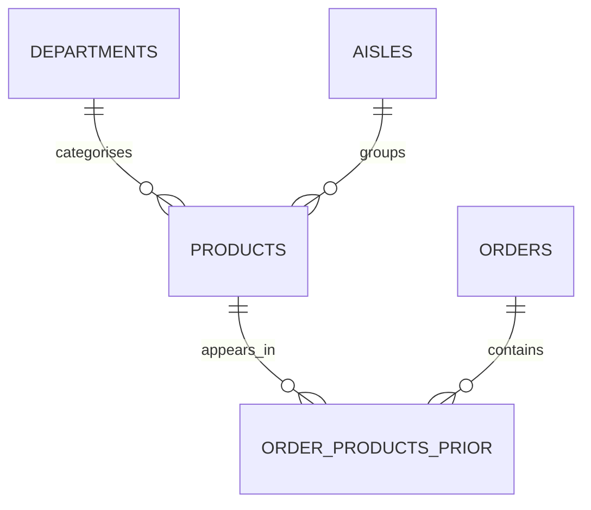

# Instacart Shopping Behaviour Analysis with SQL Server

**Author:** Saurabh Zambare  
**Project milestone:** SQL analysis and reporting preparation — scripts 01–19  
**Last updated:** 27 October 2026  
**Status:** In progress; Power BI dashboard not yet built

## Project overview

I used SQL Server to explore customer shopping patterns in the Instacart dataset. I imported five CSV files, validated data quality and table relationships, analysed product popularity and repeat purchasing, and created reusable reporting views for the next Power BI phase.

My goal is to demonstrate an end-to-end analytics workflow: understand the data, establish reliable metrics, answer business questions, and prepare a reporting model. This report documents the completed SQL milestone and the limitations of the findings.

## Results at a glance

| Finding | Result |
|---|---:|
| Historical prior orders analysed | 3,214,874 |
| Order-product entries analysed | 32,434,489 |
| Products in the catalogue | 49,688 |
| Most frequently ordered product | Banana — 472,565 orders |
| Banana order penetration | 14.70% |
| Overall product-entry reorder rate | 58.97% |
| Average different products per order | 10.09 |
| Most common basket size | 5 products — 228,330 orders |
| Largest observed basket | 145 different products |
| Busiest recorded hour | 10:00–10:59 — 271,885 orders |
| Busiest day/hour combination | Day code 1, hour 10 — 52,999 orders |
| Department with highest entry volume | Produce — 9,479,291 entries |
| Department with highest reorder rate | Dairy eggs — 67.00% |

These are descriptive findings from historical data, not measured business improvements.

## Business questions

I investigated:

1. Which products appear in the most orders?
2. What proportion of prior orders contains each leading product?
3. What share of product entries represents repeat purchases?
4. How do repeat-purchase rates differ among popular products?
5. Which hours, day codes and day/hour combinations record the most orders?
6. How many different products do orders contain, and which basket sizes are most common?
7. Which departments lead in product-entry volume and repeat-purchase rate?
8. Do the reporting views preserve source coverage, uniqueness and totals?

## Data and analysis scope

**Dataset:** Instacart Market Basket Analysis. Source: [Kaggle dataset and competition](https://www.kaggle.com/c/instacart-market-basket-analysis/data). Refer to the source for access terms and dataset documentation. Raw CSV files are not included in this report.

| File | Staging table | Rows |
|---|---|---:|
| departments.csv | staging.departments | 21 |
| aisles.csv | staging.aisles | 134 |
| products.csv | staging.products | 49,688 |
| orders.csv | staging.orders | 3,421,083 |
| order_products__prior.csv | staging.order_products_prior | 32,434,489 |

The full orders table contains 206,209 customers and three partitions: prior (3,214,874 orders), train (131,209) and test (75,000). I restricted purchase analysis to prior orders and their supplied product entries. Train/test metadata is present in staging; their product labels are outside this analysis.

### Table relationships and grain

- **Orders:** one row per order; order_id identifies an order, while user_id repeats across a customer's orders.
- **Products:** one row per product, with aisle and department references.
- **Order-product entries:** one row per order/product combination; the pair is the intended composite key.
- **Departments and aisles:** lookup tables that describe product categories.

I validated these logical keys and relationships with SQL checks. Primary and foreign key constraints are not enforced in the current staging layer.

## Method and metric definitions

I separated the workflow into import, validation, analysis and reporting preparation. I checked missing values, key uniqueness, accepted ranges, reference matches and duplicate order/product pairs before interpreting aggregate counts.

| Metric | Calculation and meaning |
|---|---|
| Product order frequency | Count entries for a product after confirming unique order/product pairs |
| Order penetration | Orders containing product / all prior orders × 100 |
| Reordered entries | Sum of the validated reordered flags (0 or 1) |
| Reorder rate | Reordered entries / all entries within the relevant group × 100 |
| Basket size | Count different products in one order |
| Department volume | Count product entries mapped to that department |

I counted orders directly from the order-level table for time analysis. Joining orders to product entries before counting would multiply each order by its basket size. I used decimal arithmetic for percentages, BIGINT-compatible counts and sums, and NULLIF to protect denominators.

## SQL implementation: scripts 01–19

The first two headings describe the setup and department-import steps; their filenames should be matched to the repository. Scripts 03–19 use the project filenames below.

### 01 — Database and schema setup (database setup)

**Purpose:** Establish the project database and staging area before importing files.

**Question:** Can the source data be organised consistently in SQL Server?

**Approach:** Use the `InstacartAnalytics` database and `staging` schema. Subsequent scripts create and query tables in this structure.

**Result:** The database and staging schema support the subsequent import, validation and analysis workflow.

### 02 — Department import (department import)

**Purpose:** Load the department lookup.

**Question:** What department names correspond to product department IDs?

**Result:** **21 departments** imported and validated. The lookup supports readable category joins. The source label `missing` is itself a department category and does not mean a join failed.

### 03 — `03_import_products.sql`

**Purpose:** Import the product catalogue and validate its identifiers and department references.

**Checks:** Row count versus distinct product IDs; missing IDs; missing/blank names; missing category IDs; product references without matching departments; first-five-product preview.

**Results:** **49,688 rows and 49,688 unique product IDs**. Missing product IDs, missing/blank names, missing aisle IDs, missing department IDs and unmatched department references all returned **0**.

**Meaning:** The checked product fields are complete and the department relationship is valid. Aisle references were verified after the aisle import.

### 04 — `04_import_aisles.sql`

**Purpose:** Load aisle descriptions and complete category relationship checks.

**Results:** **134 rows and 134 unique aisle IDs**; missing IDs/names and products without matching aisles returned **0**. A joined preview displayed product, aisle and department names.

**Meaning:** Every product can be linked to a valid aisle and department in the imported lookups.

### 05 — `05_import_orders.sql`

**Purpose:** Load order-level customer activity and validate order metadata.

**Results:** **3,421,083 rows**, the same number of unique order IDs, and **206,209 customers**. Missing order/customer IDs returned **0**. Dataset group totals are listed in section 2.

**Gap checks:** **206,209 NULL previous-order gaps** occur on first orders. First orders incorrectly containing a gap and later orders missing a gap both returned **0**.

**Range checks:** Invalid order numbers, day codes, hours, gaps and dataset groups each returned **0**. Valid day codes are 0–6 and hours 0–23. Recorded gaps are capped at 30; 30 represents 30 or more days. NULL means no recorded gap, while 0 is a recorded zero-day interval.

**Meaning:** The tested order fields follow the expected dataset encoding. Exact calendar dates and verified weekday names are not available in this model.

### 06 — `06_import_order_products_prior.sql`

**Purpose:** Load the bridge between prior orders and products.

**Results:** **32,434,489 entries**. Rows with missing order/product IDs, invalid cart positions and invalid reorder flags each returned **0**. Order 2's preview contained **9 product entries**, with cart positions 1–9.

**Meaning:** Each row records a product in an order, its cart-addition position and whether the customer had purchased it before. Cart position is not quantity.

### 07 — `07_validate_order_product_relationships.sql`

**Purpose:** Confirm relationships and ensure counts will not be inflated by duplicate pairs.

**Results:** Missing product matches, missing order matches and links to non-prior orders each returned **0**. Duplicate `(order_id, product_id)` combinations returned **0**.

**Meaning:** Every entry links to a valid product and prior order. Counting rows per product is therefore equivalent to counting orders containing that product.

### 08 — `08_top_10_products.sql`

**Question:** Which 10 products appear in the most prior orders?

**Approach:** Group entries by product ID, count rows, join product/department descriptions and return the highest counts. Product ID provides a stable grouping identifier.

**Finding:** Banana ranks first; **9 of the top 10** belong to produce. Organic Whole Milk is the exception, in dairy eggs. Full results appear in section 5.

**Business use:** A starting shortlist for availability monitoring and merchandising investigation; revenue and margin information are needed for commercial decisions.

### 09 — `09_top_products_order_penetration.sql`

**Question:** What percentage of all prior orders contained each top product?

**Approach:** Divide each product count by **3,214,874** prior orders. CROSS JOIN attaches a single-row total to each product result; decimal arithmetic preserves fractional percentages.

**Finding:** Banana appears in **14.70%**, Bag of Organic Bananas in **11.80%**, and Organic Strawberries in **8.23%** of prior orders.

**Meaning:** About 15 of every 100 prior orders contain Banana. Product percentages overlap because baskets can contain several products.

### 10 — `10_overall_reorder_rate.sql`

**Question:** What share of all prior product entries are repeat purchases?

**Approach:** Sum the validated 0/1 reorder flags and divide by entry count. CAST to BIGINT supports large sums; NULLIF protects against a zero denominator; DECIMAL(5,2) returns two decimal places.

**Results:** **19,126,536 reordered entries / 32,434,489 total entries = 58.97%**.

**Meaning:** About 59 of every 100 entries represent products previously purchased by that customer. This is the overall comparison baseline.

### 11 — `11_top_products_reorder_rates.sql`

**Question:** What are the reorder rates of the 10 most frequently ordered products?

**Approach:** Calculate entry counts and reorder-flag sums per product, then rank by order frequency.

**Finding:** All 10 have reorder rates above the **58.97%** overall baseline. Banana is **84.35%**, Bag of Organic Bananas **83.26%**, and Organic Whole Milk **83.04%**.

**Caution:** These are the top products by frequency with their reorder rates attached, not the top reorder-rate products across the entire catalogue.

### 12 — `12_orders_by_hour.sql`

**Question:** At which hours are the most prior orders placed?

**Approach:** Filter the order table to prior, group by hour and count orders directly, avoiding multiplication by product joins.

**Results:** **24 hour groups**. Hour 10 leads with **271,885 orders**, followed by hour 11 (**268,006**), hour 15 (**266,132**) and hour 14 (**265,556**).

**Meaning:** 10:00–10:59 is the busiest recorded hour across the supplied prior orders. Order-placement time alone is not a fulfilment staffing schedule.

### 13 — `13_orders_by_day.sql`

**Question:** Which day-of-week codes have the most prior orders?

**Approach:** Filter to prior and group by day code. Retain codes rather than assign unverified weekday names.

| Day code | Prior orders |
|---:|---:|
| 0 | 557,772 |
| 1 | 556,705 |
| 2 | 441,955 |
| 5 | 425,982 |
| 6 | 418,848 |
| 3 | 412,400 |
| 4 | 401,212 |

**Finding:** Day codes 0 and 1 lead; day code 4 has the fewest orders. The seven counts total **3,214,874**.

### 14 — `14_orders_by_day_and_hour.sql`

**Question:** Which day-and-hour combinations have the most prior orders?

**Approach:** Group on both day code and hour. Each result row represents one combination.

**Results:** **168 combinations** observed. The busiest is **day 1, hour 10: 52,999 orders**. Next are day 0, hour 14 (**50,484**) and day 0, hour 15 (**50,020**).

**Meaning:** Day 0 has the highest daily total, while day 1 has the busiest single hour. These statements describe different aggregation levels. The result can support a Power BI day/hour heatmap.

### 15 — `15_basket_size_summary.sql`

**Question:** How many different products does an order contain?

**Approach:** Count entries per order in a CTE, then calculate mean, minimum and maximum across those order-level counts.

**Results:** **3,214,874 orders**; average **10.09** different products; minimum **1**; maximum **145**.

**Meaning:** With prior-only relationship validation already passed, matching the total prior-order count establishes product-entry coverage for every prior order. A basket of 145 is unusual in size but is not automatically an error.

### 16 — `16_basket_size_distribution.sql`

**Question:** Which basket sizes occur most frequently?

**Approach:** First count products per order, then count orders per basket size. Sort by frequency to identify the mode.

| Basket size | Orders |
|---:|---:|
| 5 | 228,330 |
| 6 | 227,675 |
| 4 | 222,081 |
| 7 | 220,006 |
| 3 | 207,027 |

**Results:** **113 distinct observed basket sizes**. The mode is **5**, versus the mean of **10.09**. Larger baskets raise the mean above the most common size. Some integer sizes within the 1–145 range are absent.

**Remaining validation:** Reconcile the sum of all basket-size frequencies to the total prior-order count in the final reporting checks.

### 17 — `17_department_analysis.sql`

**Question:** Which departments have the most product entries, and how do their reorder rates compare?

**Approach:** Join entries to products and departments; group by department ID/name; calculate entry counts, reordered counts and rates.

**Finding:** Produce leads volume (**9,479,291 entries**); dairy eggs has the highest reorder rate (**67.00%**). Full department results appear in section 6.

**Meaning:** Volume and repeat-purchase rate answer different questions. Department percentages must not be averaged unweighted to obtain the overall rate; combine numerators and denominators instead.

### 18 — `18_create_product_reporting_view.sql`

**Purpose:** Create `reporting.dim_products`, a reusable product lookup with aisle and department descriptions.

**Grain:** One row per product.

**Contents:** product_id, product_name, aisle_id, aisle, department_id, department.

**Verified results:** **49,688 rows and 49,688 unique product IDs**; preview shows readable category names. The joins preserve product coverage and uniqueness.

**Meaning:** Power BI can use a consistent product dimension to label and filter analysis. A regular view stores a query definition, not a separate physical copy of its results.

### 19 — `19_create_order_reporting_view.sql`

**Purpose:** Create `reporting.fact_orders`, restricted to prior orders, with an order-level basket count.

**Grain:** One row per prior order.

**Contents:** order_id, user_id, order_number, order_dow, order_hour_of_day, days_since_prior_order, distinct_products_in_order.

**Approach:** Build per-order basket counts, then LEFT JOIN them to prior orders so missing counts remain visible rather than disappearing.

| Validation | Verified result |
|---|---:|
| Total prior orders | 3,214,874 |
| Unique order IDs | 3,214,874 |
| Orders without basket size | 0 |
| Sum of basket sizes | 32,434,489 |

**Meaning:** The reporting view preserves all prior orders and reconciles to the product-entry total. Customer 1's preview contains 10 prior orders, with basket sizes 5, 6, 5, 5, 8, 4, 5, 6, 6 and 9. The view's basket aggregation is evaluated when queried; it is not a materialised summary table.

## Detailed product results

| Product ID | Product | Orders containing product | Order penetration | Reordered entries | Reorder rate |
|---:|---|---:|---:|---:|---:|
| 24852 | Banana | 472,565 | 14.70% | 398,609 | 84.35% |
| 13176 | Bag of Organic Bananas | 379,450 | 11.80% | 315,913 | 83.26% |
| 21137 | Organic Strawberries | 264,683 | 8.23% | 205,845 | 77.77% |
| 21903 | Organic Baby Spinach | 241,921 | 7.53% | 186,884 | 77.25% |
| 47209 | Organic Hass Avocado | 213,584 | 6.64% | 170,131 | 79.66% |
| 47766 | Organic Avocado | 176,815 | 5.50% | 134,044 | 75.81% |
| 47626 | Large Lemon | 152,657 | 4.75% | 106,255 | 69.60% |
| 16797 | Strawberries | 142,951 | 4.45% | 99,802 | 69.82% |
| 26209 | Limes | 140,627 | 4.37% | 95,768 | 68.10% |
| 27845 | Organic Whole Milk | 137,905 | 4.29% | 114,510 | 83.04% |

Banana and Bag of Organic Bananas are separate product IDs and are analysed separately. Their percentages cannot simply be added to calculate the percentage of orders containing either, because an order may contain both.

## 6. Department findings: script 17

| Department | Product entries | Reordered entries | Reorder rate |
|---|---:|---:|---:|
| produce | 9,479,291 | 6,160,710 | 64.99% |
| dairy eggs | 5,414,016 | 3,627,221 | 67.00% |
| snacks | 2,887,550 | 1,657,973 | 57.42% |
| beverages | 2,690,129 | 1,757,892 | 65.35% |
| frozen | 2,236,432 | 1,211,890 | 54.19% |
| pantry | 1,875,577 | 650,301 | 34.67% |
| bakery | 1,176,787 | 739,188 | 62.81% |
| canned goods | 1,068,058 | 488,535 | 45.74% |
| deli | 1,051,249 | 638,864 | 60.77% |
| dry goods pasta | 866,627 | 399,581 | 46.11% |
| household | 738,666 | 297,075 | 40.22% |
| breakfast | 709,569 | 398,013 | 56.09% |
| meat seafood | 708,931 | 402,442 | 56.77% |
| personal care | 447,123 | 143,584 | 32.11% |
| babies | 423,802 | 245,369 | 57.90% |
| international | 269,253 | 99,416 | 36.92% |
| alcohol | 153,696 | 87,595 | 56.99% |
| pets | 97,724 | 58,760 | 60.13% |
| missing | 69,145 | 27,371 | 39.58% |
| other | 36,291 | 14,806 | 40.80% |
| bulk | 34,573 | 19,950 | 57.70% |

## Interpretation for business stakeholders

The combination of high order frequency and high repeat-entry rates makes the leading products useful candidates for availability monitoring and buy-again recommendation investigation. Produce's volume highlights its importance in the observed baskets. Variation by day/hour and basket size provides a starting point for understanding operational demand.

These findings do not establish that promotions, staffing changes or recommendations will improve results. I would need stock availability, prices, margins, fulfilment timing and experiment results to evaluate those decisions.

## Reporting layer completed

| View | Grain | Validated checks |
|---|---|---|
| reporting.dim_products | One row per product | 49,688 rows and unique product IDs |
| reporting.fact_orders | One row per prior order | 3,214,874 rows and unique order IDs; 0 missing basket sizes; basket total 32,434,489 |

The product view includes product, aisle and department descriptions. The order view includes customer/order sequence, day code, hour, recorded gap and basket size. These regular views store query definitions, not independent physical result tables.

The purchase reporting view is pending. Final Power BI relationships, filter behaviour and import strategy will be documented after implementation. In particular, order-level basket sizes must not be treated as additive after joining to product entries.

## Limitations and responsible interpretation

- Product entries are not unit quantities, revenue or profit.
- A reorder rate is the share of observed entries marked as repeat purchases. It is not customer retention or the probability that a new buyer returns.
- Product order-penetration percentages overlap because orders contain multiple products.
- The same product may contribute many reordered entries across different orders.
- Day codes remain numeric; I have not assigned unverified weekday names.
- Recorded gaps are capped at 30 days. NULL and zero have different meanings.
- No calendar-date trend, current-market conclusion, causal effect or predictive performance is claimed.
- The source category named missing is retained as a category, distinct from SQL NULL and failed references.
- Department rates require weighted aggregation: sum reordered entries and total entries before dividing.

## Skills demonstrated and learning value

This milestone demonstrates bulk CSV ingestion, staging schemas, data profiling, referential checks, conditional aggregation, joins, CTEs, multi-stage grouping, numeric types, safe percentage calculations and SQL views. It also demonstrates an analytical habit: define the grain and denominator before interpreting a number.

Students can practise the workflow by running the numbered scripts against their own SQL Server database, adapting CSV paths to their environment. Import scripts skip loading when a table already contains rows; this guards against accidental duplicate loading but does not prove an existing table is complete. Validation remains necessary. The files depend on earlier tables and should be run in numeric order. The purchase file contains over 32 million rows, so loading and grouping costs depend on local resources.

Useful exercises include comparing order penetration with reorder rate, explaining why the modal basket size (5) differs from the average (10.09), and checking how a join changes the number of rows. These exercises build interpretation as well as SQL syntax skills.

## Current status and next milestones

**Completed:** Five-table ingestion; the documented data checks; product, reorder, ordering-time, basket and department analyses; product and order reporting views.

**Remaining:** Purchase reporting view; final reporting reconciliation; Power BI connection/model design; measures and dashboard development; validation against SQL totals; final documentation and portfolio presentation.

I will update this report as those stages are completed. Dashboard screenshots, DAX measures and final model diagrams will be added only after implementation and validation.

## Repository navigation

- `sql/`: numbered SQL scripts.
- `docs/SQL_PROJECT_REPORT.md`: this public project report.
- Dataset: download separately from the linked source and adapt the script paths.

Only the SQL and documentation milestone is described here. The Power BI deliverables remain planned.
